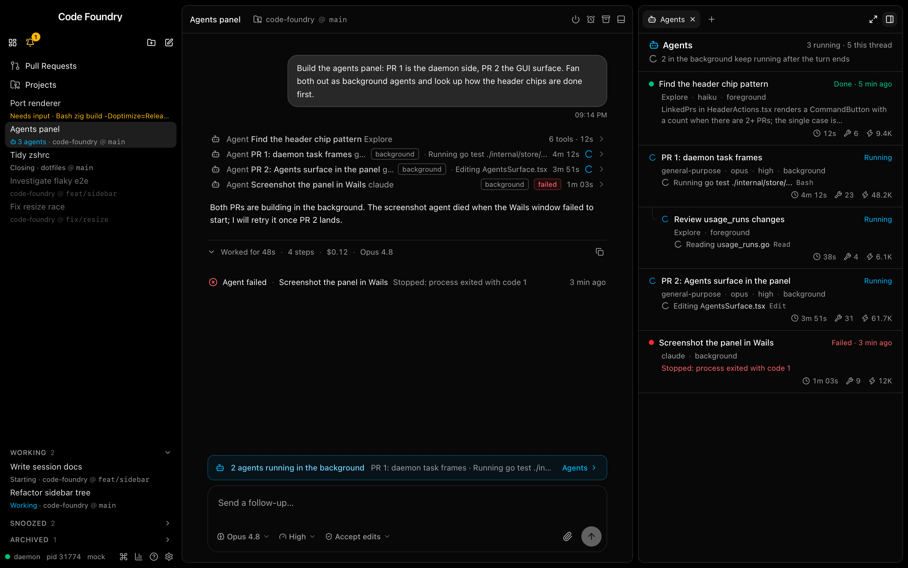
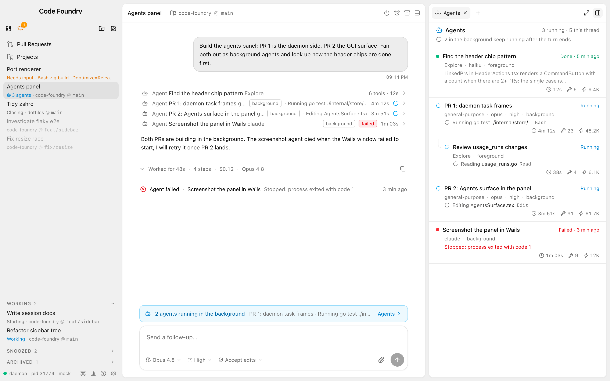
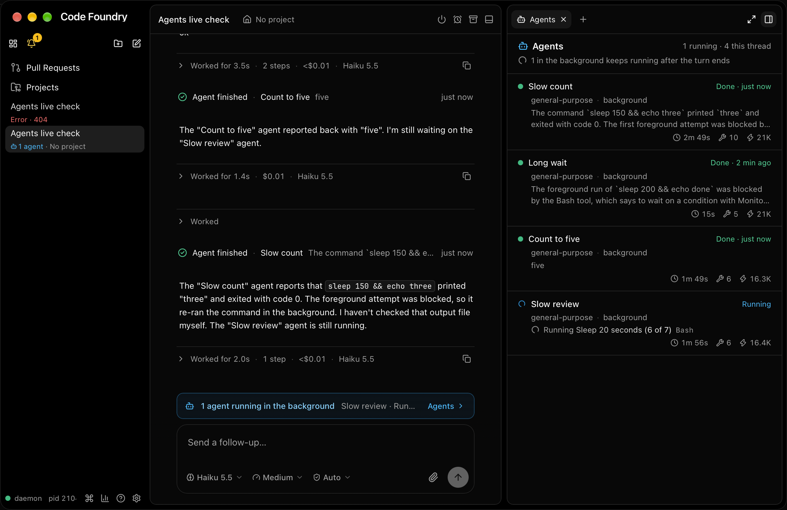

# Agents, PR 2 of 2: the GUI

Status: built on branch `t3code/agents-panel-2-gui`, stacked on PR 1 (`agents-1-daemon.md`,
the daemon). Design: `docs/sketches/agents-panel/` variant **L1** (`DESIGN.md`, `shots/l1-strip-*`).
`make check` and `make gui-e2e` green; exercised live (built app, isolated daemon, haiku).

The mock's sketch thread (the turn unfolded), dark and light: the strip above the composer,
the Agents tab, the sidebar's "3 agents", the Agent rows' chips and the failed run's note.

The built app against a live daemon (below): one background run left, two "Agent
finished" notes, the sidebar's "1 agent".

## What was built

* **API** (`src/api/agents.ts`): `ThreadAgentRun` → `AgentRunView` (status `running | done |
  failed | unknown`, times in epoch ms). `api/thread.ts` adds the snapshot's `agents` and the
  `agents` event (the whole list each time); `api/session.ts` maps `agentsRunning` and
  `backgroundAgentsRunning`.
* **Store**: `ThreadLog.agents` on the thread store, fed only by the thread's Watch (open
  whenever the thread is selected). `lib/agents.ts` `shareAgents` keeps unchanged runs by
  identity (and the list itself when nothing changed). `stores/agents.ts` has the narrow
  selectors: `useAgentRowIds` (shallow over ids, so it changes only when a run starts or the
  nesting changes), `useAgentRun`, `useAgentLevel`, `useAgentRunOfCall` (by the Agent call's
  tool use id), `useAgentRunOfNote`, `useAgentCounts`, `useStripParts`. A progress update
  re-renders only the moved run's row (tested by render counts).
* **Surface** (`surfaces/agents.ts`, `agentsTarget.ts`, `stores/agentsPanel.ts`,
  `components/agents/AgentsSurface.tsx` + `agents.css`): kind `agents`, "Agents", lucide
  `Bot`, hotkey **A** (free; between MCP and Workspace in the empty list), enabled for a
  thread (a disconnected one too: runs persist), hidden otherwise; one tab per panel that
  follows the selection's thread. Opened by A, `view.panel.agents` (ShowView `panel.agents`,
  `agentsPanelCommand` in `stores/views.ts`) and the strip. Header: sky bot, "Agents",
  "N running · K this thread", then a spinner + "M in the background keep(s) running after
  the turn ends", "N in the foreground, part of the turn", or "No agents running". Rows (L1):
  dot or sky spinner, name (500; 450 once done), right "Running" / "Done · 5 min ago" /
  "Failed · 3 min ago" (30 s clock, only ended rows subscribe); muted `type · model · effort
  · mode`; a running run's spinner + shimmering activity + mono last tool, a done run's
  summary clamped to 2 lines, a failed run's error in red (2 lines); stats right-aligned:
  clock (live on the 1 s clock while running, from `resumed_at` or `started_at`; Claude's
  `duration_ms` once ended), wrench tool uses, zap tokens. Separators are `border-b` on full
  width rows (border to border). Rows are not buttons.
* **Timeline** (`components/thread/rows.tsx`, `thread.css`): an Agent/Task row with a
  known run gets `AgentMeta`: a muted outline `background` chip; while running the
  activity after a "·" (ellipsised at 260px) and the live elapsed time with the spinner
  (the spinner also shows while the daemon keeps the call's item running); a failed run a
  red `failed` chip (instead of the call's own `error` chip) and its duration; a done run
  keeps the call's meta ("6 tools · 12s"). Nested children and `AgentReport` unchanged. The
  daemon's notes "Agent finished · name · report" / "Agent failed · name · error" render
  as one muted line: circle-check (emerald) or circle-x (red), "Agent finished · name" in
  the foreground colour, the summary ellipsised, the age at the right (30 s clock). Other
  notes (a fork's "Forked from …") stay the centered divider.
* **Strip** (`components/thread/AgentsStrip.tsx`, in the dock above `ThreadComposer`):
  shown only while `Session.background_agents_running > 0` and the thread is not archived.
  Sky tinted border and fill (the sketch's 35% / 7%), bot, "N agent(s) running in the
  background", the running background runs (spawn depth 1) as "name · activity" in one
  muted ellipsised line, and an "Agents ›" `CommandButton` for `view.panel.agents`. The
  dock's top padding tightens to 8px while it shows (`.dock:has(> .agents-strip)`).
* **Sidebar** (`SidebarRow.tsx` `AgentsRunning`): line 2 starts with a bot + "N agent(s)"
  in the sky tone while `agentsRunning > 0`, then " · " and the usual status/place. No
  tooltip (nothing hidden), sort unchanged.
* **Mock** (`mock/agents.ts`): `POST /__mock/thread?state=agents` builds the sketch's
  thread ("Agents panel", idle at its prompt): the done Explore with its work and report,
  "PR 1" and "PR 2" running in the background, "Review usage_runs changes" nested under PR 1
  (started last), "Screenshot the panel in Wails" failed with its note.
  `POST /__mock/thread/agent-end?run=a1[&status=failed]` ends a run like the daemon (item
  done/error, note for a background run, list + session counts published). The session's
  two counts follow the list (`sessionMsg`). `thread.agents` and `view.panel.agents`.
  `finish()` no longer errors the items of running runs at a turn's end.

## Decisions and gotchas

* **Counts include nested runs.** The header's "N running · K this thread" counts every
  run, nested ones too, like `Session.agents_running`, the sidebar and the CLI's header
  ("Agents: 3 running (2 in the background) · 5 this thread"). The sketch counted only the
  thread's own runs ("2 running · 4 this thread"); one rule everywhere seemed better than
  two numbers that disagree. The "in the background" figure is the thread's own (depth 1).
* **Order.** The list is spawn order, never by status; a nested run is placed right under
  its parent (a tree walked in spawn order), even when it started after later siblings
  (the mock's nested run did). A run whose parent is not in the list stays at its own spawn
  position, indented by its spawn depth. Connector: the sketch's `::before` from the row top
  to the first line, 20px per level.
* **Tokens use the usage page's `fmtTok`**: "9.4K", "48.2K" (capital K). The brief wrote
  "9.4k"; the usage page's helper was reused rather than a second formatter.
* **Background Agent rows stay collapsed** while running (a running foreground one still
  opens to show its work, as before): their progress is on the row, the strip and the tab.
* **Finished turns still fold.** A turn that launched background runs folds when it ends
  like any other, so its Agent rows (chips, activity) show once the footer is unfolded; the
  strip and the end notes (notes never fold) carry the signal meanwhile. Keeping such a turn
  open until its runs end would jump the timeline when they do; left as is.
* **The note is plain text** (PR 1's `agentNote`: `head · name · first line`, no structured
  fields). `parseAgentNote` splits on " · "; when the run that owns the note is known
  (`note_item_id`, the latest note only), its description says where a name containing
  " · " ends. A woken run's older note falls back to the first " · ".
* **The strip's visibility comes from the Session** (EventService, no Watch needed), the
  names from the thread log; the count text uses the Session's number, so the two never
  disagree about whether it shows. The failed note's summary stays muted (the red cross
  says it failed).
* **Tests had to learn the new log field**: every `ThreadLog` / snapshot literal in specs
  gained `agents: []`; `keys.test.ts` lists the new surface and its A.
* e2e: the surface's A key needs the panel focused (the composer has focus on a selected
  thread), so the spec opens the panel with the header's toggle, like the MCP spec.

## Verification

* `make check` green (Go unchanged from PR 1; typecheck, lint, vitest: 132 files, 2675
  tests). New: `api/agents.test.ts` (mapping, statuses, Watch snapshot + event, session
  counts), `lib/agents.test.ts` (order and nesting incl. a missing parent and a cycle,
  names, meta, elapsed incl. wakes, status text, counts, subline, strip runs, sharing,
  note parsing), `stores/agents.test.ts` (log apply, sharing across events and a resync),
  `surfaces/agents.test.tsx` (listing and A, order/levels/connector, every state and the
  stats, empty and quiet states, render counts for a progress update vs a new run, a
  disconnected thread), `components/thread/AgentsStrip.test.tsx` (names only background
  runs, singular, hidden for foreground-only / none / archived, follows the count),
  `components/thread/agentRows.test.tsx` (chips, activity, elapsed, spinner while the run
  runs, collapsed background row, failed vs done meta, an older daemon; the notes, the name
  hint, other notes), `SidebarRow.test.tsx` (the "N agents" prefix in each status).
* `make gui-e2e`: 734 passed, 32 skipped, 2 failed: `panel.spec.ts`'s empty surface list
  (both browsers) still expected six entries; updated to list "AgentsA", then
  `panel.spec.ts` + `agents-panel.spec.ts` re-run on both browsers: green apart from one
  Chromium run of the tab-drag test, which passed on its own three times in a row (a flake;
  it passed in the full run). `e2e/agents-panel.spec.ts`: A opens the tab
  (order, levels, statuses, meta, summary, activity, error, stats, no buttons, rows as wide
  as the panel body); `view.panel.agents` and the palette open it, a run ending changes its
  row in place; the strip (count, background names only, "Agents ›" opens the tab, shrinks
  then goes as runs end) and the sidebar count (3 → 2 → 1 → none); the timeline's chips,
  activity, live elapsed, collapsed background row, failed chip, the failed note, then a
  finished note. Each spec failed with its fix reverted (surface unregistered; the
  `panel.agents` ShowView case renamed; the strip not rendered; the sidebar prefix removed;
  the note row and the Agent meta disabled in turn).
* Screenshots: the mock via Playwright (`SHOTS=<dir>` on the spec's screenshot tests,
  WebKit 1440×900), and the live app (screencapture of the window found by its pid).
* **Live** (2026-10-14, `make gui-build`; `CODE_FOUNDRY_HOME=/tmp/cf-agents2-home`, daemon
  `--dev`, the GUI with `CODE_FOUNDRY_BIN`; a no-project thread on Haiku 5.5, medium, auto):
  two background agents that slept 150/200 s came back at once (Claude's Bash refuses long
  foreground sleeps, so each agent backgrounded its own sleep and reported "not yet"); a
  second prompt ("sleep 20" five and seven times, one after another) kept two runs going:
  the tab showed both running with "Running Sleep 20 seconds (3 of 7) Bash" and a live
  clock, the strip "2 agents running in the background", the sidebar "2 agents". When
  "Count to five" ended the row went "Done · just now" with "five", the note "Agent
  finished · Count to five · five" appeared, the strip and the sidebar dropped to 1. The
  first "Slow count" was woken by Claude when its own background sleep ended: a second
  note, its row done again with the summed time (2m 49s, 10 tools).
* Not verified: a run that Claude reports `failed` (the mock covers the row, chip and
  note); the strip over a long list of background runs (the line ellipsises); light mode
  live (the isolated app shares the installed app's WebKit storage, so the appearance was
  left alone).
