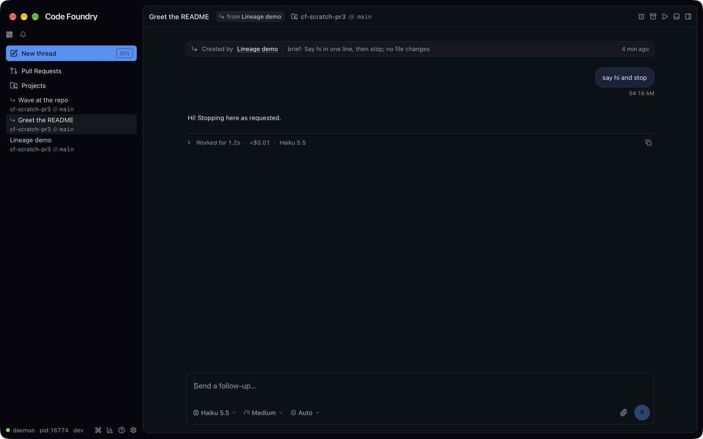
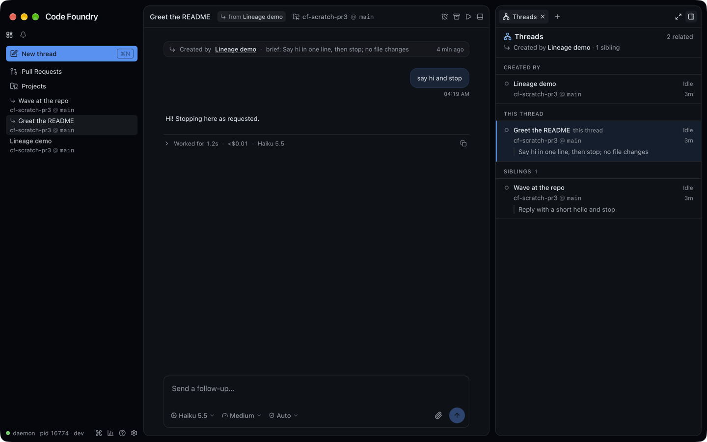
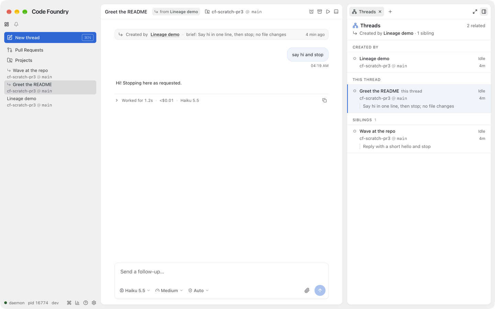
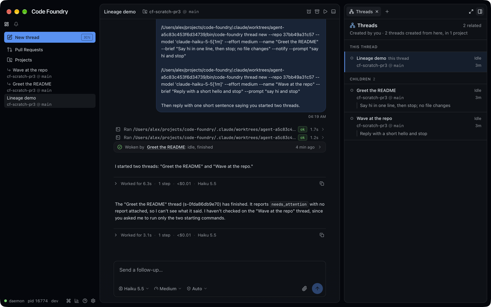

# Agents, PR 3: thread lineage in the GUI (2026-10-17)

The third of five PRs that make threads drivable by agents (PR 1: `agents-1-wait-events.md`,
PR 2: `agents-2-metadata.md`). PR 2 records who created a thread (`created_by`,
`created_by_name`), why (`brief`) and writes a "Created by" note at the top of it; this PR
shows that lineage: a glyph in the sidebar, a chip in the thread header, a Threads tab in the
side panel and a styled note in the timeline. PR 4 (`agents-4-wake.md`) merged while this
was built, so its wake messages render here too, as a collapsed "Woken by …" note on the
same component. Frontend only, apart from one command (`view.panel.threads`). Everything
is derived from the thread list the GUI already has: no new RPC.

The built app against a live daemon (haiku, medium): "Lineage demo" ran `code-foundry
thread new` twice ("Greet the README" with `--notify`, "Wave at the repo").

## Decisions

Chosen by Alex from the HTML mockups (`/tmp/cf-lineage-sketch`, `DESIGN.md`, PNGs
`~/.t3/userdata/attachments/lineage-*.png`):

* **One glyph everywhere**: lucide `CornerDownRight` (↳) means "made by a thread": the
  sidebar marker, the tooltip line, the header chip, the panel's subline and the note. It is
  the Agents tab's nesting arrow, so it already reads "child of".
* **Sidebar row, variant A**: a muted 12px ↳ before the name on line 1 of every row whose
  thread has `createdBy`, the archived and snoozed single-line rows included. The list stays
  flat; sort, line 2 and the v14 geometry are unchanged. The glyph has no tooltip of its own:
  the row tooltip gains "↳ Created by **<name>**" under the status line.
* **Header, variant A**: a filled muted chip "↳ from **<name>**" right after the thread's
  name, before the location. It runs `view.panel.threads` (a `CommandButton`). A removed
  creator leaves the chip inert: 60% opacity, no hover, default cursor, tooltip "Thread
  removed". An archived creator still exists: the chip works.
* **Threads tab, variant C**: header "Threads" + "N related", a subline ("↳ Created by
  **X** · 3 siblings · 1 child", or "Created by you · 6 threads created from here, in 3
  projects"), then flat sections with overline labels: Created by, This thread (tinted with
  a 2px primary bar, "this thread", not clickable), Siblings N, Children N. Rows: spinner or
  dot, name, the status word in the sidebar's tone; "project @ branch" (mono) and the age;
  the brief as a muted left-bordered quote clamped to two lines. Rows open their thread
  like a sidebar click. Spawn order (the list's creation order). Archived threads are
  listed, muted, "Archived".
* **Siblings capped at five** with a "+N more" row that expands (the sketch's open
  question; the brief settled it). Children are not capped (a foreman's six children all
  show, as in the foreman mockup).
* **Note**: the daemon's "Created by <name> · brief: …" renders as the sketch's `.lnote`:
  one muted line on a faint fill with a hairline, ↳, "Created by", the creator as a quiet
  underlined link, "brief: …" ellipsised, the age on the right. The fork's "Forked from"
  note keeps the centred divider (it is the same `SystemNoteRow`, but a different look on
  purpose: the sketch keeps it).

Decided while building (not in the brief; flagged for review):

* **The note's link** uses the thread's recorded creator when the note is the thread's own
  (`note-created-by` and the thread records a creator under that name); a fork's copied
  note (same id, but the fork has no `createdBy`) resolves the name against the thread list
  and links only a unique match. A removed creator or an ambiguous name is muted text, no
  link (the sketch's "gone" style). The note item carries no creator id (`NoteItem` is text
  only), so nothing else was possible without a proto change.
* **The recorded name is shown, not the creator's current name**, everywhere (chip,
  tooltip, subline, note): `createdByName` is kept verbatim by the daemon, and the note
  text has it too, so all four agree. The creator's own row in the panel shows its current
  name.
* **Tooltip with a removed creator**: "Created by <recorded name> (removed)", the name
  muted. The sketch had "Created by a removed thread"; the brief asked for the name. The
  panel's subline does use "Created by a removed thread" (as the sketch), and its Created
  by section keeps an inert row: hollow dashed dot, the recorded name, "Removed", no place
  line (the GUI does not know where a removed thread ran).
* **Empty state** follows the empty mockup: no sections at all (not even This thread), just
  "Created by you. No threads created from here." and the hint naming
  `code-foundry thread new`. The header then has no count or subline.
* **"N related"** counts the rows other than This thread, a removed creator's row included
  (as the removed mockup's "5 related").
* **Status words**: Working (sky), Needs input (amber: permissions, questions, plans,
  snooze ended), Finished (emerald), Error (red, interrupted included), Idle (muted),
  Archived and Snoozed (muted, before any status). "Snoozed" is not in the brief's list; a
  snoozed thread is stopped and waits on nothing, like an archived one.
* **Age** is `shortAge` ("41m", "1h", "2d"), the archived rows' compact format, on the
  shared 30 s clock.
* **Hotkey H** (T is Worktree's). `view.panel.threads` has no default chord, like
  `view.panel.usage`; available for any thread.
* **Header chip sizing**: `max-w-60 shrink-[4]`: it reads in full when there is room and,
  with the side panel open on a narrow window, gives way before the thread's name (it
  shrinks four times as fast; the sketch had the name, chip and a truncated location all
  fit). A chip that never shrank cut the name to "Greet th…" with the panel open.
* **The expandable body** (`LineageNote`'s `body: { label, lang, code }`): the line becomes
  a toggle (role button, Enter/Space, chevron after the age) and shows a `CodeBlock` (with
  its Copy) under "label LANG". Unit tested; the wake note uses it.
* **Wake messages** (PR 4's user items with `wake: { title, json }`) render as a lineage
  note instead of a bubble (the sketch's "Woken by" rows): the tone's icon (emerald check:
  finished or idle, or a run that exited 0; amber alert: waiting on a prompt; red cross: an
  error, a failed report, a non-zero exit), "Woken by **<thread>**: idle, finished", the
  report's summary (a run's last output line), the age, and once expanded the payload
  pretty-printed under "Wake payload JSON". The thread's current name is the link (the
  payload's name is often empty: the child is not named yet at its first wake); a removed
  thread is muted, an action run's name plain. A finished turn reads "idle, finished" (as
  the wake's header says "is idle"), not the raw `needs_attention`. An unreadable payload
  shows the header line. `lib/wake.ts` (`wakeLine`, table-tested). The wake item keeps its
  place in the turn structure (it is a user item: it starts a turn, or sits in one when
  the wake was queued while Claude worked, as in the live shot).

## What was built

* `internal/command/commands_view.go`: `view.panel.threads` (`ViewPanelThreads =
  "panel.threads"`), `When: hasThread`, no chord. Tests: the ShowView table, the
  thread-surface availability table, `TestAllRegistersEveryDomain`.
* `src/lib/lineage.ts` (pure, table-tested in `lineage.test.ts`): `creatorOf`,
  `siblingIds`, `childIds`, `capIds` (`SIBLINGS_CAP` 5), `projectCount`, `relatedCount`,
  `lineageTail`, `lineageStatus` + words and tones, `parseCreatedByNote` (the recorded name
  says where a name containing " · brief: " ends), `noteCreatorId`.
* `src/stores/lineage.ts`: narrow selectors over the thread list: `useCreator`,
  `useSiblingIds` / `useChildIds` (shallow over ids, so a list re-renders only when a thread
  joins, leaves or changes creator), `useLineageCounts`, `useLineageStatus` (a string),
  `useMadeByThread`, `useNoteCreatorId`.
* Surface: `src/surfaces/threads.ts` + `threadsTarget.ts` (kind `threads`, lucide
  `Network`, hotkey H, enabled for a known thread, hidden otherwise, one tab per panel
  following the selection, like Agents), registered after Agents in `registry.ts`;
  `src/stores/threadsPanel.ts` (`openThreadsSurface`); `stores/views.ts` (`panel.threads` →
  `threadsPanelCommand`).
* `src/components/lineage/ThreadsSurface.tsx`: header, sections, rows (each row selects its
  own fields: a sibling's status change re-renders that row's word only), the removed
  creator's row, "+N more", the empty state. Tailwind only, type roles and the radius scale.
* `src/components/sidebar/SidebarRow.tsx`: `MadeByThreadGlyph` in `ThreadLabel` and
  `SingleLineLabel`; `TipCreatedBy` in the tooltip after the status (or snooze) line.
* `src/components/thread/ThreadParts.tsx`: `CreatedByChip` between `ThreadName` and
  `ThreadLocation`.
* `src/components/thread/LineageNote.tsx` (the generic note: icon, content, age, optional
  expandable code body) and its CSS in `thread.css` (`.lnote`); `rows.tsx`'
  `SystemNoteRow` sends "Created by …" notes to `CreatedByNoteRow`.
* Mock: `MockThread` gained `createdBy`, `createdByName`, `brief`, `labels` (published);
  `SeedHistory.note` (a daemon note before the first message, with its id);
  `World.addLineage` / `POST /__mock/lineage`: "Fix login redirect" (working) created "Add
  retry to login redirect" (finished, its log opening with `note-created-by`) and six
  siblings (one archived, one in ghostty-playground), and "Add retry…" created "Write retry
  backoff tests"; all held. The creator's log ends with a wake message from the child
  (`SeedHistory.wakes`, origin WAKE with title and JSON). `view.panel.threads` in the mock
  registry.

## Gotchas

* Opening a finished child in the GUI marks its turn seen (the viewer clears "finished"), so
  the panel's This thread row reads Idle once you look at it. The e2e asserts that.
* `Tip` on the removed chip needs a span child (a disabled `CommandButton` has no pointer
  events); the inert chip is a plain span, not `whenUnavailable="plain"`.
* The `xs` button size sets `font-medium` and `has-[>svg]:px-1.5`; the chip overrides the
  weight (`font-normal`) and uses `px-1.5` rather than the sketch's 6/7 px padding, which
  the `has-[>svg]` variant would have won over anyway.
* The panel tests' repo fixtures need `githubSlug` (the Pull request surface's `warm`
  reads it for every listed surface).
* The worktree-isolation hook of the agent session refuses compound shell commands and
  heredocs; edits went through small scripts under `/tmp`.

## Tests

* Unit: `lib/lineage.test.ts`, `surfaces/threads.test.tsx` (listing and H, sections in
  spawn order, statuses and tones, place, age, brief, the highlighted This thread, rows
  open threads, the cap and "+2 more", Created by you, the empty state, a removed creator,
  live updates), `components/thread/LineageNote.test.tsx` (static line, age, the
  expandable body by click and keyboard, defaultOpen), `components/thread/lineageRows.test.tsx`
  (the note: link, brief, recorded-name split, removed creator, a fork's copy by name and
  ambiguous, the fork divider unchanged), `SidebarRow.test.tsx` (glyph before the name,
  none for the user's thread, archived footer), `ThreadParts.test.tsx` (chip order and
  command, removed chip inert), `panel/keys.test.ts` (the new surface and its H).
* e2e `e2e/lineage.spec.ts` (WebKit + Chromium): the sidebar glyph (main list, Working and
  Archived footers, its position) and the tooltip line; the header chip (order, opens the
  tab) and the note (text, age, the link opens the creator); a removed creator's inert chip
  ("Thread removed", no panel on click) and plain note name; the tab on the child (counts,
  subline, sections, cap and +1 more, statuses, place, brief, archived, a row opens its
  thread); on the creator (Created by you, 7 children in 2 projects) via H, and the empty
  state via the palette; the wake note (link, detail, summary, tone, expands to the
  payload and back, the link opens the child). `panel.spec.ts`' empty surface list gained
  "ThreadsH". `SHOTS=<dir>` saves mock screenshots. Also `lib/wake.test.ts` and the wake
  cases in `lineageRows.test.tsx` (thread and action run, a plain bubble without `wake`).

## Verification

* `make check` green; `make gui-e2e` green apart from `panel.spec.ts`' surface list, which
  the new surface changed (updated, then re-run green on both browsers). No flakes seen.
* Live (2026-10-17, `make gui-build`, `CODE_FOUNDRY_HOME=/tmp/cf-pr3`, the GUI with
  `CODE_FOUNDRY_BIN`, scratch repo `~/cf-scratch-pr3`, Haiku 5.5 at medium): the parent's
  Claude ran `thread new` twice; the child opened with the Created by note and the chip;
  the Threads tab on the child showed Created by / This thread / Siblings 1, on the parent
  "Created by you · 2 threads created from here, in 1 project"; the parent's timeline had
  the "Woken by Greet the README: idle, finished" note (its `--notify`). Screenshots by
  window id (`screencapture -l`), since another session's Code Foundry window overlapped.
  Theme set with `settings set appearance.theme` on the isolated daemon and put back to
  `system`; the panels closed again before quitting. Home, scratch repo and its
  `~/.claude/projects` directory deleted.
* Not verified live: a removed creator (mock e2e), the sibling cap (mock e2e), an action
  run's wake (unit test).

Daemon restart: needed for `view.panel.threads` (the only Go change). Against an older
daemon everything else works; the command is not listed, so the header chip is plain text
and the palette lacks it (H in the panel still opens the tab).
