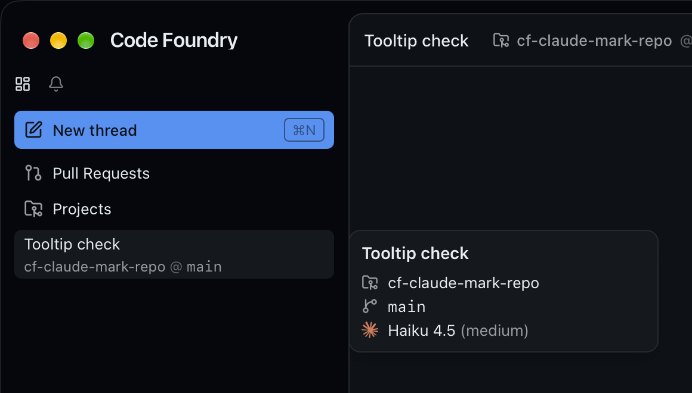
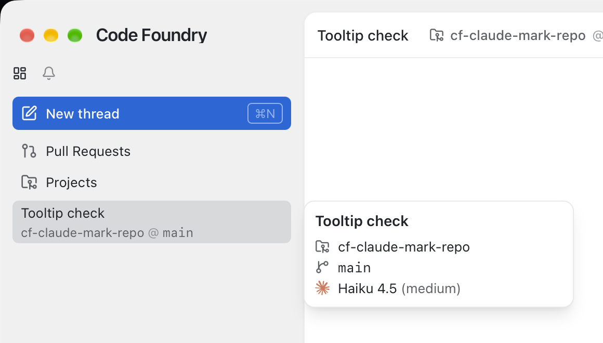

# Thread tooltip: the real Claude mark, 260px wide

Decided 2026-10-17 (Alex). Frontend only; builds on `thread-list.md` (the tooltip) and
`tooltip-status-reason.md` (its status row).

## Decisions

* **The real Claude mark.** The tooltip's model row drew a home-made starburst (twelve
  stroked rays). It now uses the brand mark from simple-icons (`claude`, CC0): its single
  path copied verbatim, filled with `currentColor`, no stroke. It stays 14px (`size-3.5`),
  the size of the lucide icons beside it, in `CLAUDE_ORANGE`. No npm dependency for one icon.
* **Tooltip 260px** (was 220px). 300px was rejected: at that width it reads as a card
  rather than a tooltip.

## What changed

* `components/icons/ClaudeMark.tsx`: a filled 24×24 svg, `aria-hidden`, className
  passthrough, same `SVGProps` signature. `ClaudeMark` and `CLAUDE_ORANGE = "#d97757"` are
  unchanged, so the call site (`SidebarRow.tsx`) and `lib/palette.test.ts` are untouched.
* `components/sidebar/SidebarRow.tsx`: `ThreadTooltip`'s `TooltipContent` is `w-[260px]`.
* `e2e/sidebar.spec.ts`: the two width assertions and their comments say 260.
* `thread-list.md` and `tooltip-status-reason.md` get a one-line pointer here; their 220px
  history is left as it was.

## Verification

* `make check` green. The first run failed one wall-clock assertion in
  `src/surfaces/mcp.test.tsx` ("Checked 12s ago" vs "13s ago"), which this change does not
  touch. The file passed when run alone, and the rerun of `make check` was green (3605 tests).
* `pnpm exec playwright test e2e/sidebar.spec.ts`: 30 passed, including both tooltip width
  checks at 260.
* `make gui-build` green.
* **Live** (isolated `CODE_FOUNDRY_HOME=/tmp/cf-claude-mark`, GUI from `gui/bin`, daemon
  started by it, scratch repo `~/cf-claude-mark-repo`, an idle Haiku 4.5 / medium thread):
  hovering the row opens the tooltip with the filled orange mark beside "Haiku 4.5
  (medium)", about 259pt wide on screen, in dark and light. Theme put back to `system`,
  scratch repo and home deleted afterwards.

