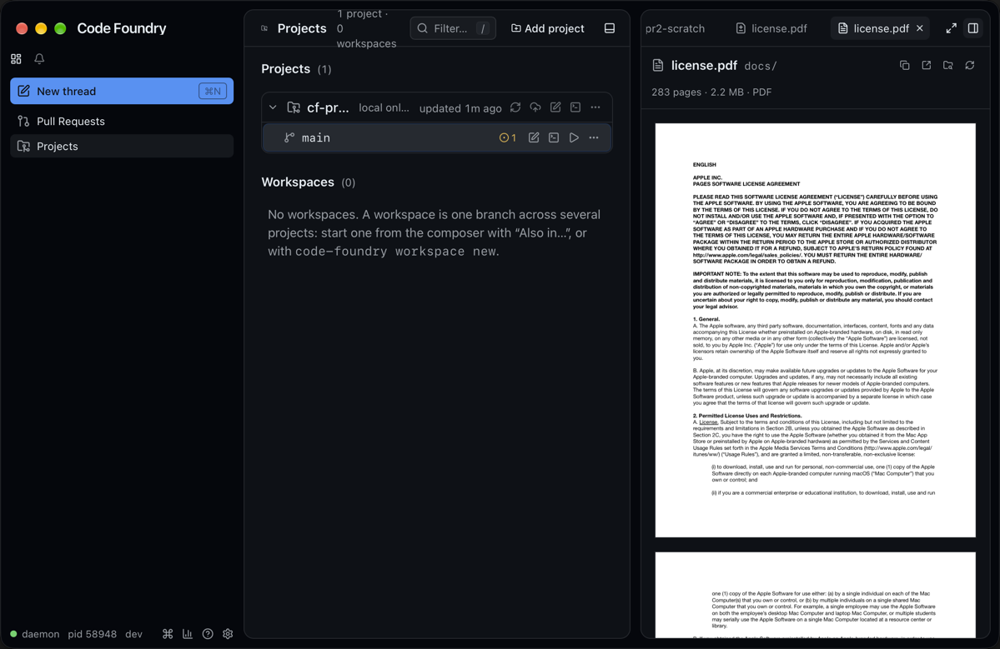
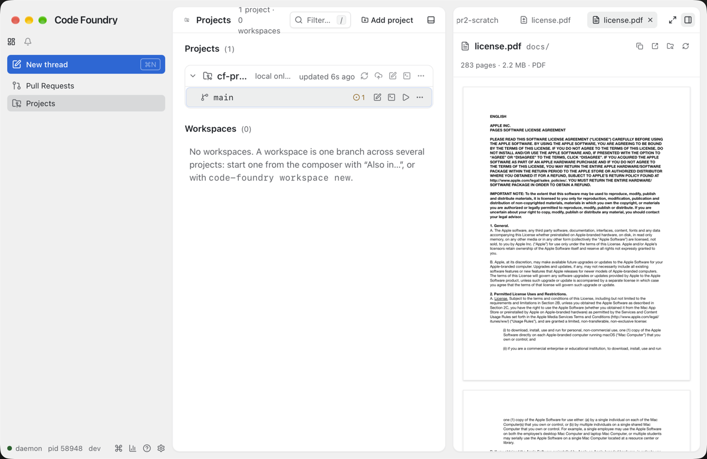

# File tab: PDFs, whole large images

PR 2 of 2. PR 1 (#212, docs/notes/binary-read-cap-and-mcp-settle.md) let
`FilesystemService.ReadFile` read a non-text file up to 32 MiB. This one makes the File tab
(docs/notes/file-viewer-3-tabs.md) ask for that much, show a PDF as its pages with the
attachment lightbox's viewer, and say "too large to show" for an image or PDF that still
does not come back whole. Frontend only.

## Decisions

- **One request size.** `api/files.ts READ_MAX_BYTES` (32 MiB) on every `readFile`. Text
  is capped at 1 MiB by the daemon whatever we ask, so text reads are unchanged; an older
  daemon clamps every read to 1 MiB, so there a larger image or PDF arrives truncated and
  shows as too large instead of broken. No per-kind request, no second read.
- **`FileReadView.pdf`**: the bytes when the mime is `application/pdf` (the daemon types
  `.pdf` by extension) and the path is a file, mirroring `image`. Both keep their bytes when
  truncated; the tab decides.
- **The viewer is `PdfPages`, not a copy.** It gained `fill` (the scroll column is
  `min-h-0 flex-1` instead of the lightbox's `max-h-[calc(85vh/var(--cf-zoom))] min-h-40`)
  and `onPages` (the count, once the document opens; an effect event, so a new callback
  does not reopen the document). `files/PdfPreview.tsx` builds the Blob (a copy of the
  bytes, typed `application/pdf`, as `useBlobSrc` does) and renders `PdfPages fill`. Pages
  fit the panel's width; lazy drawing and releasing far pages work as in the lightbox, so a
  283-page PDF is fine.
- **Header.** Icon `FileText` (`fileIconOf`: `application/pdf` or `.pdf`). Meta
  `fileKind.pdfMeta`: "283 pages · 2.2 MB · PDF", "2.2 MB · PDF" until pdf.js has counted
  (and for a truncated PDF). No mode switch or wrap toggle (neither applies to a PDF).
- **Too large.** A truncated image or PDF is never handed to the webview or pdf.js: a
  `FileEmptyState` "Image · 47.7 MB · too large to show" / "PDF · …" (`tooLargeHeading`,
  sizes through `formatSize`, so "48.0 MB" for exactly 48 MiB) with the path and Open in
  editor / Reveal in Finder; testIds `file-image-too-large`, `file-pdf-too-large`. The
  "Showing the first 1 MiB" notice bar stays text-only.
- **Markdown local images** take only a whole image too (a truncated one is the path chip,
  as for a missing one).
- Re-reads (Refresh, worktree event, the thread's edits, window visible) bring new bytes,
  so the document opens again and the column scrolls back to the top. Accepted.

## Gotchas

- `e2e/fixtures.ts testPdf` moved to `mock/pdf.ts` (re-exported from the fixtures) so the
  mock daemon's file fixtures can use it; the e2e specs import it as before.
- The mock's ReadFile now caps like the daemon: 0 → 1 MiB; text at most 1 MiB; anything
  else at most 32 MiB. New fixtures under `~/src/code-foundry/docs/`: `spec.pdf` (3 pages,
  padded to 1.2 MB), `photo.png` (the 2×2 PNG padded to 1.5 MB with bytes after IEND, which
  decoders ignore), and `huge.png` / `huge.pdf` (50,000,000 bytes on "disk", so truncated).
  The two padded files come back whole only because the tab asks for more than 1 MiB.
- jsdom has no canvas: `FileTab.test.tsx` fakes `@/lib/pdf` and IntersectionObserver as
  `UserBubble.test.tsx` does, and mocks only `readFile` (the rest of `@/api/files` is real).

## Verified end to end

- `make check` green; `e2e/file-tabs.spec.ts` on Chromium and WebKit (the new test: pages
  render with `data-rendered` and a sized canvas, "3 pages · 1.2 MB · PDF", the column fills
  the tab and scrolls, the 1.5 MB image whole, both too-large states). The compose and
  thread PDF tests still pass on the moved `testPdf`.
- Live: `make build && make gui-build`, run with `CODE_FOUNDRY_HOME=/tmp/cf-pr2-shots`
  against PR 1's daemon (fsx identical to main's). A scratch repo `~/cf-pr2-scratch` (deleted
  afterwards) with Pages' `License.pdf` (2.2 MB, 283 pages) untracked; Projects → main →
  Changes row → Diff tab (still "Binary file") → Open file → File tab: the pages drawn, the
  meta "283 pages · 2.2 MB · PDF". Dark and light through the isolated daemon's
  `appearance.theme`, set back to `system`; the tabs opened in the shared Projects panel were
  closed again and the panel left on its previous tab.

| Dark | Light |
|---|---|
|  |  |

The PNGs are scaled to 1x (the window in points).

## Follow-ups

- The Diff tab and the PR Code tab still say "Binary file" for a PDF (and the Diff tab's
  notice says the diff covers the first MiB). Both could open the File tab's viewer on each
  side, or offer Open file more prominently.
- No page indicator or zoom in the tab; pages always fit the panel's width.
