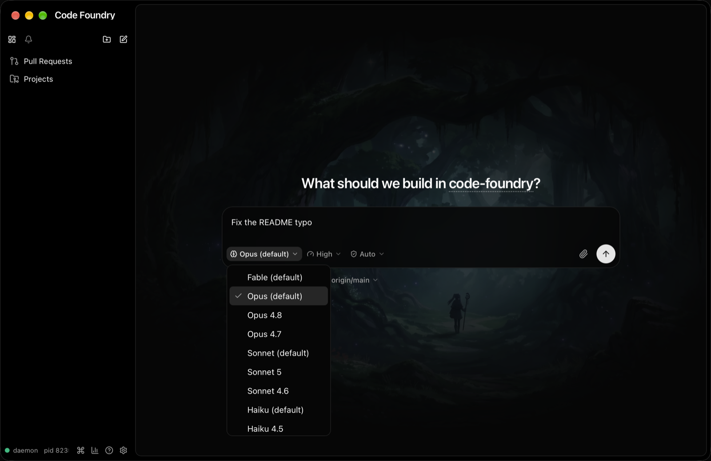
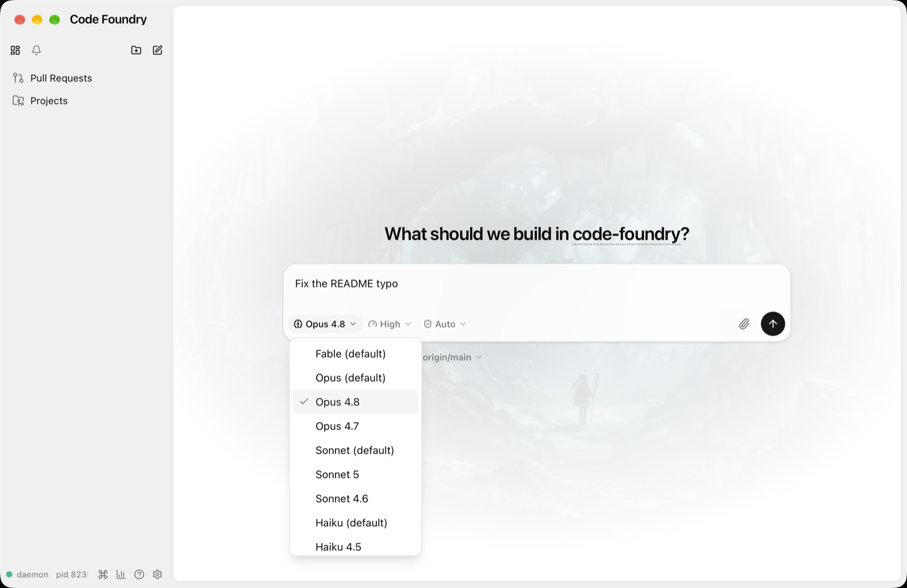
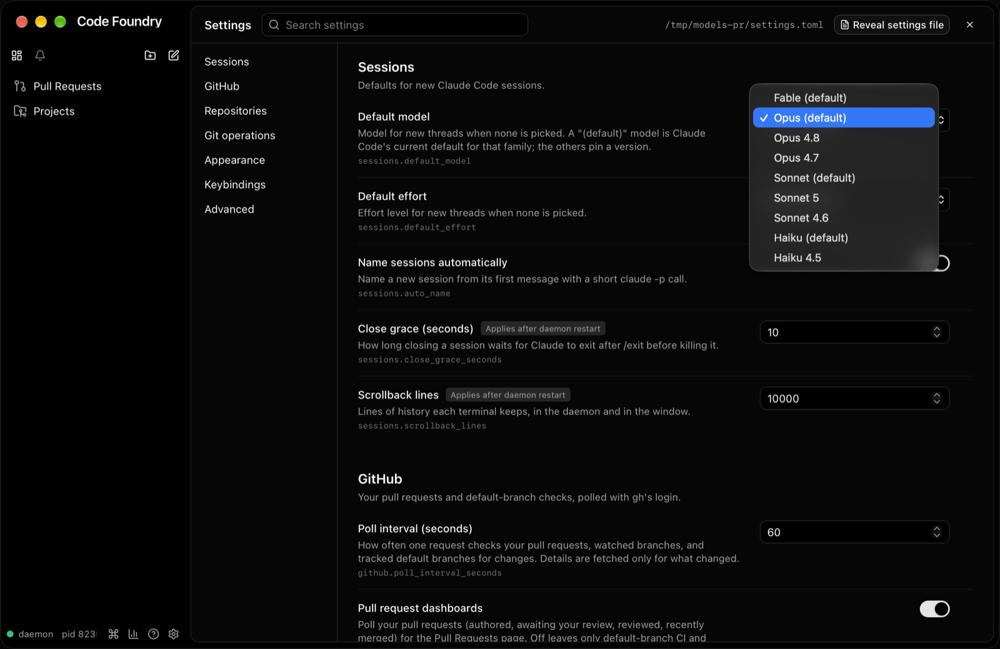
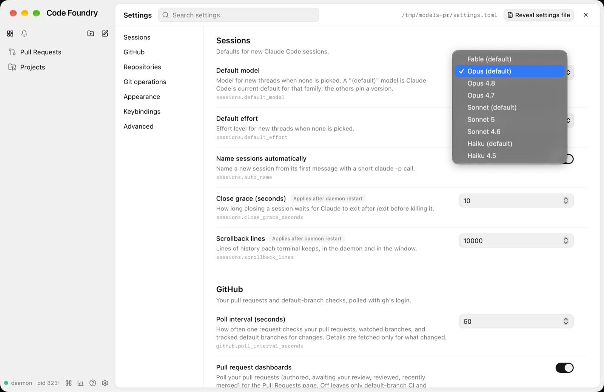
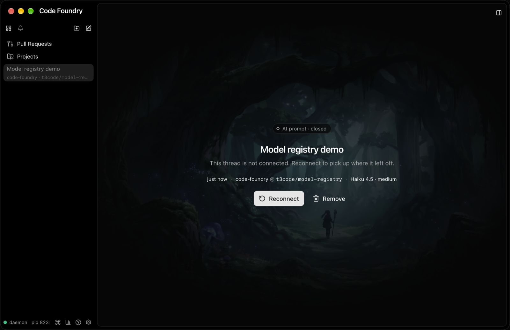

# Model registry

> The alias entries below were replaced by 1M pinned ids on 2026-10-13; see
> `model-registry-1m.md`.

Decided 2026-10-11 (Alex). Before this change the composer had its own list of four
models, with labels hardcoded as "Opus 5.5 / Sonnet 5.5 / Haiku 5.5 / Fable 5.1". The
settings enum was `command.SessionModels` (the same four aliases). Those labels were wrong
on a machine with managed settings: the work Mac has only Opus 4.8/4.7, Sonnet 5/4.6 and
Haiku 4.5. Pinned versions could not be picked either.

## What changed

* **One list: `internal/model`.** Entries are `{Value, Label}` in display order. Value is
  what goes to `claude --model`.

  | Value | Label |
  |---|---|
  | `fable` | Fable |
  | `opus` | Opus |
  | `claude-opus-4-8` | Opus 4.8 |
  | `claude-opus-4-7` | Opus 4.7 |
  | `sonnet` | Sonnet |
  | `claude-sonnet-5` | Sonnet 5 |
  | `claude-sonnet-4-6` | Sonnet 4.6 |
  | `haiku` | Haiku |

  The family entries (Fable, Opus, Sonnet, Haiku) pass the bare alias. Claude Code then
  resolves it to the user's default for that family, including a managed-settings pin.
  They are labelled plainly; a "(default)" suffix was tried and dropped in review.
  `model.Label(v)` returns the raw value for ids it does not know. The SessionService API
  still accepts any full model name, guarded only by the session store's `modelPattern`.
  `model.Default` is `"opus"`.
* **Go consumers derive from it:**
  * `command.SessionModels = model.Values()`: the `--model` enum of session.new and the
    pr.* starters. Validation and the CLI help placeholder therefore list the registry.
    The description explains alias vs. pinned id.
  * The `sessions.default_model` enum, plus `EnumLabels: model.Labels()`.
  * The unused `session.ModelAliases` list is gone.
* **Settings schema labels.** `settings.Field.EnumLabels` (parallel to `Enum`, optional).
  The proto has `SettingField.enum_labels = 12` (additive). `SettingFieldView.enumLabels`
  is emptied when its length does not match the values. A schema test checks that every
  field's labels line up with its values.
* **The frontend reads the list from the settings schema.** `stores/settings.ts` keeps
  `modelChoices`, built by `lib/models.ts` `modelChoicesFromSchema` from the
  `sessions.default_model` field. The schema is now fetched on every events-stream
  (re)connect, not only when the settings page opens, so a restarted daemon with a new
  registry is picked up. `useModelChoices()` returns the list, or
  `FALLBACK_MODEL_CHOICES` (the four aliases) until the schema arrives. `MODEL_CHOICES`
  is gone.
* **Everything that names a model goes through it:**
  * the composer's picker and trigger;
  * the disconnected page's meta line (`modelEffortLabel`);
  * the sidebar thread tooltip (`threadRow.modelLabel`; it used to capitalize the raw
    value);
  * the settings "Default model" select.
* **Formats are unchanged:** the meta line and tooltip still read "Opus 4.8 (high)", and
  the settings select still marks the setting's own default ("Opus (default)").
* **Composer pickers fit the window.** The model list is nine options now. The picker's
  popover is capped at the room Radix finds on its side (divided by the page zoom), and
  the list scrolls. Before the cap, the flipped list at 150% zoom in a short window ran
  97 px above the window. `zoom-popovers.spec.ts` gives its "opens under the trigger"
  cases a viewport tall enough for nine options.
* **Not touched:** `internal/pricing` and the Usage views. They key on the canonical ids
  Claude writes to transcripts (`claude-opus-5-5`, ...), which are a different concern.

## Updating the registry

1. Edit the `registry` slice in `internal/model/model.go`. Keep the per-family order:
   alias first, then pinned ids newest first.
2. Update the `want` list in `internal/model/model_test.go`, and the expected error
   string in `internal/store/settings/schema_test.go` (`TestFieldParse`).
3. Mirror the list in the mock daemon: `MODELS` in `gui/frontend/mock/settings.ts`. The
   e2e specs `compose.spec.ts` and `settings.spec.ts` assert the option lists.
4. Restart the daemon. The GUI re-reads the schema on reconnect; no frontend change is
   needed.

A `sessions.default_model` that names a removed entry is reported as a settings issue and
falls back to `opus`, like any bad value.

## Verified

* `make check` green after merging main (#46, #49, #50). The Playwright compose,
  composer-switch, settings, sessions, sidebar, workspaces and zoom-popovers specs pass
  in WebKit and Chromium. One exception: `zoom-popovers.spec.ts:74` (the row context menu
  at 125%) is flaky in Chromium, and fails the same way on origin/main.
* Live, against an isolated daemon (`CODE_FOUNDRY_HOME=/tmp/models-pr`, built `bin/` and
  `gui/bin/Code Foundry`):
  * `help session.new` lists the registry. `--model gpt-9` is rejected with the list.
  * `settings set sessions.default_model claude-sonnet-4-6` became the `--model` default;
    `nope` was rejected.
  * The composer picker shows the labels, and picking Opus 4.8 shows it in the trigger.
  * A `--model claude-haiku-4-5 --effort medium` thread spawned
    `claude … --model claude-haiku-4-5`. It reached the prompt (no turn spent), and its
    disconnected page shows "Haiku 4.5 (medium)".

## Gotchas

* WebKit does not move focus to a `<select>` on Tab, and System Events' `click at` does
  not reach the web view. For the settings screenshots, a small CGEvent click tool opened
  the native menu.
* Other worktrees' GUI windows can open on top of yours. Raise your PID right before each
  `screencapture`.

## Follow-up 2026-10-11: Haiku pin removed

The `claude-haiku-4-5` / "Haiku 4.5" entry is gone. The `haiku` alias stays, and so do
the Opus and Sonnet pins. On the work laptop the pinned Haiku id showed up with an odd
name and may not be a valid pick there. The bare `haiku` alias always resolves to Claude
Code's current default for the family, so it is always valid. The registry now has
eight entries ("nine options" above is as of the original change). `internal/pricing`
keeps `claude-haiku-4-5`, since transcripts still contain it. Threads already started
with `--model claude-haiku-4-5` keep working (the session store checks only
`modelPattern`); their meta line now shows the raw id, like any id the registry does not
know.
