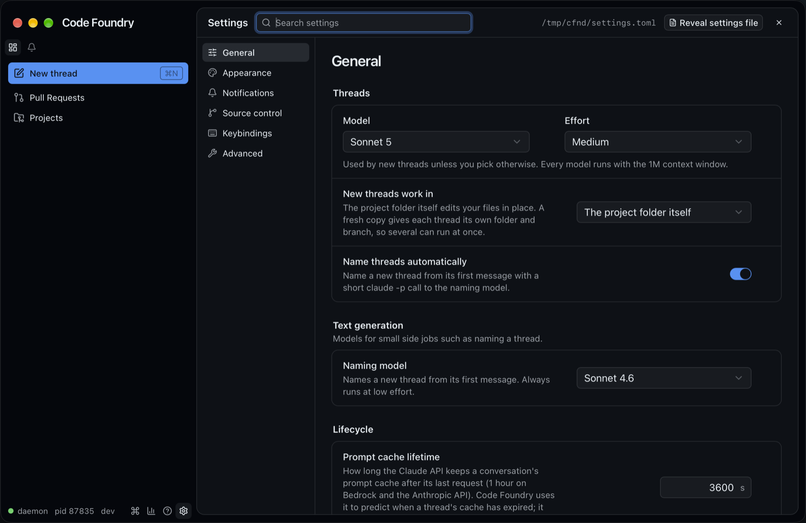
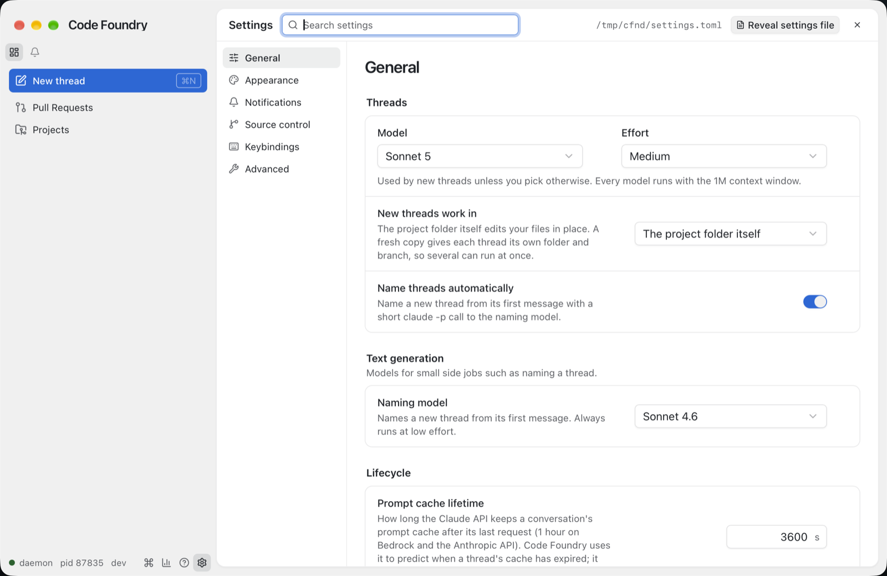

# New defaults (2026-10-17)

Alex picked new out-of-the-box defaults. A setting the user has saved is untouched; only
keys absent from `settings.toml` change behaviour.

| Setting | Was | Now |
|---|---|---|
| `threads.default_model` (`model.Default`) | Opus 4.8 | Sonnet 5 (`claude-sonnet-5[1m]`) |
| `threads.default_effort` | high | medium |
| `threads.naming_model` (`model.NamingDefault`) | Sonnet 5 | Sonnet 4.6 (`claude-sonnet-4-6[1m]`) |
| `threads.default_worktree` | `new` (a fresh copy) | `current` (the project folder itself) |
| `appearance.density` | compact | comfortable |

Status: `make check` green; `make gui-e2e` (both browsers) failed 15 tests per browser on
the old defaults, all fixed here (the touched specs rerun: 128 passed). Live pass with an
isolated `CODE_FOUNDRY_HOME`: the fresh `settings.toml` comments out the new defaults,
`settings get` and `help thread.new` report them, Settings › General shows them, and a
new composer for a project with no remembered pick reads Sonnet 5 · Medium · In place.

| Dark | Light |
|---|---|
|  |  |

## Decisions

* **One source per default.** The daemon schema (`internal/store/settings/schema.go`,
  `internal/model`) owns them; thread.new's and the PR thread commands' arg defaults
  come from the settings at runtime (`internal/daemon/settings.go`), and the
  settings.toml header's commented-out lines are rendered from the schema. Nothing else
  in Go hardcodes a default model or effort.
* **GUI fallbacks match the daemon.** When the snapshot lacks a value (not loaded yet,
  or an unknown value), `defaultWorktree` (`lib/compose.ts`) now falls back to
  `current` and `densityOf` (`stores/settings.ts`, new) to comfortable. `current` still
  means a fresh copy while the main checkout is unknown, and the per-project
  remembered pick (`stores/workIn.ts`) still wins over the setting.
* **Naming model reason**: Sonnet 4.6 is cheap and fast, and a name is a few words.
* **Copy**: the "New threads work in" description now leads with the project folder
  and reads neutrally ("…edits your files in place. A fresh copy gives each thread its
  own folder and branch, so several can run at once."). The Guide
  (`docs/GETTING-STARTED.md`) lists the project folder first and calls it the default.
  The picker's option order is unchanged (fresh copy first).
* **e2e**: specs that exercise the fresh-copy flow (base picker, `new-worktree` args,
  local refs, Also in) pin `threads.default_worktree=new` through the mock's
  `settings/external` hook instead of being rewritten; the default itself is covered by
  the settings spec and the "Work in" compose spec, which no longer sets it.

## Gotchas

* The settings page and composer read the defaults from the running daemon's schema:
  an old daemon keeps showing Opus 4.8 / High / fresh copy / compact until restarted.
* Existing installs whose `settings.toml` only has the commented-out header lines get
  the new defaults on the next daemon start; the header is rewritten the next time the
  file is saved.
* `TestRenderedStartCrash` failed once in `make check` (the fake claude's broken pipe
  won the race against its exit code); it passed on rerun and is unrelated.
