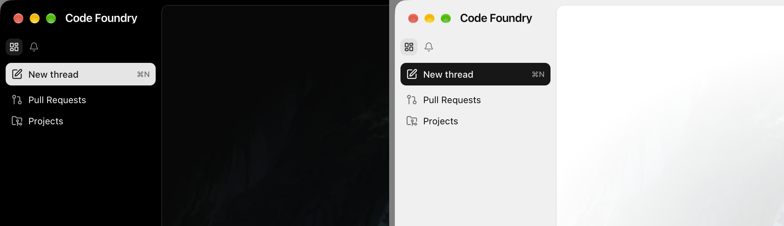
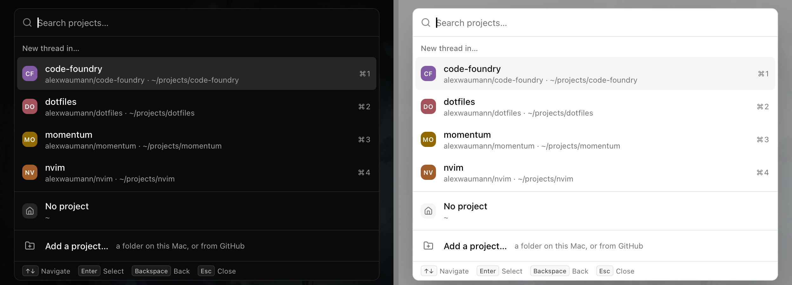
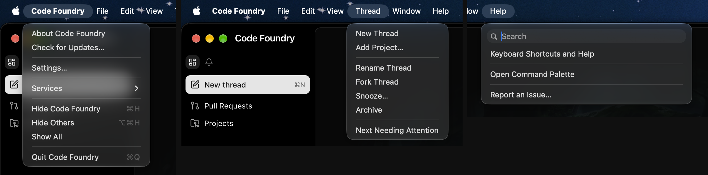

# Onboarding 1: entry points

Decided 2026-10-15 (Alex), PR 1 of the onboarding batch (proposal sections "Changes" 1
and 2: labelled primary actions, native menus). Frontend and the Wails host only: no
daemon change, so a running daemon does not need a restart.

## What changed

* **Sidebar: a labelled New thread button.** The toolbar keeps Dashboard and
  Notifications on the left; its two right-hand icon buttons (Add project, New thread)
  are gone. Under the toolbar a full-width primary button (`SidebarNewThread` in
  components/sidebar/SidebarToolbar.tsx, `sidebar-new-session`): `SquarePen`, "New
  thread", and session.new's first chord right-aligned in a muted `<kbd>`
  (`sidebar-new-session-chord`). It is a `CommandButton` (`variant="default"`,
  `whenUnavailable="disable"`), so it runs exactly what the palette runs (the project
  picker). It sits in the sidebar body's 8px gutter and runs to the sidebar's right edge,
  so it is 8px from the window edge and from the content pane, like every other row.
* **Add project entry points.** The new-thread project picker (components/compose/
  ProjectPicker.tsx) ends with "Add a project…" ("a folder on this Mac, or from GitHub")
  in its own group under a top border, whenever there are projects. It closes the
  picker and runs repo.add (the Add Project dialog). With no projects the picker's
  existing first row is unchanged; both use `picker-add-project`, and only one renders.
  The Projects page header already had a labelled "Add project" button
  (`projects-register`), so it is unchanged. No sidebar row.
* **Native menus** (gui/app.go `appMenu`, tables in gui/menu.go):
  * Code Foundry: About, Check for Updates…, separator, **Settings…** (view.settings),
    separator, Services, …
  * **Thread** (after View): New Thread (session.new), Add Project… (repo.add),
    separator, Rename Thread (session.rename), Fork Thread (session.fork), Snooze…
    (session.snooze), Archive (session.archive), separator, Next Needing Attention.
  * **Help** (last): Keyboard Shortcuts and Help (view.help), separator, Open Command
    Palette (ui.palette.open), separator, Report an Issue… (opens
    https://github.com/alexwaumann/code-foundry/issues/new with `app.Browser.OpenURL`).
    macOS adds its menu search field to a menu titled Help by itself.
* **Start page tagline** (onboarding state): "A single surface for all your agents."

## Decisions

* **One generic menu event.** Every command item emits `app:run-command`
  (`EventRunCommand`) with the command name, on the current window
  (`app.Window.Current()`; nothing happens without one). Wails delivers custom events to
  every window, but the app only ever has one. The frontend listener (keys/menu.ts
  `startMenuCommands`, started in App.tsx next to the update listener) calls
  `startCommandNamed`, so presenters, prompts and confirmations behave as in the palette.
  The Check for Updates… event stays as it was.
* **Next Needing Attention is a GUI view action, not a registry command** (cmd+shift+a,
  `jumpToAttention`). The menu names it `attention.next`; keys/menu.ts maps that name to
  the action (a small registry, `menuViewActions`) before trying the command list.
* **A native menu cannot grey items out per context**, so a command that is not
  available here (Rename Thread with nothing selected) toasts "Rename Thread is not
  available here" instead of doing nothing. Next Needing Attention with none toasts "No
  threads need attention".
* **No key equivalents on any new item, Settings… included.** The comment above
  `appMenu` explains why the default View and File roles were replaced: a menu chord
  fires whenever the page leaves the key unhandled (cmd+r reloaded the GUI, cmd+w closed
  the window), and chords the menu keeps must be in `command.ReservedChords`. Reserving
  cmd+, would have meant taking view.settings' default binding away from the page (the
  keybinding test refuses reserved defaults), dropping the chord from the palette and the
  Keyboard Shortcuts overlay, and making it unbindable. Keeping both would let cmd+, open
  Settings from a focused text field (the page leaves keys alone there) and would still
  fire cmd+, after the user rebound view.settings. Wails (`MenuItem.SetAccelerator`, an
  NSMenuItem key equivalent) cannot show a chord without binding it, so the menus show
  none, the same choice as File > Close Window. The page keeps owning cmd+, cmd+n, cmd+r,
  cmd+/ and cmd+k; ReservedChords and settings/validate.ts are unchanged.
  `TestCommandMenus` (gui/menu_test.go) fails if an item gets an accelerator.
* **The chord hint on New thread comes from the command list** (`keybindings[0]` of
  session.new, `formatChord`), so it follows a rebinding and disappears when unbound.
  `buttons.spec` used to assert that no `<kbd>` shows outside the palette and help; it now
  allows exactly this one.
* **Test ids.** `sidebar-new-session` stays on the new button; `sidebar-add-project` is
  gone. The mock e2e specs open the Add Project dialog with `openAddProjectDialog`
  (e2e/fixtures.ts: New thread, then the picker's "Add a project…"); the two live specs
  inline the same two clicks.

## Gotchas

* The picker's "Add a project…" group and item are both `forceMount`: cmdk renders a
  group only when one of its items matched, and a force-mounted item inherits the
  group's flag. The empty text ("No matching projects.") still shows above it.
* View settings is a toggle, so Settings… while the settings page shows closes it, as
  cmd+, does.
* Native menus follow the macOS appearance, not `appearance.theme`, so the menu
  screenshots are in the system's (dark) appearance only.

## Verified live

Built app (`make gui-build`) on an isolated `CODE_FOUNDRY_HOME` with four projects:
System Events lists the three menus as above with no key equivalents on the new items;
Settings… opens the settings page; cmd+, from the start page opens it exactly once (a
double fire would toggle it shut again) and does nothing while the settings search field
has focus; Thread > New Thread opens the picker, whose Add a project… opens the Add
Project dialog; Add Project… opens the dialog; Rename Thread with nothing selected toasts
"Rename Thread is not available here"; Next Needing Attention with none toasts "No
threads need attention"; Help > Keyboard Shortcuts and Help and Open Command Palette open
the overlay and the palette; Report an Issue… brings the browser to the front.

## Screenshots

Sidebar on the start page, dark and light:

New thread's project picker with "Add a project…":

Native menus (Code Foundry, Thread, Help):

