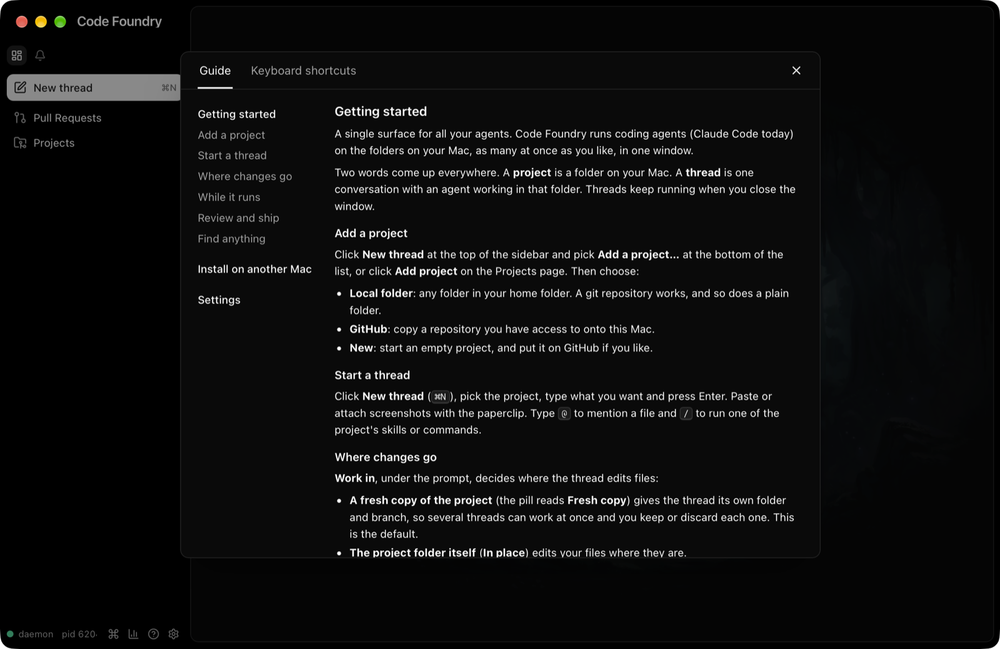
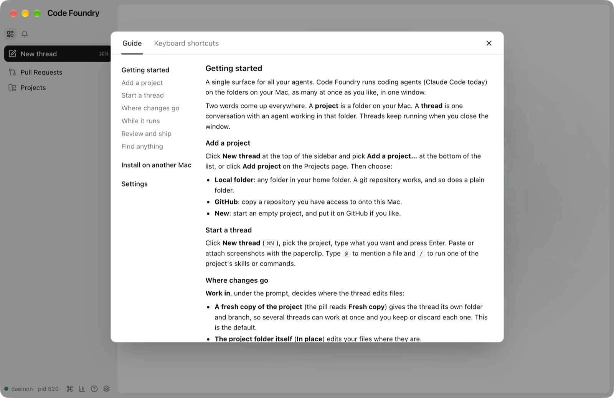

# Onboarding 2: the guide

Decided 2026-10-15 (Alex), PR 2 of the onboarding batch (proposal section 3, without the
start-page checklist, which was cut). Frontend, the Wails host's menu table, and docs:
no daemon change, so a running daemon does not need a restart.

## What changed

* **docs/GETTING-STARTED.md**, the guide, from the proposal's draft text: Getting
  started (what a project and a thread are), Add a project, Start a thread, Where changes
  go, While it runs, Review and ship, Find anything, Install on another Mac (the README's
  steps, abbreviated, linking to its install section), Settings. Its first line under
  Getting started is the app's line, "A single surface for all your agents.", with no
  vendor name. The README's install section points at it.
* **Help overlay** (components/help/HelpOverlay.tsx): two shadcn Tabs, **Guide** (the
  default) and **Keyboard shortcuts**, with a close button in the header row. The Guide
  tab is a contents column (the guide's h2/h3 headings; a click scrolls the guide to that
  heading) beside the guide itself. The overlay keeps its width and position; its body
  is now a fixed 72vh (it was at most 72vh) so switching tabs does not resize it.
* **Help menu**: Getting Started (first), then Keyboard Shortcuts and Help, then Open
  Command Palette and Report an Issue… as before. No key equivalents.

## Decisions

* **The guide is bundled with a `?raw` import of the repo file**
  (components/help/guide.ts, a relative import of `docs/GETTING-STARTED.md?raw`), so the
  window and the repo cannot drift and there is no copy step. The overlay shows it from
  the first `## ` on; the file's `#` title and the maintainer comment above it are for
  repo readers.
* **The existing markdown renderer** (components/pr/Markdown.tsx, react-markdown with
  GFM, sanitized; threads render through it via ThreadMarkdown) with the shared
  `.cf-markdown` styles. No new dependency. Raw HTML is on (sanitized) so the guide can
  use `<kbd>⌘N</kbd>`, which GitHub renders too; `.cf-markdown kbd` now draws keys like
  the shortcut list does (PR bodies get the same look).
* **Contents by index.** `buildToc` reads the h2/h3 ATX headings from the source
  (skipping fenced code and HTML comments), and entry i scrolls to the i-th h2/h3 the
  renderer produced, so Markdown.tsx needed no heading ids. A unit test renders the real
  guide and checks the two lists match, and another pins the guide's section list.
* **The orientation paragraphs are folded into the guide**, not kept on the shortcuts
  tab: they duplicated it, and parts were stale (threads "running in a terminal"). The
  shortcut list itself is unchanged, now in two columns to use the overlay's width.
* **Which tab opens.** `helpTab` lives in stores/views.ts next to `helpOpen`. view.help
  (cmd+/, the status bar's ?, a ShowView intent) opens on the guide every time, even if
  the shortcuts tab was showing last. `openHelp(tab)` opens on a tab, or switches the
  open overlay to it. No `tab` argument on view.help: that would be a daemon change for
  something only this window needs.
* **The Help menu's two items are GUI view actions** in keys/menu.ts `menuViewActions`
  (`help.guide`, `help.shortcuts`), like Next Needing Attention. view.help is a toggle,
  so from a menu it would close an open overlay instead of showing the tab asked for.
  **Keyboard Shortcuts and Help now opens the shortcuts tab** (it used to be view.help):
  with Getting Started above it, both landing on the guide would make one of them
  pointless. The start page's Keyboard Shortcuts link also opens the shortcuts tab.
* **Focus on open goes to the open tab's scrolling body**, not the first tab trigger:
  Radix would focus the Guide tab and draw its focus ring, and with the body focused the
  arrow keys and space scroll the guide. Escape still closes.

## Gotchas

* Vite's dev server (`wails3 dev`, `pnpm run dev:mock`, the e2e server) refuses files
  outside the frontend, and vitest uses the same check. vite.config.ts adds the repo's
  `docs/` directory to `server.fs.allow`. The file alone is not enough: for `?raw` Vite
  checks `GETTING-STARTED.md?raw` itself against the list, and only a parent directory
  matches it. Production builds (`vite build`) are not affected.
* Radix tab triggers switch on mousedown; a unit test must fire `mouseDown`, not
  `click`.
* Write chords in the guide the way the app formats them (`formatChord`: ⇧⌘E, not ⌘⇧E),
  so they read the same as the Keyboard shortcuts tab beside them.
* The dialog fades in; a screenshot taken the moment the guide mounts shows the page
  through it.

## Verified live

Built app (`make gui-build`) on an isolated `CODE_FOUNDRY_HOME`: the Help menu lists
Getting Started, Keyboard Shortcuts and Help, Open Command Palette, Report an Issue…;
Getting Started opens the overlay on the Guide tab; Keyboard Shortcuts and Help switches
the open overlay to the shortcuts tab; cmd+/ then closes it, and cmd+/ again opens it on
the guide; Page Down scrolls the guide right after opening (its body has focus);
`appearance.theme = light` restyles it live. The contents click was not driven live
(System Events cannot click inside the web view); e2e/help.spec.ts covers it in WebKit
and Chromium.

## Screenshots

Guide tab, dark and light:

