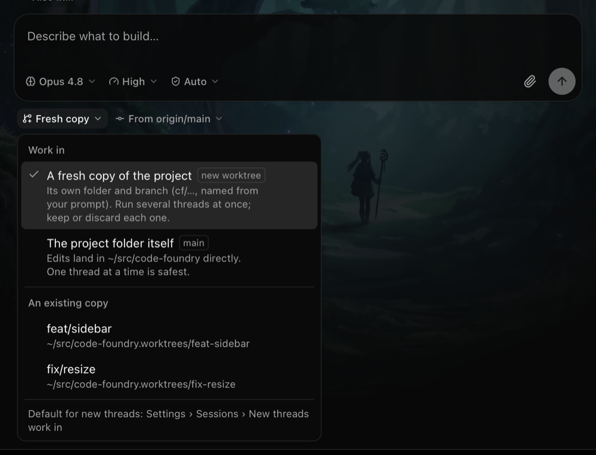
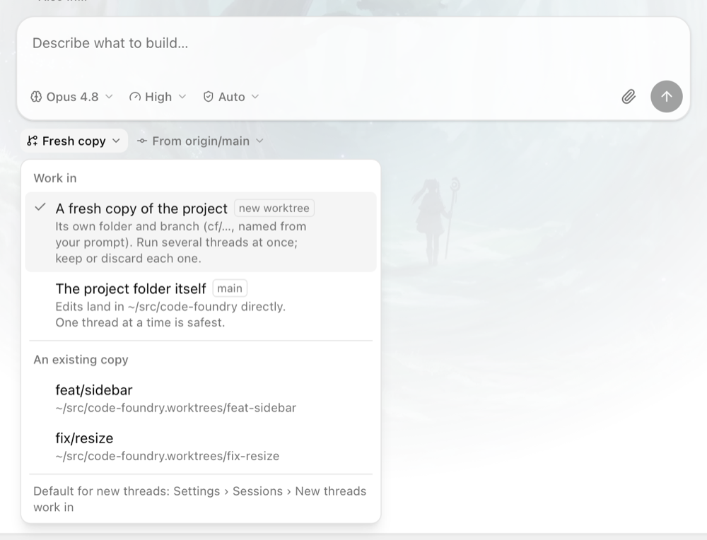
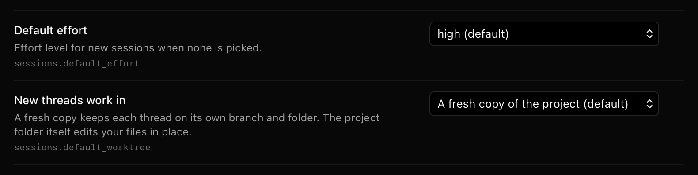
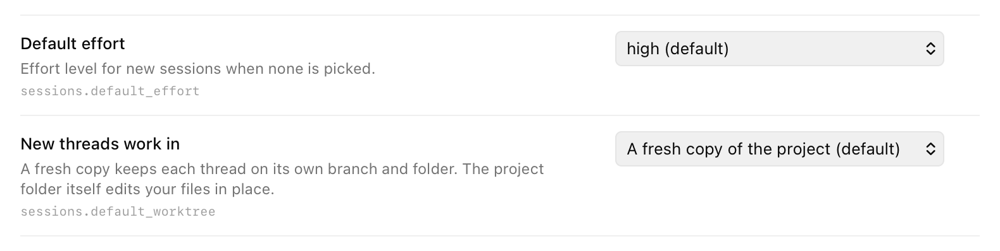

# Onboarding PR 3: Work in

Status: done on branch `cf/onboarding-3-work-in`. PR 3 of the onboarding batch (design:
the onboarding proposal, section 4, "Worktrees become a plain-language choice with a
default"). `make check`, `make gui-e2e` and `make gui-build` green.

**A running daemon must be restarted for the new setting to appear**: the daemon owns
the settings schema, and an old daemon neither lists nor accepts
`sessions.default_worktree`. Until then the composer behaves as before (a fresh copy by
default) and the per-project memory still works.

| Dark | Light |
|---|---|
|  |  |
|  |  |

## What changed

| Path | What |
|---|---|
| `internal/store/settings/schema.go`, `settings.go` | `sessions.default_worktree`: Enum `new` \| `current` (`WorktreeNew`, `WorktreeCurrent`), labels "A fresh copy of the project" / "The project folder itself", title "New threads work in", default `new`, live, right after Default effort; `Sessions.DefaultWorktree` |
| `gui/frontend/mock/settings.ts` | The same field in the mock schema |
| `gui/frontend/src/lib/compose.ts` | `defaultWorktree`, `workInMemory`, `workInText` (pure); `MovableDraft.worktree` may be null |
| `gui/frontend/src/stores/workIn.ts` | Per-project memory (`localStorage "code-foundry.workIn"`) |
| `gui/frontend/src/stores/compose.ts` | `Draft.worktree: WorktreeChoice \| null` (null: the project default); `projectWorktree`, `pickWorktree`; `draftPlace` resolves null |
| `gui/frontend/src/components/compose/ComposerPicker.tsx` | Option `tag` and `wrap`, group `separated`, picker `footer` and `listClassName` |
| `gui/frontend/src/components/compose/Composer.tsx` | The Work in picker |
| `gui/frontend/src/components/settings/SettingRow.tsx` | Editor column 16rem → 18rem |

## Decisions

* **Draft worktree null = "the project's default", resolved live**, like `model` and
  `effort` (null = the settings default). The composer resolves it with hooks
  (`useSettingValue`, `useRememberedWorkIn`, the main checkout from the repo store);
  `sendDraft` resolves the same inputs with `getState` (`projectWorktree`). Both go
  through the one pure `defaultWorktree`. A blank draft cannot be seeded with a computed
  object instead: `getDraft`/`useDraft` return the shared `emptyDraft` for a missing key,
  and a fresh object per call would break selector stability.
* **Order**: the draft's own pick, else the choice remembered for the project, else
  `sessions.default_worktree`, else a fresh copy. `current` falls back to a fresh copy
  while the main checkout is unknown (repo store not loaded yet). A picked worktree that
  vanished still falls back to a fresh copy (`resolveWorktree` / `threadPlace` unchanged).
* **What is remembered**: only "A fresh copy" (`new`) and "The project folder itself"
  (`current`, not the path), recorded when the user picks it in the picker
  (`pickWorktree`). Picking another existing worktree is a one-off and leaves the memory
  alone; it would otherwise pin new threads to a feature branch's worktree. The sidebar
  "+" on a worktree row (`composeIn` with a path) is not a pick either. Picks forced by
  Also in (fresh copies only) or by a project without git are not recorded.
* **Moving a draft to another project** (the heading switcher) resets its worktree to
  null, so it takes the new project's default (it used to be "new").
* **Memory store**: its own small persisted zustand store, like `reviewerRecents`
  (`persist`, versioned, never pruned). Drafts stay memory-only.
* **Copy**:
  * pill: "Fresh copy", "In place" (main checkout, or a project without git), the
    branch name for another worktree (short head when detached; the old "Existing
    worktree: " prefix is gone). Aria: "Work in: <text>".
  * list: heading "Work in"; "A fresh copy of the project" + tag "new worktree" + the
    sentence from the brief; "The project folder itself" + tag = the main checkout's
    branch (short head when detached) + "Edits land in <tildified path> directly. One
    thread at a time is safest."; a rule, heading "An existing copy", the other
    worktrees (branch + path, as before); a rule and the muted footer "Default for new
    threads: Settings › Sessions › New threads work in" (text, not a link).
  * Also in (a project with other projects): one option "A fresh copy of every
    project", tag "new worktrees", detail as before; no footer (nothing to default).
  * Project without git: one option "The project folder itself", tag "no git", the
    in-place detail; no footer.
  * Workspaces: unchanged ("Workspace worktrees" / "New worktree", pill and list).
* **The Base picker** shows only for a fresh copy (unchanged logic, now driven by the
  resolved default too: with `current` it is hidden from the start).
* **Settings row is the existing enum dropdown.** The editor column grew from 16rem to
  18rem so "A fresh copy of the project (default)" is not cut off; every row shares the
  column.
* **Picker size**: `w-90` for projects (room for the detail sentences, close to the mockup) and
  `max-h-96` so the four default rows fit without scrolling; workspaces keep `w-80`.

## Gotchas

* With an 800 px tall window the list opens upward over the composer (Radix flips it
  when there is no room below); with room it opens down as in the mockup.
* `cmd+n` with the keyboard in an (empty) composer did not open the project picker in
  the new e2e; the test clicks a thread row first, as the existing "draft survives"
  test does. Not investigated further (predates this change).
* cmdk renders the Command's `label` as a hidden `<label>`: a `getByText("Work in")`
  inside the list matches both it and the group heading. The e2e reads
  `[cmdk-group-heading]` instead.

## Verified

* `make check` green (gofmt, vet, staticcheck, `go test ./...`, typecheck, lint, vitest).
* Unit: `TestDefaultWorktreeField` (Go); `defaultWorktree`, `workInMemory`, `workInText`
  tables (`lib/compose.test.ts`); setting × memory × draft resolution, pick memory, the
  vanished-worktree fallback and workspace drafts (`stores/compose.test.ts`).
* `make gui-e2e` (WebKit + Chromium, `E2E_MOCK_PORT=7841 E2E_VITE_PORT=9341`): the
  updated compose, nogit, workspaces, composer-switch, sessions and settings specs, plus
  the new "Work in: sessions.default_worktree = current…" test (pill "In place", Base
  hidden, a fresh-copy pick sent with `new-worktree` + `base`, remembered for
  code-foundry only, and still remembered after a reload).
* `make gui-build` green.
* Screenshots taken in WebKit against the mock daemon.
