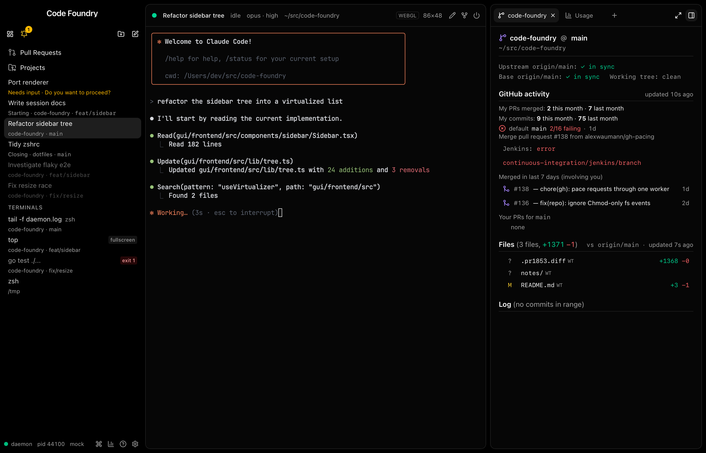
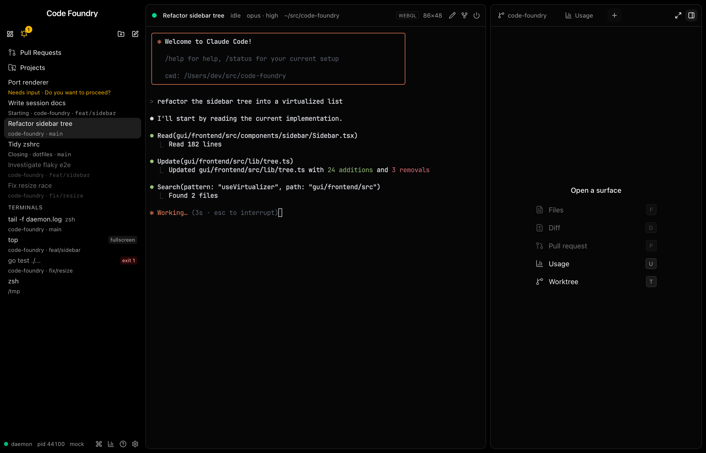

# Side panel: a "+" new-tab button

Status: done on branch `t3code/panel-new-tab` (2026-10-11). `make check` and `make
gui-e2e` green. Builds on the side panel (`side-panel.md`).

Alex's ask: once a panel has a tab, the "Open a surface" list is gone until every tab is
closed. A browser-style "+" after the last tab now brings the list back without closing
anything, exactly as agreed with him (plan in the task brief; nothing here deviates from
it except where noted below).

Light: `panel-new-tab/panel-new-tab-strip-light.png`, `panel-new-tab-picking-light.png`.

## What landed

| Path | What |
|---|---|
| `internal/command/commands_view.go` | `ViewPanelNewTab = "panel.new-tab"`; `view.panel.new-tab` ("New Side Panel Tab", View, no chord, no `When`, like `view.panel.expand`) |
| `internal/command/commands_view_test.go`, `commands_test.go` | The ShowView table row; the registered-commands list |
| `gui/frontend/src/stores/panel.ts` | `PanelEntry.pickFrom?`, `isPicking`, `startPicking`, `stopPicking`; `openTab`/`activateTab`/`closeTab` handle picking; `startPanelPicking`, `stopPanelPicking`, `usePanelPicking` |
| `gui/frontend/src/stores/views.ts`, `keys/bindings.ts` | `newPanelTabCommand`, `showView("panel.new-tab")`, the window-local presenter |
| `gui/frontend/src/components/panel/keys.ts` | `{ kind: "stopPicking" }`; cmd+w and Escape while picking; `isPanelChord(chord, picking)` |
| `gui/frontend/src/components/panel/SidePanel.tsx` | `NewTabButton` (a `CommandButton`) after the last tab; `data-picking` on the aside; roving tabindex while picking; the reveal effect scrolls the + into view; `keepPanelFocus` when the list unmounts |
| `gui/frontend/src/components/panel/reveal.ts` | `revealElement` (what `revealTab` now calls) |
| `gui/frontend/src/components/help/HelpOverlay.tsx` | One row for Escape and cmd+w on the surface list ("back to the tab") |
| `gui/frontend/mock/world.ts` | `view.panel.new-tab` for the e2e mock daemon |

## Decisions

* **Picking is `activeTabId: null` with tabs.** No new flag: a panel with tabs and no
  active tab already rendered the empty list (`Body`), so picking is that state, and
  `isPicking(e) = tabs.length > 0 && activeTabId === null`. An entry with no tabs is
  never picking: the list shows anyway, and cmd+w still hides the panel there.
* **`pickFrom` is optional and dropped, never `undefined`.** This follows `expanded`, so
  entries saved before this change and entries never picked look the same. It is
  persisted with the rest, so a reload keeps the picker and where to go back to.
  `openTab` and `activateTab` always drop it. Closing the last tab drops it too, and
  hides the panel as before.
* **Closing the `pickFrom` tab moves `pickFrom`** to its right neighbour, else the left
  one. That is the same rule as closing an active tab, so going back after the close
  lands where closing that tab outright would have. Closing any other tab keeps picking
  unchanged.
* **`stopPicking` falls back to the first tab** when `pickFrom` is missing or gone. The
  move above means it should never be gone; an old or hand-edited entry can still lack
  it.
* **No tab until a pick.** The list's rows and the surface letters go through
  `openSurface` → `openTab`. Picking an already-open surface activates that tab instead
  of adding a duplicate.
* **Escape is the panel's chord only while picking.** No `SurfaceSpec.onKey` uses Escape
  today; only the PR surface has `onKey`, and it handles cmd+shift+c. Surface bodies do
  use it, though: the PR ask composer cancels on it, and the Radix popups (merge menu,
  reviewer picker, PR menu) close on it, and their portaled key events bubble through
  React to the aside. While picking there is no surface body, so taking Escape is safe;
  with an active tab, `isPanelChord("escape")` is false and the key still reaches the
  surface (a SidePanel test checks this).
* **The + is a `CommandButton`, unextended.** `title="New tab"` gives the aria-label and
  tooltip. `size-7` matches the tabs' h-7, and class overrides give the inactive-tab
  hover and the active-tab background while picking. `pressed={picking}` renders
  `aria-pressed`, which is how tests and assistive tech tell it is highlighted (as
  PanelToggle and PanelExpand do). `keepFocus` stays on, so a click does not focus the
  button; the command focuses the aside instead (panelFocusSeq), and Escape and the
  letters work at once.
* **The + sits in a `span` wrapper** that holds the ref the reveal effect needs, because
  `CommandButton` takes no ref. The wrapper is `no-drag` too.
* **Roving tabindex while picking.** With no active tab, no tab had `tabIndex=0`, so Tab
  could not reach the strip. The first tab (and its ×) takes it while picking.
* **Focus leaves the list before it unmounts.** A row reached with Tab lost focus to
  `<body>` when picking ended (Escape), a letter opened a surface, or the row was
  clicked (Chromium focuses clicked buttons; WebKit does not), and then cmd+w and the
  letters no longer reached the panel. `keepPanelFocus` moves focus to the aside first,
  as `LinkedPRsSurface`'s `openLink` does. It applies to the empty panel's list too.
* **Hiding the panel keeps picking.** `toggle` leaves `pickFrom` alone, like `width` and
  `expanded`. Showing the panel again shows the list it was hidden with. Alex did not
  specify this; it is the simpler rule.
* **A local presenter, like `view.panel.toggle` and `.expand`.** The + and the palette
  act on this window only; the CLI's ShowView reaches every window. The e2e test checks
  that the + makes no daemon call.

## Gotchas

* In the mock world, the Worktree tab opened from s-1's list is titled `code-foundry`
  (the worktree), not "Worktree". The e2e expectations use the title.
* The gap between the last tab and the + includes that tab's invisible × (inactive tabs
  keep its box at opacity 0). The e2e test allows 0–8px.
* After a reload the e2e test has to select s-1 again: the selection is not persisted,
  the panel state is.
* This worktree had no `third_party/ghostty-vt`, so a bare `go test` (outside make) tried to
  link another worktree's library and failed.
  `make ghostty-vt` fixed it; `make check` builds it anyway.

## Tests

* Vitest (whole suite 1400 tests, 75 files): `stores/panel.test.ts` 83 (+28: picking
  rows for `openTab`/`closeTab`/`activateTab`, `isPicking`, `startPicking`,
  `stopPicking`, round trip, survives hide/resize, `startPanelPicking`/`stopPanelPicking`
  incl. persistence), `components/panel/keys.test.ts` 24 (+9), `SidePanel.test.tsx` 25
  (+13: the + only with tabs, entering picking adds no tab, picking a surface, picking an
  open one, clicking a tab, Escape and cmd+w, focus moving to the panel when a focused
  row's list unmounts (Escape, a letter, a click), Escape with an active tab reaches the
  surface, closing the `pickFrom` tab, closing every tab), `stores/views.test.ts` 29 (+5).
* Go: `TestViewCommandsEmitShowView` and `TestAllRegistersEveryDomain` cover the new
  command.
* Playwright (`e2e/panel.spec.ts`, WebKit and Chromium): the + (position, height,
  no-drag, aria), picking (no tab added, none selected, pressed, focus in the panel, no
  daemon call), Escape, picking a new and an open surface, clicking a tab, cmd+w handled;
  closing the `pickFrom` tab and a reload; the palette and the CLI's ShowView.
  `make gui-e2e`: 436 passed, 16 skipped (the SHOTS-gated screenshot tests among them).
* Screenshots: `SHOTS=<dir> pnpm exec playwright test e2e/panel.spec.ts -g "new-tab
  screenshots" --project webkit` (skipped without `SHOTS`), mock daemon, 1400x900, dark
  and `-light`, saved under `docs/notes/panel-new-tab/`.

## Daemon restart

`view.panel.new-tab` is a daemon command, so the running daemon must be restarted before
the GUI's + appears: `CommandButton` hides a command the daemon does not list.
