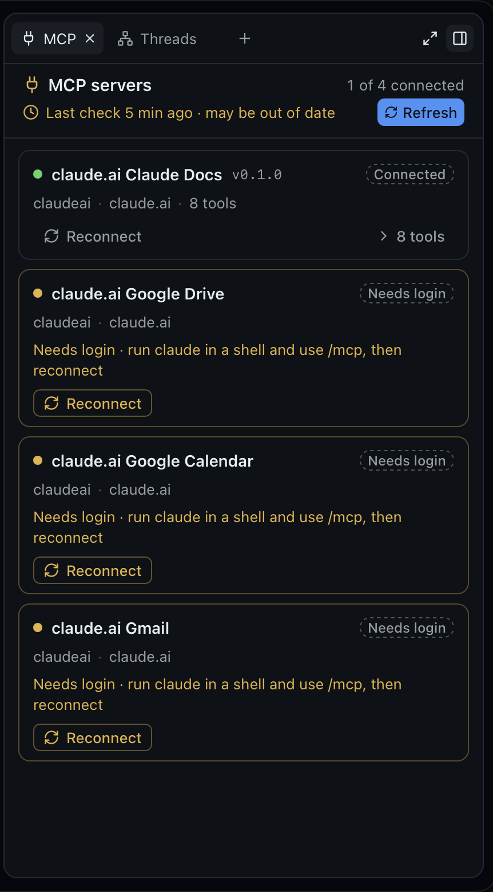
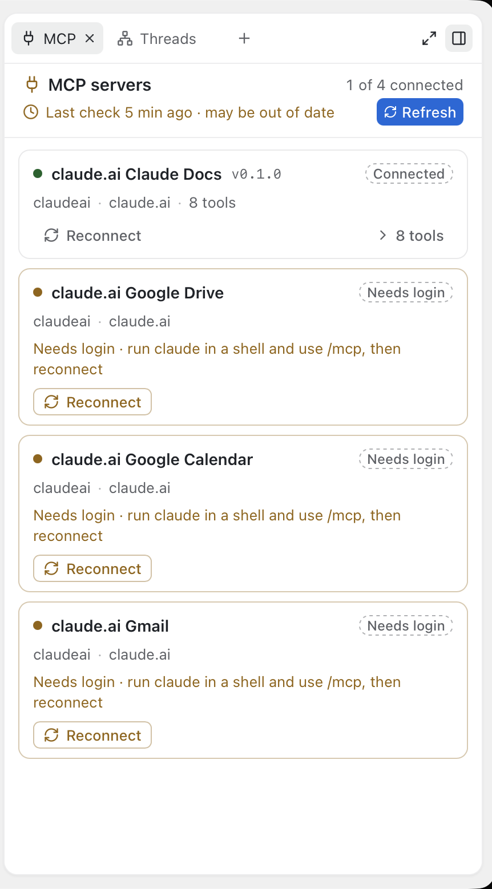

# Panel polish: tooltip height, inline HTML in markdown and threads, tabs only when there is something, stale MCP (2026-10-18)

Four small GUI items in one PR (`cf/panel-polish`). No daemon or proto change.

## 1. Agents tab tooltips stop at five lines

* The shared `Tip` (`components/ui/tooltip.tsx`) takes `maxLines`: the label is wrapped in
  a span with `line-clamp-(--tip-lines)` and `--tip-lines: N` as an inline custom
  property. A CSS variable rather than `line-clamp-5` so any N works without listing
  literal classes for Tailwind's scanner; jsdom keeps custom properties, so the unit test
  can read it (`style.getPropertyValue`), where `-webkit-line-clamp` set as a style
  property is dropped. Absent: unlimited, the label is not wrapped at all.
* `AgentsSurface` uses `maxLines={5}` on the `whenTruncated` tips of a done run's summary
  and a failed run's error. The row itself still clamps at two lines; the tooltip shows
  three more and an ellipsis instead of the whole report.

## 2. `<small>` and friends in markdown, thread answers included

Alex's report was that `<small>` did not render in the conversation view. Thread answers
showed every HTML tag as literal text (`html: false`, like Claude Code's own UI), so the
fix had two halves.

* **Where raw HTML is parsed** (PR descriptions and comments, the File tab's markdown
  preview, the guide): `components/pr/Markdown.tsx`'s sanitize whitelist gains `small`,
  `mark`, `ins`, `s` and `u`.
* **Thread answers** (`ThreadMarkdown`, `components/thread/Code.tsx`, the `html: false`
  path): the literal-HTML rule is reversed narrowly. A fixed allowlist renders: `small`,
  `mark`, `sub`, `sup`, `kbd`, `ins`, `s`, `del`, `u` and `br` (`lib/inlineHtml.ts`
  `INLINE_HTML_TAGS`). Every other tag stays literal text exactly as before:
  `<pasted_content>`, `<file>`, `Result<T, E>`, `<script>`.
  * **How:** a rehype plugin (`rehypeInlineHtml`) in place of the old raw-to-text pass.
    remark-rehype leaves each inline tag as its own raw node; code spans and fenced
    blocks hold text, never raw nodes, so a tag in code stays literal with no extra
    care. Per parent (paragraph, heading, list item, cell), a raw node that is exactly
    one allowlisted tag without attributes (`<small>`, `</small>`, ` `, ` `,
    any case) and has its matching partner in the same parent becomes an element
    wrapping what is between. Everything else becomes text: other tags, tags with
    attributes, `<small/>`, HTML blocks, unmatched opening or closing tags. Markdown
    inside a pair still renders (`<small>see **this**</small>`). The sanitize schema on
    this path allows markdown's own elements plus the allowlist only.
  * **Not rehype-raw:** the brief suggested escaping, then rehype-raw. The plugin builds
    the elements itself instead, because the HTML parser re-opens unclosed formatting
    elements (`small`, `s`, `u`, ...) in every following paragraph. One stray `<small>`
    would then shrink the rest of the message even though it was escaped in the source
    pass. Matching per parent makes "an unclosed tag swallows nothing" structural.
  * **Limits:** a pair split across paragraphs does not match, and both tags stay
    literal. An HTML block (a tag alone on its line: `<small>` newline text newline
    `</small>`) stays literal, as before. A message still streaming shows a `<small>`
    literally until its `</small>` arrives.
  * **Tests:** table tests in `lib/inlineHtml.test.ts` (tag matching, pairing) and
    `Markdown.test.tsx`. They cover: each allowlisted tag renders; unknown, attributed
    and self-closed tags stay literal; tags in a code span and a code block stay
    literal; an unclosed allowlisted tag stays literal and leaves the next paragraph
    alone.
* **Styles** (`index.css`):
  * `.cf-markdown small` is `@apply text-caption`: 13px muted. In a File tab's 15px body
    and in threads it reads smaller; in a PR body it is the same size, but muted.
  * `mark` is the highlight token at 22% behind inherited text, 4px radius.
  * `ins` is underlined and `s` struck. Both are stated rather than left to the UA, in
    case a reset touches them.
  * `kbd`, `sub` and `sup` already had styles or UA defaults.

## 3. Agents and Threads listed only when there is something

* `surfaces/agentsTarget.ts` `selectionAgentsThread`: the selected thread when the thread
  list's `agentRuns` is non-empty (runs persist, so a stopped thread with runs still
  lists it). `surfaces/threadsTarget.ts` `selectionThreadsThread`: the selected thread
  when `lib/lineage.ts` `hasLineage` (a creator, removed ones included since the panel
  keeps their row, siblings, or children). Otherwise **hidden**, not disabled (Alex's
  call).
* `watches` stays `[useThreadsStore, useProjectsStore]`: both answers come from the
  thread list, so a first run or a new child lists the entry live (tested). The strip
  above the composer reads `backgroundAgentsRunning` from the same thread-list message
  that carries `agentRuns`, so it never shows before the surface is enabled.
* **Entry points.** The panel's letters (A, H) follow availability already
  (`panel/keys.ts`). The header's "from …" chip only shows for a thread with a creator,
  and the Agents strip only while background runs go, so both always find the surface
  enabled. `view.panel.agents` / `view.panel.threads` (palette, CLI) follow the Linked
  PRs precedent: for a thread without runs or lineage they toast "No agents yet" / "No
  related threads" with the empty state's explanation and open nothing; still a no-op
  with no thread selected. The daemon still offers the commands for any thread (it does
  not know the GUI's lists); the toast is the answer. `thread.agent.open` (the timeline's
  "Open ›") opens the subagent view, not the tab, and is unchanged.
* **An open tab stays.** Availability gates the empty list, the letters and the commands,
  never open tabs (the panel never pruned by it), so a tab restored with the panel or
  opened before the lineage went away keeps showing, with its empty state ("No agents
  yet…", "Created by you. No threads created from here…"). Those empty states stay for
  that reason.
* Mock: `threadMsg` now carries `agentRuns` (`mock/agents.ts` `listRuns`, open/closed from
  the log's runs), so the mock's agents thread lists the surface like the daemon's.
* Test fixtures that cast partial `ThreadView`s gained `agentRuns: []`: every surface's
  `available` runs for the empty list, and the Agents one now reads it.

## 4. MCP staleness

* `lib/mcp.ts`: `mcpStale({ checkedAtMs, running, refreshing }, now)`: stale when Claude
  is not running for the thread (`claudeRunning`: state not connected or starting) or the
  check is `MCP_STALE_AFTER_MS` (10 min) old or more; never while a refresh is in flight.
  An unknown check time is stale only when Claude is not running. `staleLine`: "Last
  check 12 min ago · may be out of date". Table tests for all three.
* `stores/mcp.ts` `useMcpStale(threadId)`: false without a status (the empty state talks
  then). The clock is `lib/clock.ts`'s new `useNowSelect(5000, now => …)`: the shared 5 s
  clock re-evaluates the boolean, and React re-renders only when it flips
  (`useSyncExternalStore` compares the snapshot), so the cards do not re-render every
  tick and the state flips at most 5 s after the 10 min mark, without interaction.
* `McpSurface`: computed once and passed to the header and the cards. Stale: the checked
  line (clock icon included) is `text-warning`, its text the stale line; the pills drop
  their status tint for `border border-dashed border-muted-foreground/50
  text-muted-foreground` (the label stays, the dot and the card borders keep their
  colours); Refresh becomes a shadcn `Button size="xs"` (primary) with the icon and the
  word "Refresh" and no tooltip (nothing hidden). Not stale, the quiet icon button with
  its tooltip as before. A refresh in flight is never stale, so the spinning state is
  always the icon button.
* No new RPC: `checkedAtMs` from the Watch, the state from the thread list.
* A stopped thread is stale at once, even with a check seconds old: after the idle stop
  Claude no longer checks, so nothing says the list is current. A refresh starts Claude
  (the daemon's behaviour), which clears it.
* Mock: `POST /__mock/thread/mcp-age?id=s-r1&ago=720` backdates the last check
  (`mock/mcp.ts` `ageMcp`), published like a new answer. e2e: stale after aging, cleared
  by Refresh; a stopped thread stale at once; the SHOTS run also saves
  `mcp-stale-<scheme>-panel.png`.

## Verified

* `make check` green; `make gui-e2e` on Chromium plus WebKit for the touched specs
  (lineage, mcp-panel, panel, agents-panel, addproject). Two failures elsewhere were
  timing flakes that passed on rerun (`panel.spec.ts` tab drag reorder,
  `addproject.spec.ts` Local folder Enter), as was Go's `TestRenderedStartCrash` once
  under load.
* Live, built app (`make gui-build`) with an isolated `CODE_FOUNDRY_HOME`, a plain scratch
  folder project and Haiku 5.5 threads (`claude-haiku-5-5[1m]`, medium): a thread that ran
  one subagent and created a child lists Agents and Threads; a plain thread lists neither,
  and Related Threads from the palette toasts "No related threads". With
  `threads.cache_ttl_seconds` at 60 the thread stopped on idle and the MCP tab flipped to
  stale on its own (screenshots above); `thread mcp --refresh` started Claude and the
  header went back to "Checked just now".
* **Gotcha (daemon, not changed):** that refresh's first answer, right after Claude
  started, listed no MCP servers ("0 of 0 connected"); the next turn's check would bring
  them back. Before this PR the refresh had the same answer, just without the stale
  state around it.
* Live, inline HTML in a thread answer (Haiku 5.5 asked to echo a reply using every
  allowlisted tag): small, mark, kbd, sub, sup, s, ins and u render; `<pasted_content>`,
  `<file>`, `Result<T, E>`, a stray `<small>` and a code span stay literal (screenshots
  in the PR body).
* Not checked live: the Tip clamp (no way to hover from a script; the unit test reads
  the clamp) and `<small>` in a File tab preview (unit tests).
