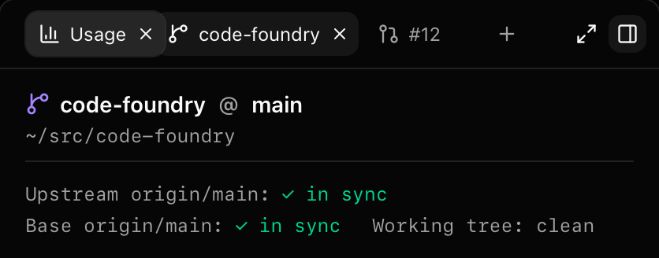

# Side panel: drag tabs to reorder

Status: done on branch `t3code/panel-tab-reorder` (2026-10-11), built on
`t3code/panel-new-tab`. `make check` and `make gui-e2e` green. Builds on the side panel
(`side-panel.md`) and its "+" (`panel-new-tab.md`).

Alex's ask: reorder the side panel's tabs by dragging them, smoothly, like browser tabs.
Plan agreed with him in the task brief. The deviations are listed under Decisions.

Full window: `panel-tab-reorder/panel-tab-reorder-drag.png`. Light:
`panel-tab-reorder-drag-light.png`, `panel-tab-reorder-drag-closeup-light.png`.

## What landed

| Path | What |
|---|---|
| `gui/frontend/package.json`, `pnpm-lock.yaml` | `@dnd-kit/core` 6.3.1, `@dnd-kit/sortable` 10.0.0, `@dnd-kit/utilities` 3.2.2, `@dnd-kit/modifiers` 9.0.0 (exact pins) |
| `gui/frontend/src/stores/panel.ts` | `moveTab(e, id, toIndex)` (pure) and `movePanelTab(target, id, toIndex)` |
| `gui/frontend/src/components/panel/keys.ts` | `tabMoveIndex(chord, index, count)`: where alt+←/→ moves a tab |
| `gui/frontend/src/components/panel/SidePanel.tsx` | `DndContext` + `SortableContext` in `TabStrip`; `useSortable` in `TabButton`; the drop settle; alt+arrows in `onTabListKeyDown`; announcements |
| `gui/frontend/src/components/panel/reveal.ts` | `tabNode` (what `revealTab` and the drop settle use) |
| `gui/frontend/src/components/help/HelpOverlay.tsx` | One row: ⌥← ⌥→ "Side panel, focused tab: move it left or right" |

No daemon or proto change: reordering is window-local panel state, so no command. No
daemon restart is needed.

## Decisions

* **dnd-kit, in place.** No `DragOverlay`: the tab itself follows the pointer (its
  `transform`), and its neighbours slide with `horizontalListSortingStrategy` and
  sortable's 200ms transform transition. Collision detection is `closestCenter`.
* **`CSS.Translate`, not `CSS.Transform`.** Tabs differ in width. Sortable's derived
  transforms carry a `scaleX` (old width / new width), and that would stretch the text.
* **Modifiers: `restrictToHorizontalAxis` and `restrictToParentElement`.** The tab never
  leaves the header row and stays inside the strip's visible box, so it never slides
  under the expand and toggle buttons. Auto-scroll still works: it follows the pointer,
  not the clamped tab. Near the right edge the lifted tab can cover the "+", as in a
  browser.
* **A drop animation without a DragOverlay (deviation).** dnd-kit's drop animation is a
  `DragOverlay` feature. In place, the dropped tab jumped from under the pointer to its
  slot (about 40px in the test drag). On drop and on cancel, `TabStrip` now records the
  tab's on-screen left, and a layout effect slides it the rest of the way with WAAPI
  (`el.animate`, FLIP). It uses dnd-kit's own `defaultDropAnimation` timing (250ms,
  `ease`). Measured per frame in WebKit and Chromium: 978 → 935px over about 250ms, no
  jump. jsdom has no `animate`, so the code checks for it. The running settles are kept
  per tab, and picking a settling tab up again cancels its settle: a WAAPI animation
  overrides the inline transform, so the lifted tab would not follow the pointer until
  the 250ms were up. Other tabs keep settling.
* **The sensor: `PointerSensor` with `distance: 4`.** A press and release under 4px is
  still a click (activates the tab), and the × and middle click work as before. The
  sensor only takes primary-button pointerdowns, so middle click (`onMouseDown` /
  `onAuxClick`) is untouched. Once a drag starts, dnd-kit swallows the next click in the
  capture phase on `document`, so **dropping a tab does not activate it**. Dragging is
  reordering only. Escape mid-drag cancels.
* **While a tab is lifted, Escape belongs to the drag.** dnd-kit cancels from a
  `keydown` listener on the document, so a React handler that stops the key starves
  it. The panel's Escape while picking did, and the drag went on (and picking ended). The
  aside now skips Escape while a `[data-dragging]` tab is in it, and the tablist skips
  every key then, so alt+←/→ no longer move tabs under a lifted one.
* **A release after the strip unmounted moves nothing.** dnd-kit's sensor keeps its
  document listeners until the release even when its `DndContext` unmounts. `Panel` is
  keyed by `panelKey`, so a selection switch mid-drag (a cmd chord with the mouse held)
  unmounts it, and the release reordered the hidden panel. `onDragEnd` returns when
  `stripRef` is null.
* **Auto-scroll is slowed: `acceleration: 4` (default 10), `threshold: { x: 0.2, y: 0 }`.**
  At 10 a dozen tabs went past in about half a second. The lifted tab also lagged the
  scroll by up to 16px per frame, which showed as jitter. At 4 the lag is about 6px
  (±3). The y threshold of 0 keeps the vertical axis out of it.
* **No `KeyboardSensor`.** It takes Space/Enter to pick up and the arrows to move,
  which clash with the strip's roving tabindex (arrows move focus, Enter/Space activate).
  alt+←/→ in `onTabListKeyDown` moves the focused tab one slot instead: `tabMoveIndex`,
  clamped, no wrap. At an end the key is still handled (preventDefault, stopPropagation),
  so it never reaches a surface's `onKey`. It works from the tab's × too, and focus stays
  on whichever had it. Moving is not activating.
* **Focus survives a move on its own.** React keeps the focused element across a commit
  that moves it (its commit saves and restores focus). A manual refocus was tried and
  removed: with it disabled, the e2e check still passed in both browsers. `flushSync`
  remains so the moved tab is in its new place before `revealElement` scrolls the strip
  to it.
* **Keyboard moves do not animate.** Sortable's layout animation (`useDerivedTransform`)
  needs rects measured during a drag. Without a drag it would use stale rects or none.
* **a11y.** dnd-kit's `attributes` (`role="button"`, `tabIndex=0`,
  `aria-roledescription="sortable"`) are *not* spread on the wrapper. It stays
  `role="presentation"`, and tablist/tab/aria-selected/roving tabindex/Home/End are
  unchanged. Only `aria-describedby` goes on the `role="tab"` button. It points at
  dnd-kit's hidden instructions, which `screenReaderInstructions` sets to "To move this
  tab, press Option with Left Arrow or Right Arrow." The live region's announcements use
  tab titles and 1-based positions ("Tab Diff is over position 1 of 3.") instead of the
  tab ids (`pullrequest?number=12`).
* **The lifted tab is opaque.** It gets `z-10 bg-accent shadow-md ring-1 ring-border`,
  and its × shows. An `opacity-95` first try let WebKit paint the slid neighbour's icon
  through it (see Gotchas).
* **`moveTab` uses arrayMove semantics.** Take the tab out, put it back at `toIndex`.
  The index is clamped to the strip and truncated. NaN and unknown ids return the same
  entry, and so does a move to where the tab already is. Everything else is kept:
  `activeTabId`, `pickFrom`, `open`, `width`, `expanded`. `onDragEnd` passes the
  index of the tab it was dropped on. The order is persisted with the entry.
* **The "+" is outside `SortableContext`**, so it is never a drop target. A tab dropped
  on it lands on the closest tab by centre, the last one, so it goes last.

## Gotchas

* **WebKit and `opacity` on the lifted tab.** At `opacity: 0.95` with `z-index: 10`, the
  slid neighbour's icon showed through clearly, far more than 5%. The lifted tab is now
  fully opaque. Check this in the live Wails window (WKWebView) too.
* **React 19 StrictMode:** no problems seen. dnd-kit 6 renders its live region and
  hidden instructions through a portal into `document.body`. Their ids (`DndDescribedBy-0`,
  `DndLiveRegion-0`) come from a module counter, so they differ between mounts, which is
  harmless. The e2e runs use the app's StrictMode build. dnd-kit's peer range is
  `react >=16.8`, and nothing warned.
* **jsdom does not drop focus when React moves a node**, so a SidePanel test cannot catch
  lost focus. The e2e alt+arrow test checks `toBeFocused` in both browsers.
* **`data-dragging`** marks the lifted tab's wrapper. Tests and the key guards above use
  it. It is also handy in the live window's inspector.
* **dnd-kit's click swallower outlives the drop by 50ms** (its document listeners are
  removed on a timer). A SidePanel test that clicks right after another test's drag sees
  the click swallowed; the picking test uses `startPanelPicking` instead of clicking the
  "+".
* **Every tab re-renders on each pointer move during a drag.** dnd-kit's public context
  carries the collisions, which change per move, and `SortableContext`/`useSortable`
  read it. `TabStrip` itself does not re-render then; memoizing `TabButton` would not
  help.
* **Live Wails check:** the header is a window-drag region (`--wails-draggable: drag`),
  and each tab wrapper (now the sortable node), its ×, and the "+" wrapper are `no-drag`.
  The e2e checks the lifted tab's computed `no-drag`. What the e2e cannot cover: (1) a
  drag that starts on a tab should never move the window, even when the pointer leaves
  the strip mid-drag (the gesture began on a no-drag element, so Wails should not
  start a window drag); (2) WKWebView paints the lifted tab opaque, over its neighbour;
  (3) a press on the strip's empty space still drags the window. dnd-kit puts a
  `contextmenu` preventDefault on `window` while a press is pending or dragging, and
  removes it on release.

## Tests

* Vitest (whole suite 1444 tests, 75 files; was 1400): `stores/panel.test.ts` 105 (+22:
  16 `moveTab` rows, 3 same-entry rows, no mutation, `movePanelTab` per key + no-op
  identity + persisted across rehydrate, nothing selected),
  `components/panel/keys.test.ts` 35 (+11 `tabMoveIndex` rows), `SidePanel.test.tsx` 36
  (+11: alt+→/← move and keep focus and the active tab; clamped ends still handled and not
  offered to the surface; from the ×; plain arrows and alt+shift unaffected; a sub-4px
  press is still a click; a drag past 4px is not a click; Escape mid-drag while picking
  cancels the drag and keeps picking, alt+arrows mid-drag do nothing; with a stubbed
  layout (jsdom has none): a drop takes the target tab's index, a tab opened mid-drag
  and the dragged tab closed mid-drag, a release after a selection switch moves nothing;
  the tab's aria-describedby and the presentational wrapper).
* Playwright (`e2e/panel.spec.ts`, WebKit and Chromium, +6 tests each, real
  `page.mouse` drags in 12 steps):
  dragging onto a neighbour (lifted, no-drag, neighbour slid, order, not activated, a
  click still activates, persists across reload); dropping on the "+" puts it last,
  dragging to the first tab puts it first, Escape cancels; 12 tabs: holding at the right
  edge auto-scrolls to the end and the tab lands last, the left edge back to 0 and it
  lands first, and alt+→ on the last fully visible tab scrolls the strip to it; alt+←/→
  (order, focus, clamped end, not activating, plain arrows still move focus); while
  picking, Escape mid-drag cancels the drag and keeps picking, alt+→ mid-drag moves
  nothing; no transform or animation is left on any tab after a drop and after a cancel,
  and a tab picked up again right after its drop has no settle running.
  `make gui-e2e`: 448 passed, 20 skipped (was 436 and 16; the SHOTS-gated screenshot tests are among the skipped).
* Screenshots: `SHOTS=<dir> pnpm exec playwright test e2e/panel.spec.ts -g "tab reorder
  screenshots" --project webkit` (skipped without `SHOTS`), mock daemon, 1400x900, dark
  and `-light`, the mouse held down mid-drag, saved under `docs/notes/panel-tab-reorder/`.
