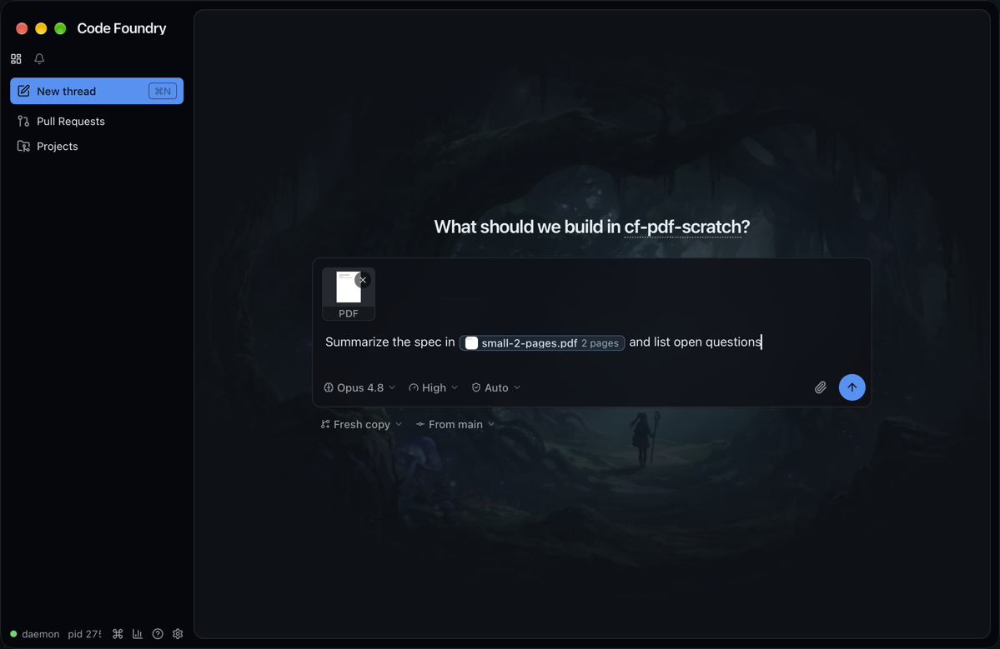
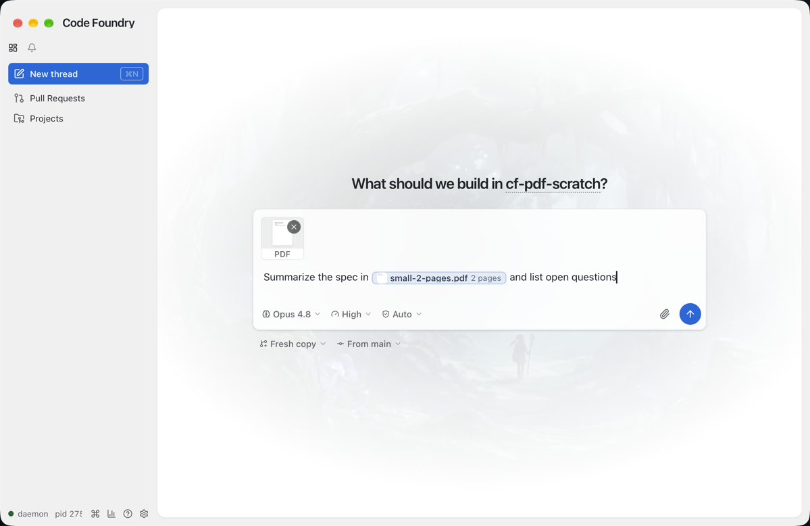
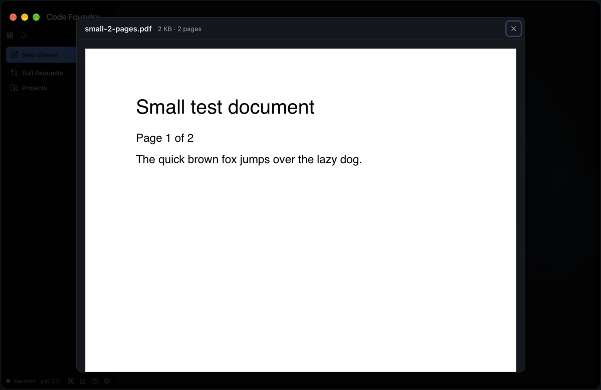
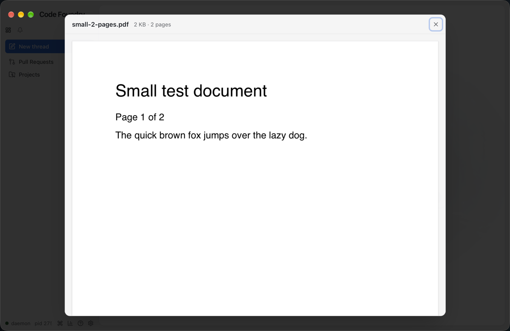
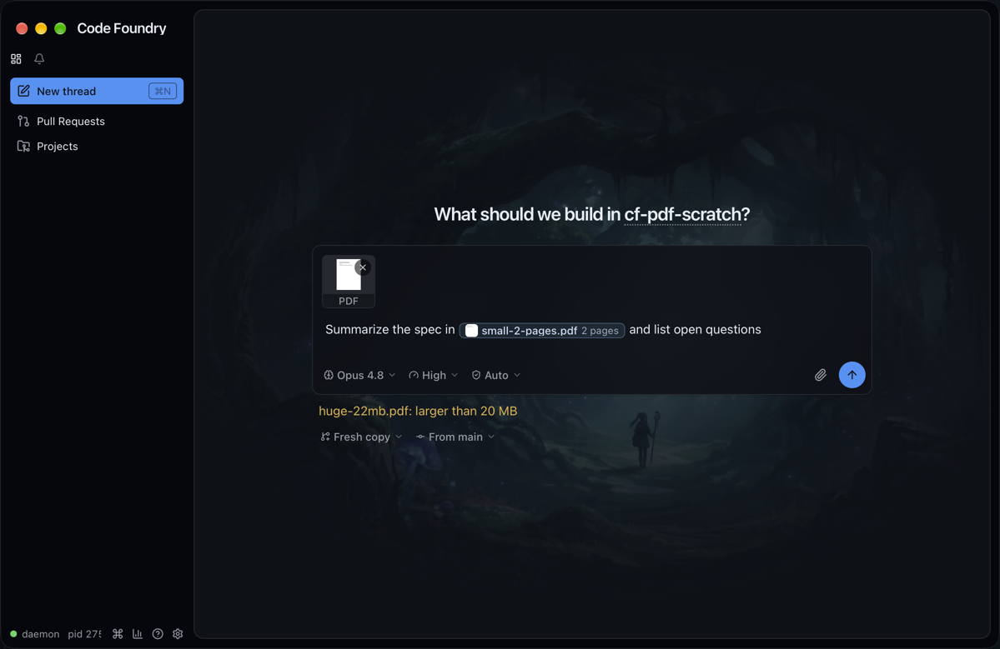
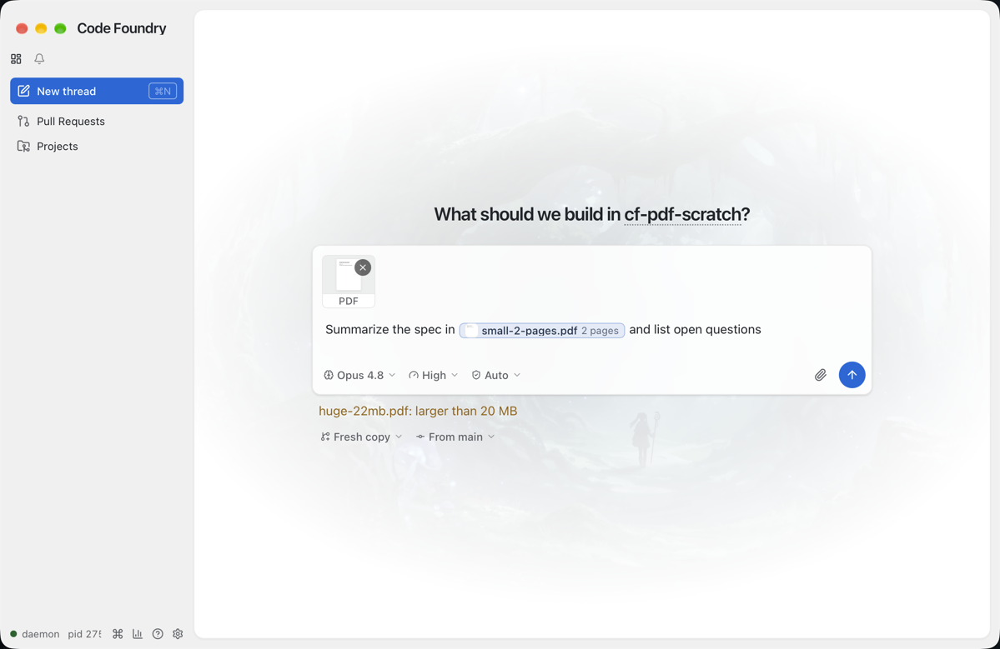
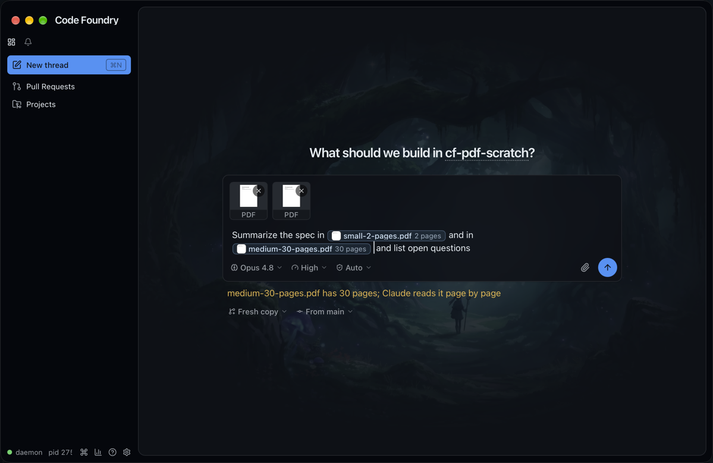
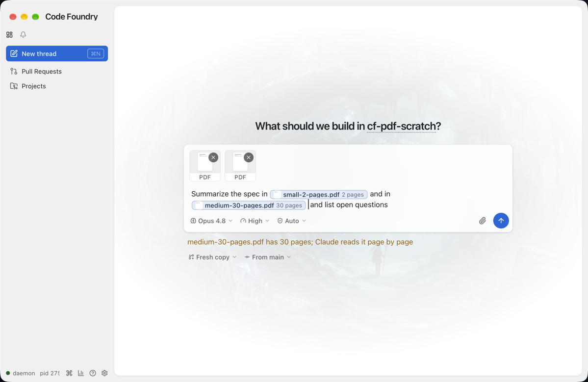

# PDF attachments 2: the composers

Both composers (new thread and a thread's follow-up) take PDFs by paste, drop and the
attach button, show them like images (a tile above the prompt, a chip in the text, a
lightbox), and say what the daemon will do with them (docs/notes/pdf-attachments-1-daemon.md).

## Decisions

- **pdf.js, lazily.** `pdfjs-dist` 5.7.284 (the latest 5.x). `src/lib/pdf.ts` is the one
  module that touches it: `loadPdf(blob | ArrayBuffer) → { pages, pageSize(n),
  renderPage(n, width, { canvas?, pixelRatio? }), destroy }` and `pdfSummary(file, 128) →
  { pages, thumb }`. pdf.js itself is `import("pdfjs-dist")` on the first call, so it is a
  chunk of its own (`assets/pdf-*.js`, 410 kB, 122 kB gzip) that loads only when a PDF is
  attached or previewed. The worker is `pdfjs-dist/build/pdf.worker.min.mjs?url`, Vite's
  documented way to get a dependency's file as an emitted asset (a bare specifier inside
  `new URL(…, import.meta.url)` is not resolved by Vite); it is set as
  `GlobalWorkerOptions.workerSrc` when the chunk loads. The `?url` import in pdf.ts is only
  a string, so the main bundle carries no pdf.js code.
- **Fonts from the system.** `useSystemFonts: true`; pdf.js's standard font data and CMaps
  are not bundled (they are ~100 files). A PDF that names Helvetica without embedding it
  draws with the system's Helvetica; one with non-embedded CJK fonts may draw poorly. Only
  the preview is affected; Claude gets the file.
- **`kind` on DraftAttachment.** `kind: "image" | "pdf"`, `pages: number | null` (null while
  counting, or when pdf.js cannot read the file) and `thumb: string | null` (the first page
  as a PNG data URL 128px wide, rendered once per attachment, nothing to revoke). `url`
  stays the object URL of the file itself, which the preview reads. A file with no type and
  a `.pdf` name (some drags) is retyped as `application/pdf` on the way in.
- **Token unchanged.** A PDF chip is the same `` token as an
  image; the chip and the tile render by the attachment's kind. `projectPrompt`'s lookup
  returns the kind and a PDF projects to `[PDF: <name>; ref=<path>]`; a chip whose
  attachment is gone guesses from a `.pdf` name (`kindFromName`). In a sent message,
  `parseUserMessage` makes a chip a `pdf` piece when its staged path ends in `.pdf` (the
  daemon names staged files by their sniffed type), else by the chip's name. The thread
  bubble shows a plain PDF chip (icon and name) until PR 3 gives it a preview; a PDF the
  text does not refer to is a `FileText` tile with a "PDF" caption in the "Attached files"
  list above the bubble, never an `` of the PDF.
- **The page count goes to the daemon.** `stageAttachment(file, pages)` sends pdf.js's
  count as `StageAttachmentRequest.pages` (0 while still counting or when pdf.js could not
  read it). The daemon takes it when it has no pdfinfo and keeps the settled count in the
  staged path (`…-2p.pdf`), so the composer's "at most 10 pages" and inline cap and the
  daemon's agree. A PDF sent before pdf.js has counted it goes without a hint (the daemon
  counts or estimates).
- **Caps** (`lib/compose.ts checkAttachments`, values from `api/threads.ts`): images 10 MiB,
  PDFs 20 MiB, 10 files per message, and the inline cap: images plus PDFs of at most
  `MAX_INLINE_PDF_PAGES` (10) pages must total at most 24 MiB. The page count arrives
  async, so:
  - an image is checked against the cap when it is added, counting the images already
    there and the PDFs already counted at 10 pages or fewer;
  - a PDF is not checked when it is added (its pages are unknown). When its count arrives
    (`settlePdf`), a PDF of 10 pages or fewer that takes the message over the cap is removed
    again, chips and all, with "Attachments sent with one message must total under 24 MB;
    <name> not attached"; a longer one adds "<name> has N pages; Claude reads it page by page".
    So whichever counts last loses, which is almost always the PDF just added.
  - A PDF pdf.js cannot read never counts; the daemon still takes it and checks the cap
    itself on send. A count that lands while a send is under way, or after a failed send
    staged the PDF (the retry reuses its path), does not remove anything.
  - Notices join with " · ", as rejections did; the next add or send clears them.
  - "At most 10 images per thread" became "At most 10 attachments per message".
- **Tile.** The same 64px square: the first page `object-contain` on the muted background
  (a `FileText` icon until it renders) over a "PDF" strip in `text-caption-sm`. The strip is
  `bg-popover` with a top border rather than black-on-white, so it is a theme surface (the
  palette guard forbids `bg-black`/`text-white` outside its allowlist). The page (tile and
  chip) has a hairline `ring-border`: in light themes a white page on the muted ground
  otherwise all but disappears (seen in the first light screenshots). The aria-label says
  "Preview spec.pdf, PDF, 2 pages, 1 KB".
- **Chip.** First page (or `FileText`), middle-truncated name and "2 pages" (the size while
  counting); the size goes in the tooltip. The accent is `TAG_ACCENT.file`, not sampled.
- **Lightbox.** Same dialog chrome; the description reads "1 KB · 2 pages". For a PDF the
  dialog is `90vw` wide, at most `max-w-4xl` (56rem), and the body scrolls at
  `85vh` like the image cap. `PdfPages` opens the file, takes page 1's aspect ratio for
  every placeholder, and an IntersectionObserver per page (root: the scroll column, margin
  50% of it) draws a page once it comes near: one canvas per page, sized to the column's
  width × `devicePixelRatio` × the page zoom (`--cf-zoom`), at most 2x, so it is sharp at
  any zoom without a 3x backing store. A second observer per page (margin 300%: three
  scroller heights) releases a drawn page's canvas (sized 0×0) once it is that far away;
  the placeholder, in the page's own shape, comes back and the page is drawn again when it
  comes near, so a long PDF holds only the canvases around the view. A page whose shape
  differs from page 1 takes its own once drawn. The document is destroyed when the dialog
  closes, also when it closes before the PDF opened; `loadPdf` destroys pdf.js's loading
  task when the file does not open.
- **Labels.** Attach button: "Attach images or PDFs"; file input `accept` adds
  `application/pdf,.pdf`; "Attaching images…" is "Attaching files…".

## Gotchas

- `vi.mock("@/lib/pdf")` in `stores/compose.test.ts`: pdf.js does not run in jsdom (no
  canvas). `lib/pdf.test.ts` covers only the scale arithmetic; the e2e covers rendering
  in both engines (the tile's thumbnail `src` is a PNG data URL, each preview page reports
  `data-rendered`; at `deviceScaleFactor: 3` a 30-page preview draws at 2x and releases
  page 1 at the end, 0×0, and draws it again at the top).
- The mock's StageAttachment records the page hint (`GET /__mock/attachments` has `pages`)
  and names a staged PDF like the daemon (`att-1-2p.pdf`).
- Left for later: a file with no type and no `.pdf` name is still judged by its declared
  type; sniffing its first bytes would make `addAttachments` async.
- `e2e/fixtures.ts testPdf(pages, pad)` is the daemon's Go `testPDF` in TypeScript;
  `pad` grows the file with a comment, which is how the 21 MiB rejection test makes its file.
- `lib/pdf.ts` is imported statically everywhere (the store, `PdfPages`); the lazy boundary
  is the `import("pdfjs-dist")` inside it, so there is one split point.

## Verified in the app

Built with `make gui-build` and run isolated (`CODE_FOUNDRY_HOME=/tmp/cf-pdf-shots`), a
scratch repo under `~/cf-pdf-scratch` (deleted afterwards). PDFs copied in Finder
(`set the clipboard to POSIX file …`) and pasted with ⌘V arrive in WKWebView as
`clipboardData.files` with type `application/pdf`; pdf.js counts and draws them in the
Wails webview (the worker loads from the app's own asset server). Appearance was switched
through the isolated daemon's `appearance.theme` and set back to `system` before quitting.

| | Dark | Light |
|---|---|---|
| A 2-page PDF: tile and inline chip |  |  |
| Its preview (Space on the selected chip) |  |  |
| A 22 MB PDF rejected |  |  |
| A 30-page PDF: read page by page |  |  |

The PNGs are scaled to 1x (the window in points) to keep the PR small.
