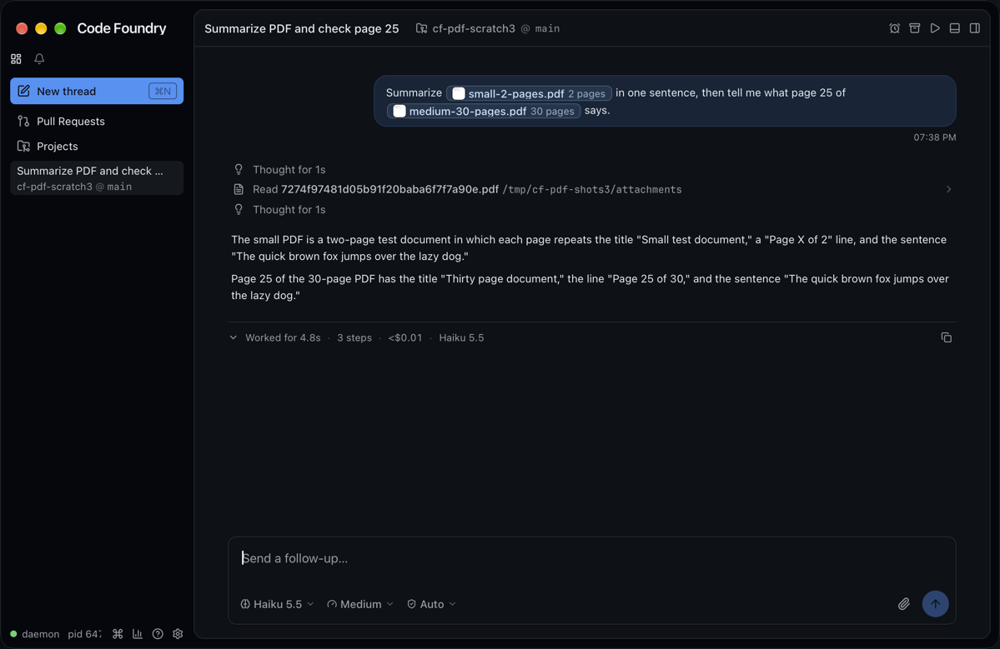
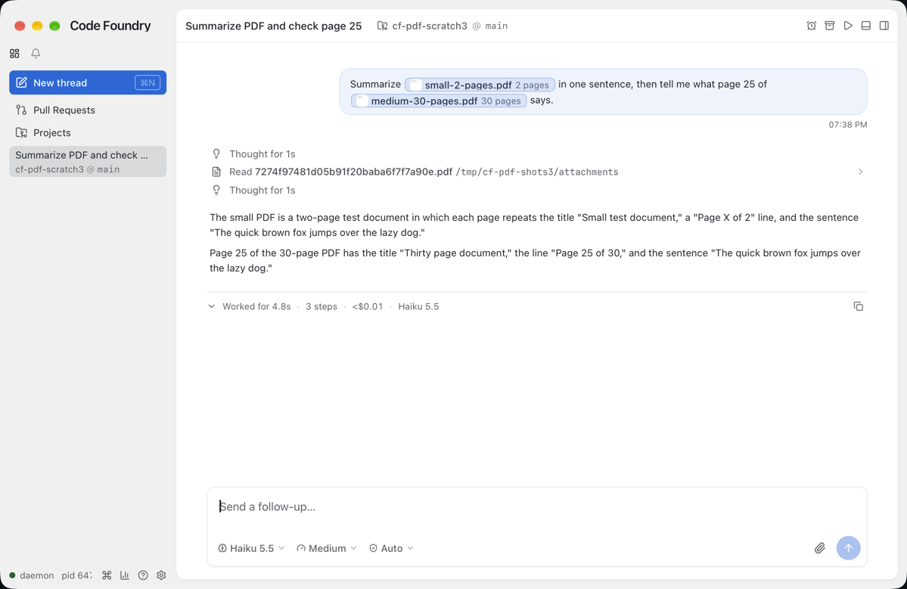
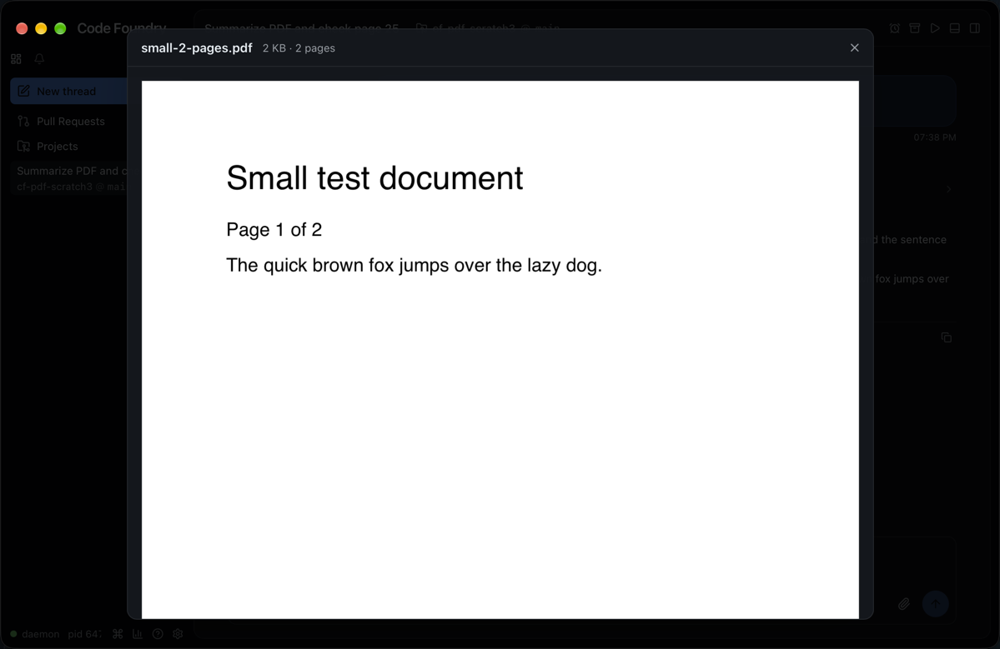
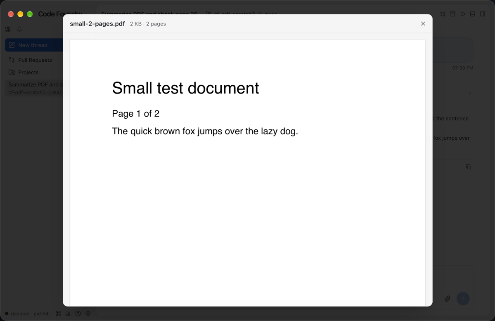

# PDF attachments 3: the thread

A sent message that carried a PDF shows it in the thread's user bubble the way the
composer did (docs/notes/pdf-attachments-2-composer.md): an inline chip with its first
page and page count, an unreferenced one as a tile above the bubble, and the same paged
lightbox from either.

## Decisions

- **One chip for both kinds.** `UserBubble`'s `ImageChip` and the PR 2 placeholder
  `PdfChip` became one `AttachmentChip` (a button, `data-tag-kind` "image" or "pdf"). A
  PDF chip has the file tags' accent (`TAG_ACCENT.file`, as in the composer), its first
  page (a `FileText` icon until it renders), the middle-truncated name and "N pages"; the
  size is in the tooltip, as in the composer. `aria-label` "PDF spec.pdf, 2 pages" (just
  "PDF spec.pdf" while counting); images keep "Image a.png". A path the daemon no longer
  has is a dashed, disabled chip, as before.
- **Tiles.** `Thumbnail` picks the kind from the path's extension (the daemon names staged
  files by their sniffed type) and draws a PDF with the composer's `PdfTile` (first page
  over the "PDF" strip) in the same 64px square. Its label is the composer's:
  "Preview 1b.pdf, PDF, 2 pages, 2 KB" (an image tile now says its size too). The list's
  `aria-label` is always "Attached files".
- **Lightbox shared.** The dialog chrome (name, "size · N pages", ×, the image or the
  `PdfPages` stack, the `bg-black/80` scrim) moved out of the composer's
  `AttachmentPreview` into `components/compose/AttachmentLightbox.tsx`; the composer's
  `AttachmentPreview` and the bubble's `SentPreview` are thin wrappers over it. `testId`
  names the dialog and its parts: `attachment-preview(-name|-size|-close)` in the
  composer (unchanged), `thread-attachment-preview(…)` in the thread (was
  `thread-image-preview`, no test used it). The thread's image lightbox thereby gained
  the size line and the Close tooltip.
- **Faces shared.** `PdfTile` (from `Composer.tsx`) and the chip's icon + name + detail
  (`ChipFace`, from `AttachmentChip.tsx`) live in `components/compose/attachmentFaces.tsx`;
  the tile label is `lib/compose.ts previewLabel`. Nothing in pdf.js rendering was
  duplicated: the thumbnail is `lib/pdf.ts pdfSummary(blob, 128)` and the preview is
  `PdfPages`, both unchanged.
- **The store.** `stores/attachmentImages.ts` became `stores/attachments.ts` (three
  importers): it keeps the blob as well as its object URL (`useAttachment` → `{ url,
  file }`; `useAttachmentUrl` stays for markdown images), and a second per-path cache
  holds a PDF's `{ pages, thumb }` (`usePdfSummary`, computed once with `pdfSummary`). The
  blob's type is the daemon's `mimeType`, or `application/pdf` for a `.pdf` path when the
  daemon sent none, so pdf.js and the viewer always get a PDF. A summary of a PDF pdf.js
  cannot read is remembered as null (no pages, icon face); a summary whose fetch failed
  (daemon restarting) is asked again, like the file.
- **Page count from the staged name.** The daemon settles a PDF's count when it is staged
  and keeps it in the name (`<hex>-2p.pdf`, docs/notes/pdf-attachments-1-daemon.md).
  `lib/prompt.ts stagedPdfPages(path)` reads it back, and the chip, tile and lightbox show
  that count, falling back to pdf.js's (`usePdfSummary`) for a name without one. An
  estimate (`-~10p.pdf`) is not shown as a count: the thread asks pdf.js, as for a name
  staged before the daemon wrote counts. So the count is there before pdf.js has opened
  the file, and a PDF pdf.js cannot read still shows the daemon's count; the first-page
  thumbnail still comes only from pdf.js.
- **Replaces the composer layer's placeholder tile.** PR 2 left a minimal `PdfTile` in
  `UserBubble` (icon, "PDF", `data-attachment-kind`, `aria-label "PDF <name>"`) for
  unreferenced PDFs; the rebase dropped it for this `Thumbnail`, and `rows.test.tsx`
  checks `data-kind` and the name's `data-pages` instead.
- **Inline set.** `inlineImagePaths` already counted PDF pieces (PR 2); it is now
  `inlineAttachmentPaths`, so a referenced PDF shows only as its chip.
- `rows.tsx` only passes the item through; nothing else in the thread assumed images
  (markdown images are images by construction).

## Gotchas

- The mock's StageAttachment kept only sizes and the page hint; it now keeps a PDF's
  bytes too (`world.attachmentBytes`) and ReadAttachment serves them back as
  `application/pdf`. Staged images still read back as the scripted PNG. A mock PDF path
  carries the hint like the daemon's (`att-1-2p.pdf`, `-~1p` without one), so the e2e's
  counts come from the name and its thumbnails from pdf.js.
- `UserBubble.test.tsx` fakes `@/lib/pdf` (no canvas in jsdom) and stubs
  IntersectionObserver; its PDF reads back with an empty type to check the store's typing.
  The e2e (`thread.spec.ts`, both engines) creates a thread from the new-thread composer
  with one PDF attached into the empty prompt (a tile only) and one chip in the text, then
  checks the bubble's chip and tile thumbnails (PNG data URLs) and the preview's drawn
  canvases from either.

## Verified end to end

This run was before the rebase onto the thread rename and the stage-time page count
(`session new` is now `thread new`); the rebase changed no styles, so the screenshots
stand.

Built with `make build` + `make gui-build`, run isolated (`CODE_FOUNDRY_HOME=/tmp/cf-pdf-shots3`)
with a scratch repo `~/cf-pdf-scratch3` (deleted afterwards). Both fixtures were staged
over the socket (StageAttachment) and the thread sent with `session new --model
'claude-haiku-5-5[1m]' --effort medium` and the composer text a GUI send carries
(`--composer-prompt` with `` tokens): "Summarize
small-2-pages.pdf in one sentence, then tell me what page 25 of medium-30-pages.pdf says."

- **small-2-pages.pdf** (2 pages) went inline as a document block; Claude summarized it
  without a tool call ("a two-page test document in which each page repeats the title
  'Small test document,' a 'Page X of 2' line, and the sentence 'The quick brown fox…'").
- **medium-30-pages.pdf** (30 pages) went as its path; Claude called
  `Read {"pages":"25"}` on it ("PDF pages extracted: 1 page(s)") and quoted "Thirty page
  document", "Page 25 of 30". 4.8 s, $0.0041.

The chips show "2 pages" and "30 pages" from pdf.js in the Wails webview; the preview
opens on the small PDF with its pages drawn. Appearance was switched through the isolated
daemon's `appearance.theme` and set back to `system` before quitting.

| | Dark | Light |
|---|---|---|
| The thread after the answer (turn unfolded: the Read of page 25) |  |  |
| The lightbox on the small PDF |  |  |

The PNGs are scaled to 1x (the window in points).
