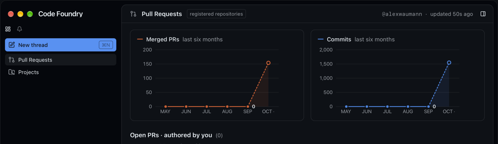
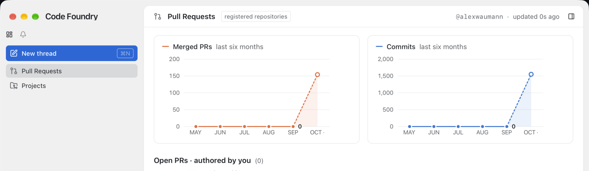

# Pull Requests page: six-month activity charts

Status: done on `cf/prs-activity-chart` (one PR). `make check` is green; `make gui-e2e`
for `e2e/prs.spec.ts` passes on WebKit and Chromium. Run end to end on 2026-10-17 with
the built GUI against an isolated daemon (`CODE_FOUNDRY_HOME=/tmp/cf-chart`, this
repository registered, real `gh`): the first poll filled six months and the page drew
them (screenshots below).

## What changed

* The two month tiles ("this month" / "last month", `tile-*` test ids) are gone. In
  their place, `components/prs/ActivityCharts.tsx` draws two cards side by side (Merged
  PRs left, Commits right), one inline-SVG line chart each, from
  `DashboardView.stats.months` (newest first; the chart reverses it, oldest left).
* Approved sketch: option `e` (cards, no shared heading, no legend; the series key and
  name are the card's title).
* Pure parts live in `components/prs/activity.ts`: `chartMonths` (order and partial),
  `labelledIndex`, `countScale`/`countStep`, `tooltipSide`, `axisLabel`, `tickLabel`.
* `useWidth` moved out of `UsageChart.tsx` into `lib/useWidth.ts` so both charts share it.
  `lib/usage.ts` gained `slotColorVars(slot)`: commits are slot 1 (blue), merged PRs
  slot 2 (orange), painted through the `--sw-l`/`--sw-d` pattern like the Usage chart.
  `modelColorVars` now calls it.

## Decisions

* **Partial month by label, not index.** A month is partial when its label is the local
  month of `now` (`useNow(60 s)`), not because it is `months[0]`. The daemon buckets in
  its own (this machine's) time zone, so local is right. After a rollover and before the
  next stats poll, `months[0]` is a closed month: nothing is drawn hollow or dashed then.
* **The value label goes on the newest closed month.** That is `months[1]` normally (the
  brief's "index 1"). When no month is partial (the rollover case) it is the newest one.
  With only the current month there is no label.
* **Whole-number ticks.** `niceStep` can give 2.5 (max 9, say), which makes no sense for
  counts. `countStep` is at least 1 and turns 2.5 into 2. The Usage chart keeps
  `niceStep` as is.
* **Linked hover lives in `ActivityCharts` state**, not a zustand store. `{index, card}`:
  both cards draw the band and dashed crosshair at `index`, and only `card` (the one the
  pointer is in) renders the tooltip. Local state also clears itself when the page
  unmounts. A store would keep a stale hover if the pointer left without a `mouseleave`
  (navigating away by keyboard). The two cards re-render on hover, which is cheap.
* **Hit areas.** One transparent rect per month slot, full height including the x axis
  labels, inside a `<g>` with `onMouseLeave`. Moving between months does not clear
  between rects. Moving between cards does: leave A, then enter B.
* **Tooltip placement.** The tooltip sits beside the crosshair, never under the pointer
  or the hovered marker: right of it for the first half of the months, left of it
  (`right: width - x + 14`) from `n/2` on, as in the sketch. Its top is fixed near the
  plot's top, not the pointer's y. It lists both series in the sketch order (commits,
  then merged prs), whichever card it is in. The header is `monthName`, plus " (so far)"
  for the partial month.
* **Narrow layout** uses a container query (`@container` + `@max-[760px]:grid-cols-1`),
  like the panel surfaces, not a ResizeObserver: it follows the content area beside the
  side panel, not the window.
* **Empty stats** (never fetched): both cards keep their frame with a zero gridline and
  "No stats yet". Fewer than six months draw what is there: 1 month is a lone marker, 2
  are one segment.
* **One PR.** The data and the mock already had six months (#156), so this is GUI only.
  The helpers, the component and the e2e rewrite only make sense together, and the tiles
  had to go in the same change: no leftover entry points.

## Gotchas

* Playwright's `toBeVisible` is false for the crosshair: a vertical SVG `<line>` has a
  zero-width box. The e2e counts it instead.
* The e2e spec's mock months are relative to the real `now`, so it hovers by slot index
  (`nth(3)` of six is two months back) and computes the expected label for `data-month`.
* Tooltip text in tests is concatenated without spaces (`"August210commits17merged
  prs"`): the row is three spans.
* Live data on Alex's account has every closed month at 0 (all of this repository's
  history is October), so the live screenshots show a flat line, then a dashed jump to
  the current month. The mock's August hover is in `e2e/prs.spec.ts` (`SHOTS=<dir>`
  saves `prs-activity-hover.png`).

## Tests

* `activity.test.ts`: month labels across a year boundary; ordering from newest-first for
  0–6 months; partial detection, including after a rollover; label index; scale and
  ticks (0, 1, 3, 9, 38, 40, 463, 1544, no fractional steps); tooltip side for n = 1, 2,
  3, 6; axis and tick labels.
* `ActivityCharts.test.tsx`: renders 0–6 months (markers, hit rects, empty state, value
  label count), the labels and the partial marker on six months, and the linked hover
  (two crosshairs, one tooltip, in the hovered card, "(so far)" for October).
* `e2e/prs.spec.ts`: the value labels (38, 463) and partial markers (2, 16), no tooltip at
  rest. Hovering August in Merged shows one tooltip there with 210 and 17, on the left,
  with the crosshair and band in Commits. Moving to June in Commits moves it, on the
  right. October says "(so far)". Leaving clears both.
* `e2e/live-prs.spec.ts` reads the current month's commits from the partial marker's
  `data-value` (not run; it needs a live daemon).

## Screenshots (live app, isolated daemon, real GitHub data)

