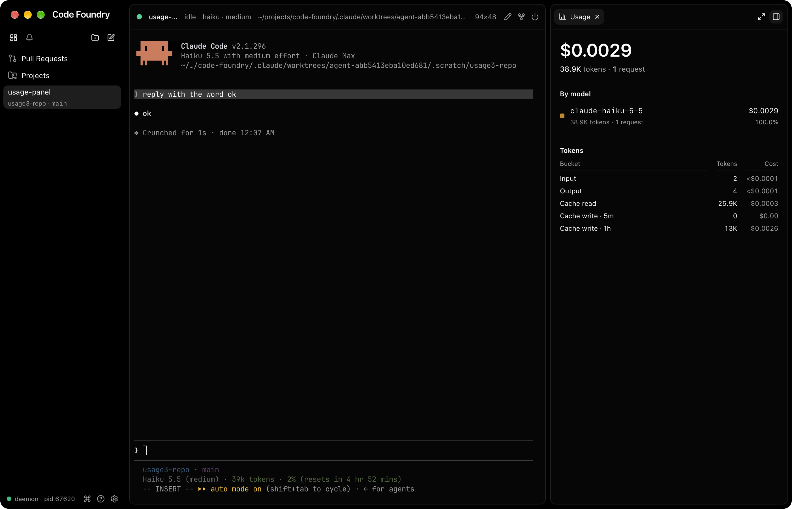
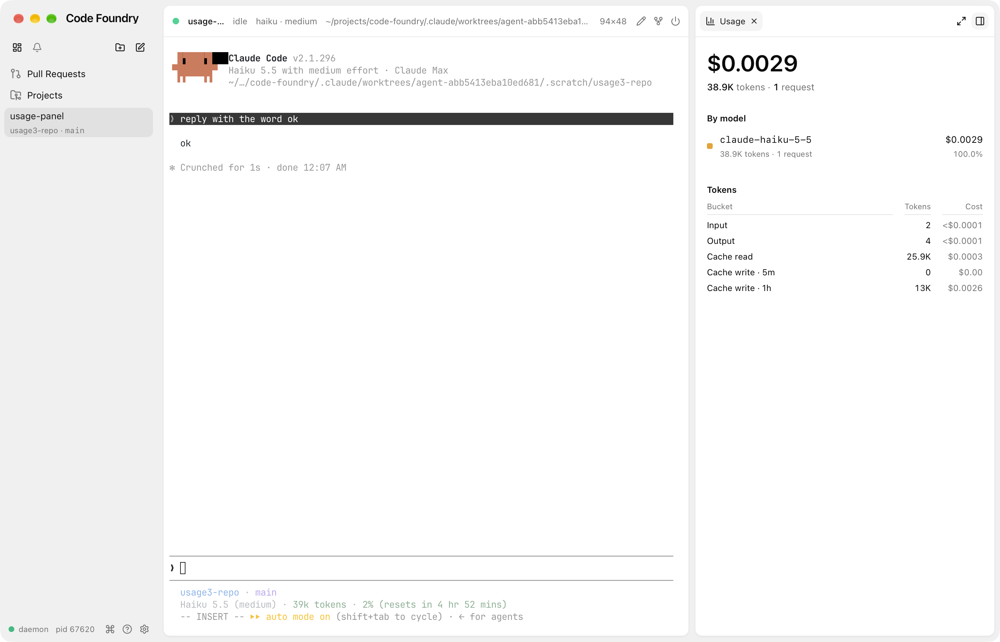

# Session usage, PR 1: daemon fold, pricing, storage, CLI

PR 1 of 4 of `docs/sketches/session-usage/DESIGN.md` (the spec). This PR covers the
daemon half: the fold over a thread's own transcript, its storage, the retired ledger,
pricing, the proto/API fields, the frontend view-model mapping (no UI), `code-foundry
usage`, and the `view.usage` command. Subagent runs (PR 2), the side panel surface (PR
3) and the Usage page (PR 4) follow.

## The invariant

A session's cached usage is only ever **replaced by a complete fold** of its transcript,
never incremented from a partial read. The fold is complete because it starts at byte
zero: either the tailer read the file from its start (a new thread, a fork), or the
prefix the tailer skipped on a resume was rescanned into a fresh fold
(`runner.backfill`), which then becomes the live fold. A crash between a transcript
write and the persist loses at most that window, and the next discovery (every
reconnect and restart goes through one) replaces it. The retired ledger receives a
session's buckets exactly once, in the transaction that deletes the session.

## What was built

* `internal/pricing`: `Rate`, `Lookup(model, tier, speed)`, `Bucket`, `Cost(Bucket)`.
  The DESIGN table verbatim (plus Mythos ids on Fable's rows). Fast mode is 2x on
  opus-5-5, opus-5 and opus-4-8 only; the Haiku 5.5 `long` tier has its own row. An
  unknown model, a tier the model lacks, or `fast` on a model without fast mode are all
  unpriced (`ok=false`), never $0 and never guessed.
* `internal/store/session/usage.go`: `UsageBucket`, `usageFold` (`Line`, `Buckets`),
  `SumUsage`, `Manager.setUsage`. `usage_db.go`: `saveUsage` (delete + insert in one
  tx), `loadUsage`, `loadRetiredUsage`, `retireSession` (upsert-add into
  `usage_retired` + `DELETE FROM sessions`, one tx; `session_usage` cascades).
* Migration `0012_session_usage.sql`: `session_usage` and `usage_retired` exactly as in
  DESIGN (STRICT, the primary keys as specified, cascade on the session).
* `Session.Usage` (copy on write, sorted Day, Model, Tier, Speed), `Snapshot.RetiredUsage`,
  and a `RetiredUsage{Buckets}` bus event published after `Removed` when the removed
  thread had usage.
* Runner: `pollTranscript` feeds every line to the fold; a batch that counted at least
  one new request calls `setUsage` (it compares, persists, publishes). `backfill`
  replaces `backfillLinks`: one pass over the skipped prefix feeds both the pr-link
  merge and a fresh fold. `scanLines` (transcript.go) is the shared line reader;
  `scanPRLinks` uses it now.
* Proto: `UsageBucket` (with per-bucket `cost_usd` and `unpriced`), `Session.usage`,
  `Session.cost_usd`, `Session.unpriced`, `SessionSnapshot.retired_usage`,
  `ListSessionsResponse.retired_usage`, and `SessionEvent.retired_usage`
  (`RetiredUsage`). Priced in `internal/api/session_usage.go`.
* Frontend `src/api/session.ts`: `UsageBucketView`, `SessionView.usage/costUsd/unpriced`,
  the snapshot's `retiredUsage` and a `retiredUsage` event kind. `stores/sessions.ts`
  keeps `retiredUsage` on the store and compares usage by content in `sameSession` (every
  Updated carries new arrays; without it every session update would re-render rows).
* Commands: `usage.show` (CLI: `code-foundry usage [--thread <id>] [--json]`) and
  `view.usage` (ShowView `"usage"`, title "Usage", no chord, next to `view.dashboard`).

## Decisions and deviations from the design

* **Forks: skip the parent's copied records by time.** The design said a fork's fold is
  "right by construction". It is not: `claude --resume <parent> --fork-session` starts
  the fork's file with a copy of the parent's assistant records, usage included, so the
  fork would bill the parent's requests again and the all-threads total would count them
  twice. Seen live (below): the fork showed 2 requests where it had made 1. The copies
  cannot be told apart by id: Claude Code 2.1.296 rewrites `sessionId` on them to the
  fork's id, and `session_id` (another field on each record) is the parent's on the copies
  but, in a 2.1.295 transcript here, also the parent's on the fork's own new requests.
  They do keep their original `timestamp`, which is before the fork was created. So the
  fold has `notBefore`; `spawn` sets it to `CreatedAt` for any thread with a `ParentID`,
  and the rescan fold inherits it. A record without a parsable timestamp is still
  counted (in the `unknown` day).
* **`pricing.Cost` takes `pricing.Bucket`, not `session.UsageBucket`.** The design both
  says the package has no store imports and gives `Cost(session.UsageBucket)`. Kept the
  first; the API layer converts.
* **Prefix match is restricted to snapshot suffixes.** After an exact lookup fails, the
  longest table id that prefixes the model matches only if what follows is a date stamp
  (`-20251001`) or a `[`/`@` suffix. A bare longest-prefix would price a future
  `claude-opus-5-6` as `claude-opus-5`; it is unpriced instead.
* **Per-bucket `cost_usd` / `unpriced` on the wire** (the design had them per session
  only), so PRs 3 and 4 can sum per model and per day without a TypeScript copy of the
  rate table.
* **Retired ledger on the wire**: `SessionSnapshot.retired_usage` and
  `ListSessionsResponse.retired_usage`, plus a `SessionEvent.retired_usage` case after a
  removal (`removed_id` is a bare string, so it cannot carry the ledger).
* **`code-foundry usage` is `usage.show`.** Command names need two segments, so the CLI's
  `resolveCommand` gained one generic rule: when no prefix of the words names a
  command, a prefix naming a domain with a `show` command runs it (`usage` →
  `usage.show`; exact names always win). `usage.show` is CLI-only (`When: ActiveView ==
  ""`, the existing CLI-context test): the palette has `view.usage`, and two "usage"
  entries, one of them a table in a toast, would be noise. Its table: model, requests,
  tokens (all five buckets), cost, share of priced cost; "—" for an unpriced row; then
  the five bucket totals in full. Costs under a cent print four decimals.
* **Unknown day** is the string `"unknown"` (the design's comment allowed `""` or
  "unknown").
* `usageFold.Line` keeps the design's signature; a `requests` counter tells the runner
  whether a batch counted anything.

## Gotchas

* **`/clear`** (fixed in PR 2, below) moves Claude to a new transcript file. Live, the fold carries on across
  the switch. But a later resume rescans only the current file, so usage from before a
  `/clear` is dropped at the next reconnect or restart. Fixing that needs the list of
  transcript files a thread has used, which is not tracked yet; PR 2's per-file folds
  are the natural place.
* **A resume that opens the file mid-line** would lose that one record: the rescan reads
  exactly the skipped prefix (its trailing partial line fails to parse) and the tailer
  starts mid-line. Claude appends whole lines, and on a resume the file exists before
  the process writes, so this has not been seen. `backfillLinks` had the same edge.
* **The tailer resets to byte 0 on truncation** without telling the runner; the fold
  would then double-count. Claude never truncates a transcript.
* Streaming repeats are always consecutive: across all 257 transcripts here, 0
  non-consecutive repeats, so "same as the previous record" is enough.
* The scratch repo for live checks must be under `$HOME`: project paths are home-only
  (`fsx.HomeRoot`), so a repo in `/tmp` cannot be registered. The daemon home can be
  anywhere (`CODE_FOUNDRY_HOME=/tmp/...`).

## Verified

`make check` green (Go: gofmt, vet, staticcheck, all tests; frontend: typecheck, lint,
1082 vitest tests).

Tests: `pricing_test.go` (every table row, dated and suffixed ids, unknown and
newer-version ids, fast, long, unpriced combinations, `Cost`); `usage_test.go` (the
fold over captured lines from `testdata/usage.jsonl`, including a streaming-repeat pair,
a dated haiku id, haiku 5.5, sonnet and a `<synthetic>` record, plus hand-written edge
rows; rescan-plus-live equals the whole fold at every cut; live usage published once per
request and persisted across a restart; a stale persisted value replaced by the rescan on
reconnect; a fork counting only its own requests, live and after its own rescan; Remove
retiring into the ledger, the event, and the ledger surviving a restart; save/load);
`api/session_usage_test.go`; `commands_usage*_test.go`; `TestResolveCommand` rows.

End to end, daemon in `CODE_FOUNDRY_HOME=/tmp/cf-usage1-home`, scratch repo in an
uncommitted `.scratch/usage-repo` inside the worktree (home-only rule above):

```
$ code-foundry repo add <worktree>/.scratch/usage-repo
registered usage-repo (8ac290c892b2)
$ code-foundry session new --worktree <repo> --model haiku --effort medium --name usage-e2e \
    --prompt "Reply with the word ok and nothing else. Do not use any tools."
created thread usage-e2e (s-2083edd6e9ed) in <repo>
$ code-foundry usage --thread s-2083edd6e9ed
Thread s-2083edd6e9ed (usage-e2e): 1 requests · 38.9K tokens · $0.0029

MODEL             REQUESTS  TOKENS  COST     SHARE
claude-haiku-5-5  1         38.9K   $0.0029  100%
TOTAL             1         38.9K   $0.0029  100%

Input 2 · Output 4 · Cache read 25,896 · Cache write 5m 0 · Cache write 1h 13,021
```

(Before the singular fix, hence "1 requests".) By hand: (2×0.10 + 4×0.50 + 25,896×0.01 +
13,021×0.20) / 1e6 = $0.00287; `--json` says `0.00286536`. `grep -o
'"requestId":"[^"]*"' <transcript> | sort -u | wc -l` = 1.

* `daemon restart --yes`, new daemon: `usage --thread … --json` byte-identical to before
  (`cmp`: `IDENTICAL-after-restart`; loaded from `session_usage`).
* `session reconnect` (resume, so discovery skips the history and `backfill` rescans):
  byte-identical again (`IDENTICAL-after-rescan`).
* `session fork`, then one prompt typed through `TerminalService.Write`: with the
  first version of the fork filter (by `sessionId`) the fork showed `2 requests · 80K
  tokens · $0.0052`, the parent's request included. With the time cutoff, after a restart
  (the stale 2 persisted) and a reconnect: `1 request · 41.1K tokens · $0.0023`, cache read
  31,065 = the fork's own `req_011CfupgqccP…`. The stale value was replaced, not added to.
* All threads before removal: `All threads (2): 2 requests · 80K tokens · $0.0052`.
  `session remove` both, then `usage`: `All threads (0 + removed): 2 requests · 80K tokens
  · $0.0052`, same table and bucket line. SQLite: `session_usage` 0 rows, `usage_retired`
  `claude-haiku-5-5|||2026-10-11|2|4|8|56961|0|23040`. After another restart, `usage
  --json` byte-identical (`RETIRED-IDENTICAL-after-restart`).

Large transcripts, the real fold (`scanLines` + `usageFold`) against grep:

| transcript | size | `grep … requestId … \| sort -u \| wc -l` | fold Requests | rescan |
|---|---|---|---|---|
| `bda8bcf8-….jsonl` | 17.8 MB | 70 | 70 | 27 ms |
| `a0f2c402-….jsonl` | 16.7 MB | 83 | 83 | 22 ms |

A GUI built from this branch needs a daemon from this branch for the new fields (an older
daemon simply sends none: empty usage, cost 0). Restart the daemon after installing.

# Panel surface (PR 3)

The side panel's **Usage** surface for one thread, per DESIGN.md's session view and
`session.png`.




## What was built

* `surfaces/usage.ts` + `usageTarget.ts`: kind `usage`, title "Usage", lucide
  `ChartColumn`, hotkey **U** (free; the others are f, d, p, l, w, t). Enabled for a
  thread or a thread's terminal (`selectionThread` from `linkedprsTarget.ts`, i.e.
  `deriveContext`), even one without usage; hidden otherwise. One tab per panel, no
  params, follows the selection's thread. Listed after Linked PRs.
* `view.panel.usage` (Go, `commands_view.go`): ShowView `"panel.usage"`, `When:
  hasSession` like `view.panel.linked-prs`, no chord. `stores/views.ts`
  `usagePanelCommand` → `stores/usagePanel.ts` `openUsageSurface`. Unlike Linked PRs
  there is no "nothing yet" toast: a thread without usage opens the surface, which says
  "No usage yet".
* `components/usage/UsageSurface.tsx`: hero cost (32px semibold), "<tokens> tokens · <n>
  requests" (no agent runs yet: PR 2 adds the count), "By model" rows (swatch, mono id,
  "<tokens> tokens · <n> requests"; cost with share of cost beneath), "Tokens" grid (Input,
  Output, Cache read, Cache write · 5m, Cache write · 1h; tokens, muted cost). A model with
  any unpriced bucket gets the "unpriced" tag; one with no priced bucket shows "—" for
  cost and share. Nothing priced at all: the hero and the kind costs are "—" too.
* `lib/usage.ts` (shared with PR 4): `TOKEN_KINDS` (labels and cost fields in display
  order), `totalUsage` and `usageByModel` (folds over `UsageBucketView[]`; per model:
  most expensive first, then tokens, then id), `modelSlot` / `SLOT_COLORS` /
  `modelColorVars` / `SWATCH_BG`, `fmtTok`, `fmtUsd`, `fmtShare`, `fmtRequests`.
* Mock: `mock/usage.ts` seeds s-1 with Opus 5.5 (two days) and Fable 5.1 buckets priced
  from copies of the `internal/pricing` rows; `POST /__mock/usage?session=…&model=…&…` adds
  counters to a (model, day) bucket; `view.panel.usage` in the mock registry.

## Decisions and deviations

* **Per-kind cost on the wire.** The Tokens table has a cost per token kind; the wire
  had one cost per bucket, and PR 1 deliberately kept the rate table out of TypeScript.
  So `pricing.CostByKind` (with `Cost` now its `Total`) and five `UsageBucket` fields,
  `input_cost_usd`, `output_cost_usd`, `cache_read_cost_usd`, `cache_write_5m_cost_usd`,
  `cache_write_1h_cost_usd` (all 0 when unpriced), mapped flat onto `UsageBucketView` so
  `sameUsage`'s field compare still covers them. PR 4's cache-savings figure can use them
  too (savings needs the input rate, which `inputCostUsd / input` gives for a priced
  bucket with input tokens).
* **Token order** follows DESIGN's Labels (Input, Output, Cache read, Cache write 5m / 1h),
  not `session.png` (which put Output last).
* **`fmtTok`** is the mockup's rule, not the CLI's: whole numbers from 100 of a unit
  (980K, 261M, not 980.4K / 261.2M), one decimal below (two for B), trailing zeros
  trimmed (1.5M, not the mockup's 1.50M). `fmtUsd` matches the CLI's four decimals under
  a cent, plus "<$0.0001" for slivers (a haiku "ok" bills 2 input tokens:
  $0.0000002 would otherwise read "$0.0000").
* **Swatch colours without a stylesheet entry.** `modelColorVars` puts the slot's light
  and dark colours on the element as `--sw-l` / `--sw-d`; `SWATCH_BG` is `bg-(--sw-l)
  dark:bg-(--sw-d)` (SVG: `fill-(--sw-l) dark:fill-(--sw-d)`). One table in
  `lib/usage.ts`, no `index.css` edit. Snapshot ids (`claude-haiku-5-5-20261001`,
  `…[1m]`) take their family's slot; anything else is slot 5 (grey).
* **Narrow selector.** Every session Updated carries a new `usage` array, so the
  surface keeps the previous array while `sameUsage` says it is unchanged: a status flip
  does not re-render it.

## Verified

`make check` green (Go incl. `TestCostByKind`, the per-kind assertions in
`TestUsageToProto`, `view.panel.usage` in `TestViewCommandsEmitShowView` and the shared
thread-surface availability table; frontend typecheck, lint, 1241 vitest tests incl.
`lib/usage.test.ts`, `surfaces/usageTarget.test.ts`, `surfaces/usage.test.tsx`).
`make gui-e2e` green incl. `e2e/usage.spec.ts` (U from the empty panel, the numbers of
the seeded thread, "No usage yet" then live buckets, unpriced, the palette, ShowView, a
plain terminal not listing it). `SHOTS=<dir>` saves `usage-panel(-light).png` and
`usage-empty(-light).png` from the mock.

**Live screenshots** (`session-usage/panel-dark.png`, `panel-light.png`): `make
gui-build`; daemon `CODE_FOUNDRY_HOME=/tmp/cf-usage3-home bin/code-foundry daemon --dev`;
a scratch git repo under the worktree (`.scratch/usage3-repo`, deleted afterwards),
`repo add`, `session new --model haiku --effort medium --prompt "reply with the word ok"`
(1 request, 38.9K tokens, $0.0029, same as `code-foundry usage --thread`); `code-foundry
gui` with the same home; `session focus --id <thread>` then `view.panel.usage
--context-session <thread>`; `settings set appearance.theme dark|light` between shots.
Window capture gotcha: with another session's "Code Foundry" running, System Events'
`window 1 of (process whose unix id is N)` resolved to the *other* app (same name), and
Accessibility exposed no windows for ours at all, so it could not be resized. The
1400x900 shots came from a throwaway build with `gui/main.go`'s default window set to
1400x900 (reverted, rebuilt), captured by CGWindowID (`CGWindowListCopyWindowInfo` filtered
by owner pid, then `screencapture -o -l <id>`), which ignores overlapping windows.

# Session usage, PR 2: subagent runs, every transcript, cache savings

PR 2 of 4. A thread's usage is now the sum of its **sources**: every transcript file the
thread has used (`/clear` moves Claude to a new one) and every subagent run under them.
Each source has its own `usageFold` (its own streaming-repeat state). Also: the runs on
the wire for PR 3's panel, and a per-bucket `cache_savings_usd` (scope addition).

## The invariant, restated

Each source's counters are only ever replaced by a complete fold of that source, and the
thread's total is always the sum of its sources' current values. A runner's folds are
complete because each file is either read from byte zero live (a new thread, a fork, a
file after `/clear`, a run opened at its spawn) or rescanned from byte zero on the
runner's first discovery. Nothing is ever added to a cached value from a partial read;
a rescan that hits a read error (other than a missing file) publishes nothing
(`usageOff`), as in PR 1.

## What was built

* `usage_runs.go`: `AgentRun`, the lifecycle parser `parseRunEvents` (byte prefilters,
  then a small decode), `fileTail` (lazy-open follower sharing `readAppended` with the
  tailer), and `threadUsage`, which holds the file folds, the run folds, pending spawns,
  and the dirty sources. `Session.Transcripts` (claude session ids, oldest first) and
  `Session.AgentRuns` (by start time).
* Migration `0013_session_usage_sources.sql`: `session_transcripts`,
  `session_agent_runs`, `session_source_usage` (source `t:<cid>` or `a:<agent id>`, same
  bucket columns as `session_usage`). It seeds every existing thread's current
  transcript as its first source, with its `session_usage` rows as that source's fold.
  `session_usage` stays the thread's total (what PR 1 loads, ships and retires). All
  three cascade on the session.
* Runner: `pollTranscript` feeds the thread's lines to the current file's fold and the
  lifecycle, then `threadUsage.poll` (match pending spawns to meta files, drain open
  runs), then `publishUsage` (once per poll with a change). `rescan` replaces
  `backfill`: on the runner's first discovery, when there is anything before (skipped
  history, earlier transcripts, saved runs), it folds every transcript in
  `Session.Transcripts` (the current one up to the skipped offset; the tailer reads on),
  then every `agent-*.jsonl` under them, into a fresh `threadUsage` that becomes the
  live one. `discoverTranscript` records each new id. `onTick` runs the safety net.
  Subagent directories of open runs are added to the tailer's fsnotify watcher.
* `setUsage(id, usageUpdate)` writes the total, the dirty sources and the changed runs in
  one transaction, and publishes when the total or the runs changed.
* Proto: `AgentRun` (id, description, agent_type, model, effort, background,
  `AgentRunStatus` OPEN / CLOSED, spawn_depth, started_at, its own priced usage),
  `Session.agent_runs = 30`, `UsageBucket.cache_savings_usd = 18` (13 to 17 are PR #43's
  per-kind costs). `pricing.CacheSavings(b)` = cache read × (input rate − cache read
  rate), 0 when unpriced; priced per bucket in `internal/api`.
* Frontend `src/api/session.ts`: `AgentRunView` (status `"open" | "closed"`),
  `SessionView.agentRuns`, `UsageBucketView.cacheSavingsUsd`; `stores/sessions.ts`
  compares runs by content (`sameAgentRuns`). The count of runs is
  `agentRuns.length`: a selector on it returns a number, so it is cheap; no separate
  count field.
* `code-foundry usage`: a `Cache savings` line under the bucket totals; with `--thread`,
  a table of agent runs (status, description, type, model, requests, tokens, cost) and
  `agent_runs` in `--json`.

## The lifecycle as built (checked against 27 `subagents/` directories here)

* **Start.** An `Agent` (or old `Task`) tool_use, in the thread's transcript or in a
  run's, is a pending spawn. While any is pending, each poll lists the directories of
  the pending spawns and opens the run whose meta `toolUseId` matches. The spawn's result
  carries `agentId`, so a run is also opened (or folded once) from its result if the
  meta was never matched.
* **Stop.** The spawn's `tool_result`: `async_launched` keeps it open (background), any
  other status closes it, including an interrupted call (no `agentId`, `is_error`,
  string `toolUseResult`: matched by tool use id). A background run closes on its
  `<task-notification>` (not a second `tool_result` as DESIGN assumed): the
  `queue-operation` `enqueue` record or the delivered `user` record, whichever comes
  first. Statuses seen: completed 1604, failed 230, killed 37, stopped 14; all close.
  Task ids that are not agents (background shells) have no file and are ignored.
* **Resume.** `SendMessage` to a finished run writes `toolUseResult.resumedAgentId`;
  the run is opened again from where its fold stopped. Not in DESIGN.
* **Nested runs are live**, through the same code: lines of run files go through the
  same lifecycle. 72 metas here are depth 2, 18 are depth 3.
* **Safety net**: 10 minutes without growth while the thread is at its prompt
  (`atPromptSince`), six times that for a background run (one runs on while the thread
  is idle, e.g. a long build). `Options.AgentIdleClose`.
* Run info: the meta file wins over the spawn's input and the result (so live and
  rescan agree whichever was met first); they only fill gaps. Claude rewrites a stopped
  run's meta as `{"agentType":…,"stoppedByUser":true}`: merged, never overwritten with
  "".

## Decisions and deviations

* **Event order by record time.** A rescan reads the thread's transcript before the run
  files. A nested background run's notification is enqueued in the *thread's*
  transcript, while its `async_launched` is in its parent run's file, so the rescan met
  the close first and the older launch reopened it: 36 and 28 phantom open runs in two
  real sessions. Each run now keeps the timestamp of the record that last opened or
  closed it and ignores older events. After the fix both rescan with 0 open runs.
* **Per-source persistence** (beyond "a small table" for the transcript list). Claude
  deletes transcripts after `cleanupPeriodDays` (30 by default). With only a list, a
  rescan after a deletion either shrinks the total or (to keep the invariant) never
  publishes again. With each source's last complete fold saved, a missing transcript or
  run keeps its counters and everything else is rescanned. Run usage had to be persisted
  anyway for `Session.agent_runs` of a disconnected thread.
* **`/clear` fixed.** The gotcha from PR 1 is gone: every transcript the thread used is
  rescanned. Threads from before this PR only know their current transcript (the
  migration's seed); pre-`/clear` files from before the upgrade are not recoverable.
* **Fork cutoff** applies to every fold and to lifecycle events: a fork's copied
  history names its parent's runs, whose files live under the parent's id, so without
  the cutoff they would be pending forever.
* **Rescan trigger**: the first discovery in a runner, when the tailer skipped history,
  the thread has other transcripts, or it has saved runs. A new thread or a fork has
  none and does not rescan.
* **Background safety net is 1 h**, not 10 min (above).

## Gotchas

* An `attachment`-like record holds the Agent tool's schema (`"name":"Agent"` plus a
  long description): it passes the spawn prefilter and is decoded once per file, then
  rejected (`type` is not `assistant`). Harmless.
* `make gen` needs `gui/frontend/dist` (`make gui-dist-stub`) in a fresh worktree for
  `go build ./...`.
* The tailer still resets to byte 0 on truncation; agent tails never do.

## Verified

`make check` green (Go: gofmt, vet, staticcheck, all tests; frontend: typecheck, lint,
1173 vitest tests). `go test -race ./internal/store/session/` green.

Tests (`usage_runs_test.go`, captured lines in `testdata/runs.jsonl`: a foreground and a
background spawn, completed, async_launched, both notification records, a SendMessage
resume, an interrupted Agent result, a run's usage record):

* `TestParseRunEvents`: every captured shape plus fork cutoff, other tools, a shell's
  notification, a quoted notification, dequeue, bad JSON.
* `TestRunLifecycle`: spawn waits for its meta then opens; completed closes after a
  final drain (later bytes not read); async_launched stays open and the notification
  closes it; SendMessage reopens and the queue-operation closes; interrupted result
  closes; a depth-2 run spawned from a run's file is followed and closed from that file;
  a result for an unseen run folds it once; a shell task id is ignored; safety net
  (foreground at 1×, background at 6×).
* `TestRunRescan`: a mix of closed, open background, in-flight foreground, nested
  in-flight, orphan and meta-less runs; then live from the rescan; a nested background
  run notified in the thread's file; and a second rescan agreeing run by run with the
  live state.
* `TestAgentRunsRollUpAndPersist` (Manager): live run open → closed, totals; identical
  after a restart; a stale cached value replaced by the reconnect's rescan.
* `TestClearRescansEveryTranscript` (Manager): `/clear` via the pid file, both files in
  `Transcripts`; restart and reconnect rescans both plus the run, replacing a stale
  value; after deleting the first file and its run, the saved folds stand in.
* `TestCacheSavings`, `TestAgentRunsToProto`, `TestRenderRuns`, frontend mapping and
  `sameAgentRuns` tests.

Real transcripts, the rescan code (`scanLines` + `threadUsage.settle`) against unique
`requestId`s over the parent and every `agent-*.jsonl` (python):

| session | runs (depth 2+) | ground truth | fold | open after rescan | rescan |
|---|---|---|---|---|---|
| `18e2b705…` (reckon) | 84 (45) | 3317 | 3317 | 0 | 1.1 s |
| `47622fac…` (reckon) | 76 (44) | 1906 | 1906 | 0 | 0.42 s |
| `c306a732…` | 20 (1) | 1436 | 1436 | 0 | 0.31 s |
| `3f281f4d…` | 18 (0) | 2376 | 2376 | 0 | 0.44 s |
| `3ea243ad…` (live orchestrator) | 4 | 576 | 576 | 2 (this PR's run and usage-4's, both running) | 0.13 s |

(`47622fac` has 76 runs for 75 transcripts: one stopped run has only its meta.)

End to end, daemon from this branch in `CODE_FOUNDRY_HOME=/tmp/cf-usage2-home`, scratch
repo in an uncommitted `.scratch/usage2-repo` inside the worktree (both deleted after):

```
$ code-foundry session new --worktree <repo> --model haiku --effort medium --name usage2-e2e \
    --prompt "Use the Agent tool with model haiku to have a subagent reply with the word ok, then say done"
created thread usage2-e2e (s-939038093df4) in <repo>
$ code-foundry usage --thread s-939038093df4
Thread s-939038093df4 (usage2-e2e): 4 requests · 151K tokens · $0.0080

MODEL             REQUESTS  TOKENS  COST     SHARE
claude-haiku-5-5  4         151K    $0.0080  100%
TOTAL             4         151K    $0.0080  100%

Input 10 · Output 361 · Cache read 106,212 · Cache write 5m 28,415 · Cache write 1h 16,019
Cache savings $0.0096

1 agent run (0 open), included above:

STATUS  RUN                         TYPE             MODEL  REQUESTS  TOKENS  COST
closed  Reply with ok (background)  general-purpose  haiku  1         28.4K   $0.0036
```

Claude ran the agent in the background: `async_launched`, then two notification records
(enqueue, delivered); the daemon closed it on the first. On disk: parent 3 unique
requestIds, `agent-a804aa7c20e2611b5.jsonl` 1, total 4. Cache savings by hand: 106,212 ×
(0.10 − 0.01) / 1e6 = $0.0096.

* `daemon restart --yes`, then `usage --thread … --json`: `IDENTICAL-after-restart`.
* `session reconnect` (resume; the runner's rescan): `IDENTICAL-after-rescan`.
* `/clear` then `reply ok`, typed through `TerminalService.Write` on the Unix socket
  (`curl --unix-socket …/daemon.sock …/codefoundry.v1.TerminalService/Write`, data
  base64). Log: `claude switched session id from 68e22def… to 42549202…`. Usage grew:
  `5 requests · 191.9K tokens · $0.01`, the run still listed.
* `daemon restart --yes`: `IDENTICAL-after-clear-restart`. Then `session reconnect`
  (respawn 00:22:34, discovery 00:22:35, a fresh rescan of both files):
  `IDENTICAL-after-clear-rescan`, still 5 requests (before this PR this rescan dropped
  to the current file's 1). SQLite: `session_transcripts` 68e22def…|0, 42549202…|1;
  `session_source_usage` `t:68e22def…` 3, `t:42549202…` 1, `a:a804aa7c20e2611b5` 1;
  `session_agent_runs` a804aa7c20e2611b5|Reply with ok|open 0.

A daemon restart is needed after installing: migration 0013 and the new fields come with
the daemon. An older GUI ignores `agent_runs` and `cache_savings_usd`.

# Usage page (PR 4)

Frontend only; no Go or proto changes. The page over every thread, `view.usage`, as in
DESIGN "Views" and the `?view=all` mockup.

## What was built

* **Views store** (`stores/views.ts`): `usageOpen` next to `settingsOpen`; the two are
  mutually exclusive. `showView("usage")` **toggles** (open if closed, `closeUsage()` if
  open), so the button, the palette and the CLI's `view.usage` all flip it. `closeUsage()`
  mirrors `closeSettings()` (refocuses the selection's terminal). A selection change and
  a top-level page (`showView("pullrequests")` etc.) close it like settings.
  `selectPageOpen` (settings or usage) replaces the bare `settingsOpen` checks: either page
  hides the side panel, and the panel commands are no-ops under it.
* **`view.usage` is presented window-locally** (`keys/bindings.ts`), like `view.settings`:
  the button needs no daemon round trip. The CLI still reaches the window through
  `UiIntent.ShowView "usage"`, which toggles too.
* **Sidebar status row**: a `ChartColumn` `CommandButton` (`status-usage`) right of the
  palette button, `aria-pressed` while the page shows, with the sidebar-accent background
  the toolbar's Dashboard button uses for its current state.
* **`components/usage/`**: `UsagePage` (header with "Code Foundry threads only", the range
  control and ×; hero total, 44px semibold, proportional figures; summary line; chart;
  by-model table; bucket strip), `UsageChart` (inline SVG), `Segmented`, and
  `usageData.ts` (the range filter, daily series, Other folding, axis helpers).
  `useEscapeCloses` moved from `SettingsPage` to `components/window/` and serves both pages.
* **`lib/usage.ts` is PR 3's, shared**: the page uses its `totalUsage`, `usageByModel`,
  `bucketTokens`, `fmtTok`, `fmtUsd`, `fmtShare`, `modelSlot`, `modelColorVars` and
  `SWATCH_BG`, so the panel surface and the page have one colour map and one set of
  formats. This branch first had its own `formatTokens` / `formatUsd` / `formatShare` /
  `modelColor` / `sumBuckets` / `byModel`; they were dropped in the merge with main (PR 3
  landed first). The only change to the shared file: `MODEL_SLOTS` is exported (the chart
  keys its series by a slot's model id).
* **ui store**: `usageRange` (1, 7, 30 or 90; default 30), persisted with the sidebar
  width and zoom. A persisted value outside the set falls back to 30. No version bump: an
  older state simply lacks the key.
* **Mock daemon** (`mock/usage.ts`, `pageUsage`, `retiredUsage`): s-3 and s-4 carry two
  weeks of buckets over four models with an empty day (s-1 keeps PR 3's `sampleUsage`, s-2
  stays empty for the panel's "No usage yet"); s-3 also has `claude-opus-5`, unpriced; the
  retired ledger has opus 20, 33 and 60 days ago and `claude-opus-4-8` (priced from
  `internal/pricing`, no colour slot: "Other") 12 days ago. `view.usage` is in the mock
  registry.
* **Test ids** are all `usage-page-*` (`usage-page-total`, `-summary`, `-chart`, `-day`,
  `-tooltip`, `-legend`, `-models`, `-model-row`, `-unpriced`, `-buckets`, `-range-<n>`,
  `-mode-<tokens|cost>`, `-close`, `-empty`): the panel surface uses `usage-empty`,
  `usage-summary`, `usage-models` and `usage-unpriced`.

## Decisions

* **Data**: one `useSessionsStore` subscription (`useShallow`) returns every thread's
  `usage` array plus `retiredUsage`; the page folds them with `useMemo` keyed on that,
  the range and today's UTC date. Buckets are kept by `day` against the range's UTC days
  (today inclusive). Day `"unknown"` buckets never show on the page (they have no slot);
  the CLI still counts them.
* **Thread count** is the live threads with a bucket in the range. Removed threads are in
  the total but not in the count: the retired ledger has no thread ids.
* **Colours** are the shared slot colours (opus-5-5 blue, fable-5-1 orange, sonnet-5-5
  aqua, haiku-5-5 yellow) as `--sw-l` / `--sw-d` vars, so swatches and SVG fills
  (`fill-(--sw-l) dark:fill-(--sw-d)`) follow the theme without a hook. `modelSlot` also
  matches dated and suffixed snapshots, so the chart stacks `claude-haiku-5-5-20261001`
  with its family's series; the table still lists the exact id. Every other id is grey:
  one "Other" series on the chart and legend, but its own row (grey swatch) in the table.
* **Table**: sorted by cost, then tokens. A model with any unpriced bucket gets the
  "unpriced" tag; when every bucket is unpriced (`allUnpriced`), cost and share are "—".
  Share is of the priced total.
* **Chart**: continuous day slots for the whole range (empty days are empty), y grid on a
  1/2/2.5/5 step (about four lines), bars at most 28px wide, a 2px gap between stacked
  segments, 4px radius on the top segment only. Segments too thin to show past the gap
  are left out of the drawing (the tooltip still lists them), so the rounded end always
  sits on a visible segment; without that, a sliver of haiku on top of a bar took the
  rounded corners as a 1px cap. Axis labels: about eight, from the oldest day, always
  today. The chart measures its width (ResizeObserver) rather than scaling a viewBox, so
  text stays 11px. The Tokens / Cost toggle is component state (not persisted).
* **Money and tokens** use the shared `fmtUsd` (four decimals under a cent, "$0.0047",
  like the CLI) and `fmtTok` (trailing zeros dropped: "85K", "28.4M").

## Cache savings

DESIGN puts "Cache savings" (Σ cache read × (input rate − cache read rate)) at the right
of the bucket strip. The GUI has no rate table, so the first version of this PR left it
out. PR 2 then put `UsageBucket.cache_savings_usd` on the wire (`pricing.CacheSavings`,
0 for unpriced buckets), and after merging it the strip ends with "Cache savings",
right-aligned (`ml-auto`): `usagePageData` sums `cacheSavingsUsd` over the range's
buckets, the retired ledger included, formatted with `fmtUsd`. It is the page's own sum,
not a `UsageTotals` field, so the panel surface's shared totals are unchanged.

## Gotchas

* `workspaces.spec.ts` (chromium) has a pre-existing keyboard race: `Meta+n` then
  `Meta+1`/`Meta+3` straight after `openApp`, or Enter before the composer has the base
  ref. On main (89232d3) it failed 3 of 40 runs with `--repeat-each=8`; unrelated to this
  PR. It also failed once in the full `make gui-e2e` here, while binaries were building.
* `layout.spec.ts:50` and `sidebar.spec.ts:455` (both browsers) fail on main since #40
  (sidebar gutter): the toolbar now sits 8px in (`toolbar.left` 8, the spec says 0) and
  New thread 0px from the toolbar's edge (the spec says 12). Checked against 4071bef
  alone; nothing here touches the toolbar.
* JSX whitespace: prettier reflowed the summary line's `· <b>` into `·<b>`; the line is
  now built from a list so the separators cannot be lost.

## Verified

`make check` green. Unit tests: `lib/usage.test.ts` (formats, colour slots, sums, model
sort), `components/usage/usageData.test.ts` (UTC days across month ends, range filter
including `unknown`, retired ledger, thread count, empty-day slots, Other folding, axis
step and labels), `UsagePage.test.tsx` (total and summary, unpriced row, bucket strip,
Other on chart and legend with ids in the table, 30/90/1-day switching and persistence,
"No usage in this range", Tokens/Cost with the tooltip, × and Escape), `views.test.ts`
(toggle, exclusivity with settings, top-level pages, `closeUsage`, selection change,
panel commands no-op). `e2e/usage-page.spec.ts` (WebKit and Chromium): button position
and `aria-pressed`, toggle, ×, Escape, selection, settings exclusivity, ShowView from the
CLI path toggling, range filter and reload persistence, Tokens/Cost and the tooltip, plus
`SHOTS=<dir>` screenshots.

Live screenshots, real Wails window at 1400x900: `make build && make gui-build`, daemon
in `CODE_FOUNDRY_HOME=/tmp/cf-usage4-home`, a scratch git repo under the worktree's
`.scratch/` (home-only paths), two haiku threads prompted "reply with the word ok"
(`code-foundry usage`: 2 requests · 75.8K tokens · $0.0047, Cache savings $0.0050; the page
shows the same). The GUI started with
`code-foundry gui` and the same home; the window raised, moved and sized by unix id
through System Events (it resolved to ours this time; see PR 3's gotcha above); the
status-row button clicked with a CGEvent mouse click (JXA; AppleScript's `click at` does
not reach the web view); `screencapture -R` of the window. Theme switched with `settings
set appearance.theme light`. Afterwards both threads removed (usage moved to the retired
ledger: `All threads (0 + removed): 2 requests · 75.8K tokens · $0.0047`, savings
$0.0050), daemon stopped, home and scratch repo deleted. The shots were retaken after
merging PR 3 (shared `fmtTok`: the axis reads "80K", not "80.0K"; main's sidebar gutter)
and again after PR 2 (Cache savings in the strip). Before the merges, a second click on
the button closed the page live.

* `session-usage/page-dark.png`: tokens, dark.
* `session-usage/page-cost.png`: cost, dark, hovering today's bar.
* `session-usage/page-light.png`: tokens, light.
