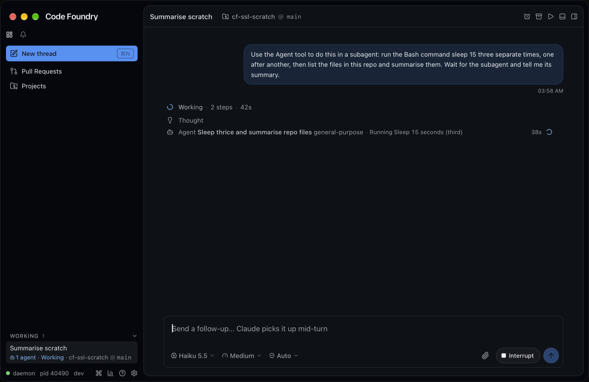
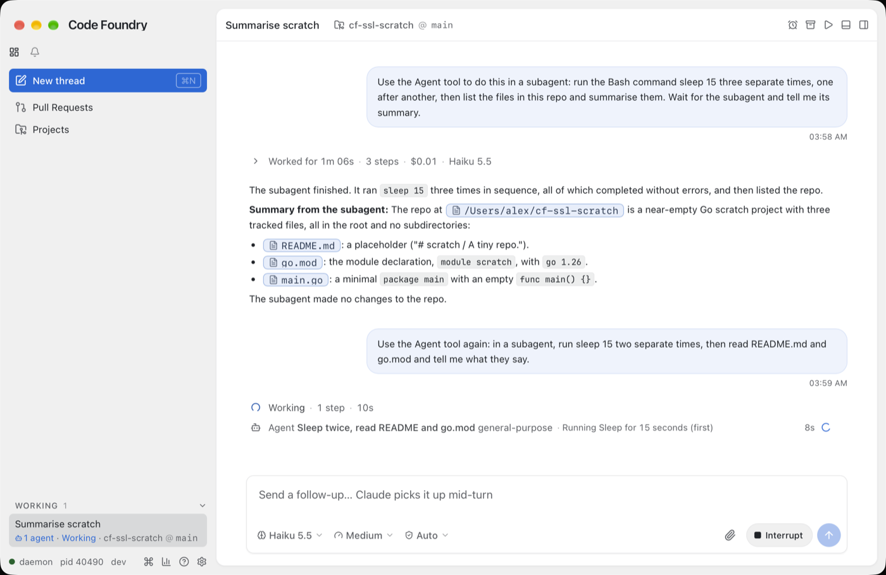

# One line per subagent in the thread (2026-10-18)

Alex's decision (2026-10-18): the main thread keeps a single line per subagent. Before
this, a running foreground Agent call opened by itself and streamed every row of its run
(thinking, reads, Bash, text) under it, which pushed the conversation down and repeated what
the subagent view (`subagent-view.md`) and the Agents tab (`agents-2-gui.md`) already
show.

The built app against a live daemon (Haiku 5.5, medium), a foreground subagent at work:

## What changed

* `components/thread/rows.tsx` `ToolRow`, for Agent/Task calls:
  * **Never opens by itself.** The default for `useToggle` is now only "a file edit waiting
    for permission"; the "running foreground depth-1 subagent" branch is gone.
  * **Nothing to open while it works.** While the call's item runs, or its run does (a
    background call's item stays running until the run ends; a done item with a still
    running run counts too), the row is a plain `div` with no chevron and no
    `aria-expanded`. A choice the reader stored earlier (`setRowExpanded`) is ignored
    while it runs. Open › (hover) and the Agents tab are the way in.
  * **Ended, it opens to the report only** (`AgentReport`, now given the text and with
    `data-testid="thread-agent-report"`). A call with no report (empty `agentReport`) has
    nothing to open. Without a known run (an older daemon) the same rules use the call's
    own status.
  * **`node.children` is no longer rendered** anywhere. `WorkNodeView`'s `nested` prop and
    `TextRow`'s nested variant went with it, and so did the `.children` CSS. The report
    sits at the label's 30px inset (`.subresult`), like other details.
* **The activity fills the line** (`thread.css`): on a row whose meta has an `.act`, the
  label takes its own width (`flex: 0 1 auto`), the meta takes the rest, the activity
  grows into it (ellipsised, no 260px cap), and the chips, elapsed time and spinner after
  it stay whole (`flex: none; white-space: nowrap`). When the line is too narrow the label
  and the activity both give way in proportion to their widths. `AgentMeta` already showed
  the activity for any running run (background, foreground or nested); now a test says so.

## Decisions and gotchas

* **The work tree keeps its children.** `lib/threadTimeline.ts` still nests a run's items
  under its Agent call (so they stay out of the parent's own rows); only the rendering was
  dropped. The subagent view does not use `WorkNode.children`: `lib/subagentView.ts`
  filters the thread's items by `parent_tool_use_id` (`runItems`) and builds its own nodes
  (`runNodes`, with no children map), so it shows exactly what it did before (checked live
  and by `SubagentPane.test.tsx` / `subagent-view.spec.ts`).
* **Agent rows inside the subagent view** (a depth-2 run) follow the same rules: one line,
  nothing to open while running. They never had children there.
* **First cut wrapped the clock.** With the meta allowed to shrink, the elapsed span
  ("4m 12s") wrapped onto two lines and the row grew to 40px in a narrow pane. The meta's
  non-activity children are `flex: none` now; the e2e checks the row stays 24px at 1280
  and 900 wide.
* **Finished/failed notes** were already one line; unchanged.
* **The ended row's report** is the Agent call's result text (`agentReport`, as before),
  not the run's `summary`.
* Supersedes `agents-2-gui.md`'s "a running foreground one still opens to show its work".

## Verification

* `make check` green.
* Unit (`agentRows.test.tsx`): a table over running foreground / background / nested,
  "call done but run still running", done with and without a report, and an older daemon's
  running and done call: the row's tag and chevron, opening only to the report, and never
  any of the run's rows (a nested Bash and text under the call). A row the reader had
  opened shows nothing while running. The activity shows for foreground, background and
  nested runs; the meta's order is chip, activity, elapsed, spinner.
  `agentOpen.test.tsx`: Open sits beside the one-line row (a `div` while running, still a
  button once ended); the nested run gets no row in the thread. `SubagentPane.test.tsx`:
  the nested Agent row in the view is a one-line `div` with nothing under it.
* e2e: `agents-panel.spec.ts` (PR 1's running row has no `aria-expanded`, clicking it shows
  nothing, its nested run and Bash are not in the thread pane; the activity starts after
  the chip, ends at the clock and is wider than the old 260px cap; the row is 24px at 1280
  and 900 wide; after `agent-end` it opens to the report only), `thread.spec.ts` (the done
  subagent opens to "Looks right." only, none of its rows), `subagent-view.spec.ts` (the
  nested Agent row has no `aria-expanded`). Full `make gui-e2e` run: see the PR.
* Live (`make gui-build`, `CODE_FOUNDRY_HOME=/tmp/cf-ssl-home`, daemon `--dev`, the GUI
  with `CODE_FOUNDRY_BIN`, a scratch repo under `~`, deleted afterwards): two prompts asked
  Haiku 5.5 for a foreground subagent doing two or three `sleep 15` then reading files.
  The Agent row stayed one line ("Agent Sleep thrice and summarise repo files
  general-purpose · Running Sleep 15 seconds (third) 38s" and the spinner) with no rows
  under it, dark and light. `thread agent open` on the second run showed the view with its
  Bash and Read rows as before; `thread agent up` went back. Light by `settings set
  appearance.theme light` on the isolated daemon, put back to `system`.
* Not verified live: opening an ended row to its report (the finished turn folds, and
  synthetic clicks do not reach the WebKit view; covered by the unit test and both e2e
  specs).

Daemon restart: not needed (frontend only).
