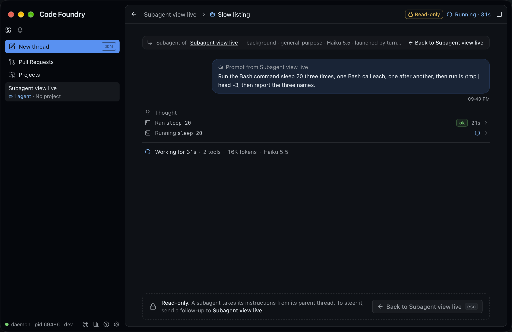
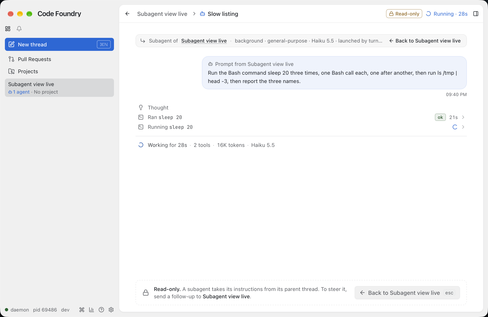
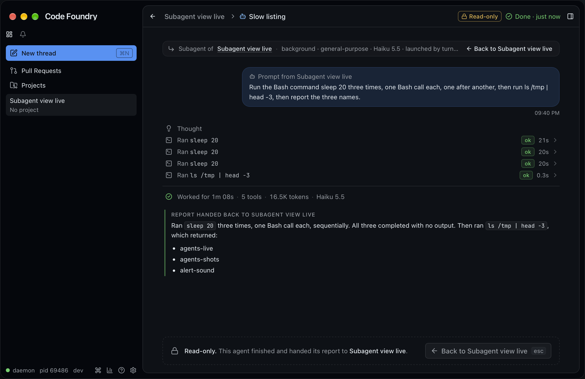
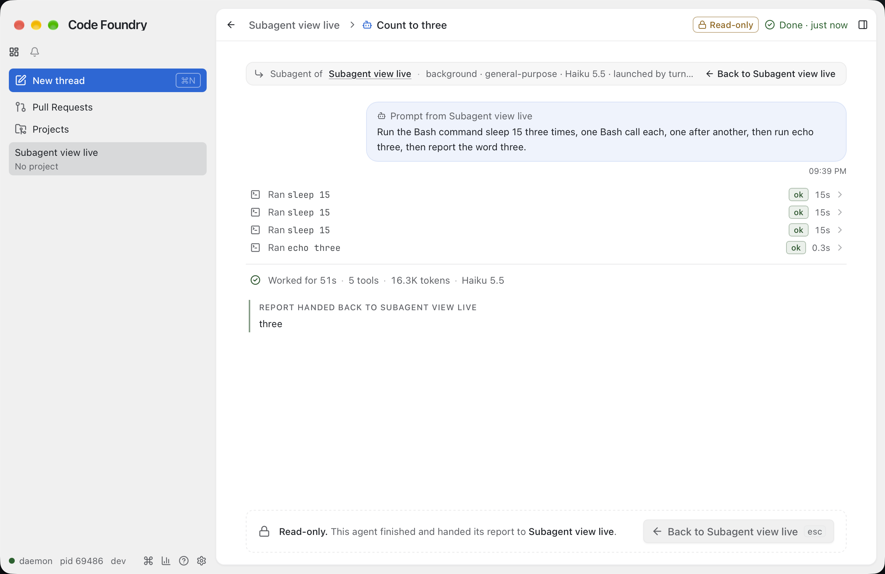
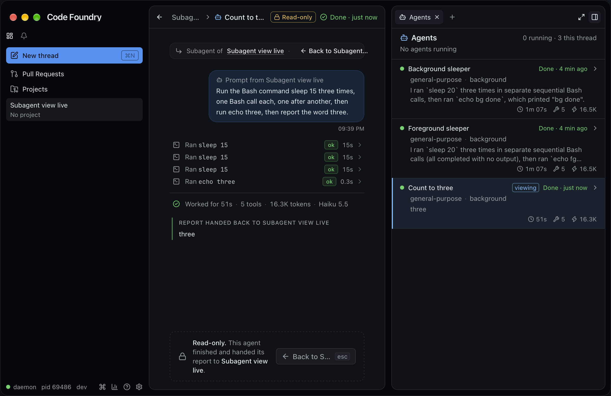

# Read-only subagent view (2026-10-17)

Two stacked PRs. PR 1 (`cf/subagent-view-1-gui`, #177) built the feature: two commands, a
UI intent, the view, its entry points and the mock. PR 2 (`cf/subagent-view-2-e2e`) adds
the Playwright spec, the live check, this note and two fixes found while testing (below).
Design: the brief and HTML mockups agreed with Alex on 2026-10-17
(`/tmp/cf-subagent-sketch`, kept out of the repo). The mock screenshots of PR 1 are in
`subagent-view-1-gui/`.

A thread's own subagent runs (spawn depth 1, background or foreground, running, done or
failed) open in the content pane as a read-only page: the prompt the parent gave, the
run's work log, its report. The thread stays selected; going back up is one click or
Escape.

The built app against a live daemon (Haiku 5.5, medium, a no-project thread): a run
while it works, dark and light, then the same kind of run once done, with the report it
handed back.

With the side panel's Agents tab open: the viewed row has the sky bar, tint and `viewing`
tag (the run had just turned done in place).

## Decisions

From the brief:

* **Depth 1 only.** The stream-json stream carries a depth-1 run's frames (their
  `parent_tool_use_id` is the Agent call), so its items are already in the thread's log.
  A depth-2 run's messages never reach the stream; they live only in Claude's
  `subagents/agent-<id>.jsonl`. Restricting the view to depth 1 needs no daemon change:
  the view is a filter over the log the thread's Watch already holds. Inside the view a
  nested Agent call shows its run's chips but has no Open and no children.
* **Main pane, not a panel tab.** A transcript needs the full width and the thread's own
  row components; the Agents tab stays the index. The selection stays the thread (its
  sidebar row, its Watch, its side panel); the view is window state
  `{threadId, runId}`.
* **One parent crumb**, never a chain: the pane is about 700px wide with the panel open.
  Back always goes one level up, to the thread.
* **Agents tab rows are clickable**, reversing the v1 decision ("rows not clickable",
  `agents-2-gui.md`): depth-1 rows are buttons with a chevron; depth-2 rows stay inert.
* **Escape** goes back up (`thread.agent.up`).

PR 1's decisions and gotchas (checked against its diff):

* **Escape is a registry chord with a `When`**, not a key handler in the view:
  `thread.agent.up` is bound to `escape` and available when the context's active view is
  `thread.agent` (the GUI sends it while a run shows, `stores/context.ts`) or empty (the
  CLI). A bare chord fires only inside the content pane and outside `[data-keys-local]`
  (`keys/bindings.ts` `chordFires`), and the view has no composer, so it cannot steal
  Escape from the composer, dialogs, the palette or the panel. The view takes the
  keyboard when a run opens (`focusSeq`), so Escape works at once.
* **Open goes through the daemon** (`thread.agent.open` emits `UiIntent.ShowAgentRun`,
  `ui.proto` field 8), like `view.panel.agents`, so every window follows and the CLI uses
  the same path. **Up is local** to the window (a presenter, like `view.panel.toggle`);
  the CLI's `thread.agent.up` emits `ShowView "agent.up"`. The back buttons fall back to
  leaving locally during the ~60 ms after a run opens before the command list is
  re-listed for the new context (`startCommandSync`'s debounce).
* **Palette**: `paletteHidden` in `keys/bindings.ts` holds only `thread.agent.open` (it
  takes a run id the palette cannot pick). "Back to Parent Thread" is listed while a run
  shows.
* **Older daemons**: every entry point hides when `thread.agent.open` is not listed.
* **No panel expand button in the view header**: the app's `PanelToggle` moves into the
  panel's header while the panel shows, where `PanelExpand` already is.
* **Model names**: a run that asked for a model shows the alias it gave ("opus"); one
  that inherits shows the thread's model by its full name ("Haiku 5.5", as live).
* **Behaviour change**: a running nested Agent row (depth 2+) in the parent's timeline no
  longer opens by itself (the stream never carries its work).
* `agents-panel.spec.ts` now expects the depth-1 rows to be buttons.
* `ThreadPane` holds the Watch one level up (`WatchedThread`) so entering and leaving a run
  keeps one stream; `TimelineList` was split out of `Timeline` (without the turn-fold
  effects) for the view's rows.
* **Known gap**: a subagent's pending permission request docks only in the parent's
  composer; the view shows the tool row waiting but has nowhere to answer.

## What PR 1 built

* `internal/command/commands_agents_view.go` (+ table tests): `thread.agent.open <run>
  [--id <thread>]` resolves the run against the thread's snapshot (exact id or a unique
  start; nested runs refused with FailedPrecondition) and emits `ShowAgentRun`;
  `thread.agent.up` "Back to Parent Thread". Registered by `RegisterAgents`.
* `proto/codefoundry/v1/ui.proto`: `UiIntent.ShowAgentRun{thread_id, run_id}`; `make gen`.
* `stores/subagentView.ts`: the viewing state and narrow selectors (`useViewingRun`,
  `useIsViewing`, `useShownRun`, `useRunTimelineKeys`), dropped when the selection leaves
  the thread or the run leaves its list; `stores/subagentActions.ts`: `openAgentRun`,
  `goUpFromSubagent`, `useCanOpenAgents`; `stores/intents.ts`, `views.ts`, `context.ts`,
  `commands.ts` wiring.
* `lib/subagentView.ts`: `runItems`, `runNodes`, `lastTextId`, `turnOfCall`,
  `agentPrompt`, `reportIsLastText`, `footerParts`.
* `components/thread/SubagentPane.tsx`: header (back, crumb with the parent shrinking 4x
  faster, Read-only chip with tooltip, live status, panel toggle), lineage note, "Prompt
  from" bubble (`UserBubble` gained a label), the run's rows through `WorkNodeView` in the
  virtualized `TimelineList`, footer, report block, dashed read-only plate with Back and
  `esc`.
* Entry points: `AgentOpen.tsx` (hover-only "Open ›" on depth-1 Agent rows and on the
  "Agent finished / failed" notes, `rows.tsx`), strip names as links (`AgentsStrip.tsx`),
  Agents tab rows as buttons with the viewing bar, tint and tag (`AgentsSurface.tsx`).
* Mock (`mock/agents.ts`, `mock/thread.ts`): PR 1 (a1) has a work log (thinking, a read
  and a search, the nested Agent call, two edits, a running test, a streaming reply), the
  failed run (a3) a short log; both commands in the mock registry; `agent-end` also ends
  the run's own running items.

## What PR 2 added

* `gui/frontend/e2e/subagent-view.spec.ts`, ten tests over the mock's `state=agents`
  thread:
  * Open › on PR 1's Agent row (hidden until hover): the header (crumb, Read-only, "Running
    · 4m NNs", only the panel toggle, no bottom toggle, archive or snooze), the lineage
    line, the prompt bubble, the run's own rows only (the explore group, the nested Agent
    row with no Open and no children, the running Bash, one streaming text), the footer,
    no report, the plate and its `esc`, no composer and no strip.
  * Escape: the palette's Escape closes the palette and stays in the view; then Escape
    goes up with the thread still selected, the conversation intact, no "Loading the
    conversation…" at any point (a MutationObserver), the same number of
    `WatchThread` requests (counted on the page), the composer's draft kept and focused,
    and the turn the reader unfolded still open.
  * The header's back button, the crumb, the lineage note's Back and the plate's Back.
  * A strip name opens its run; the done Explore from the Agents tab: "Done · 5 min ago",
    "Worked for 12s · 6 tools · 9.4K tokens · haiku", its report shown once (as its last
    text, no block).
  * The Agents tab: buttons only for a0–a3, the nested a1b an `li`, the viewed row's
    `viewing` tag, bar and `aria-current` moving with the view, gone after Escape.
  * `agent-end` on the viewed running run: done in place (status, footer, the Bash row
    done, the text no longer streaming, the report block, the plate's words), the view
    stays; the failed run opened from its note (error in the footer, the plate's words);
    another run failing while viewed turns red in place.
  * Switching to another thread drops the view; coming back shows the thread.
  * The CLI path (`CommandService.Invoke`): `thread.agent.open` from another thread
    selects s-r1 and shows the run; a nested run and an unknown one are refused; the
    palette does not list "Open Subagent" and lists "Back to Parent Thread" with `esc`;
    the CLI's `thread.agent.up` goes back. And the palette's "Back to Parent Thread".
* **Fix: a visit to a run kept nothing of the parent's folds.** Entering the view
  unmounted the thread's `Timeline`, whose unmount forgot the thread's fold and expand
  choices, so Escape brought the reader back to every turn folded and the Agent row they
  had opened from gone from view. Forgetting moved to `WatchedThread` (when the Watch is
  released, i.e. the thread is left), which a visit to one of its runs is not
  (`ThreadPane.tsx`, `Timeline.tsx`). The scroll position is not restored: the list comes
  back pinned to the bottom, as on any return (the turn is still unfolded).
* **Fix: the SubagentHandback call is no row of the view.** Live, every Haiku 5.5
  subagent handed its report back with Claude Code's `SubagentHandback` tool instead of
  ending on a text: the view drew the call as a generic tool row with the report in it,
  then the same report as the report block. The daemon already makes the handback's
  message the run's summary (`claudestream` `HandbackReport`), so `runNodes` leaves the
  call out and the report block is the one rendering. The mock's `agent-end` now hands
  back the same way, and the spec asserts it (unit test in `lib/subagentView.test.ts`).

## Verification

* `make check` green.
* e2e: `subagent-view.spec.ts` 20/20 (10 tests × WebKit and Chromium); with
  `agents-panel.spec.ts`, `panel.spec.ts` and `thread.spec.ts`, 146 passed and 16 skipped
  (the `SHOTS=` screenshot tests), no flakes. Each of these failed with its feature
  reverted and passed restored: the fold fix (the Escape test's "turn still open" and the
  back-button loop, whose second Open finds no row), the Watch held one level up (moved
  back into `ThreadBody`: 2 `WatchThread` requests instead of 1), `paletteHidden` emptied
  (the palette lists Open Subagent), the mock's Escape chord removed (Escape no longer goes
  up), the handback filter removed (a `SubagentHandback` row).
* Live (2026-10-17, `make gui-build`, `CODE_FOUNDRY_HOME=/tmp/cf-subview-home`, daemon
  `--dev`, the built GUI with `CODE_FOUNDRY_BIN`, window found by its pid and captured
  with `screencapture -R`): a no-project thread on Haiku 5.5, medium, asked for one
  background and one foreground subagent doing three `sleep 20` and an echo each, then
  two more single-run prompts.
  * `code-foundry thread agent open a2b5 --id <thread>` (a unique start of the run id)
    switched the GUI to the run while it worked: "Running · 26s", the prompt, Thought,
    "Ran sleep 20 ok 20s", "Running sleep 20", "Working for 26s · 2 tools · 16K tokens ·
    Haiku 5.5"; the rows and the clock moved on as the run worked.
  * Escape (sent to the window as a key press) went back to the thread with its strip
    and composer.
  * `code-foundry view panel agents --context-thread <thread>` then `thread agent open`
    for the second run: the Agents tab beside the view, its row tagged `viewing`.
    `code-foundry thread agent up` went back to the thread.
  * Opened while running, "Count to three" turned done in place: the status "Done · just
    now", "Worked for 51s · 5 tools · 16.3K tokens · Haiku 5.5", the report block
    ("three"), the plate's done words, the tab's row done and still tagged.
  * A finished run's report showed once, as the block (after the handback fix; before it,
    the SubagentHandback row repeated it). Light mode by `settings set appearance.theme
    light` on the isolated daemon, put back to `system`; the side panel closed again
    before quitting. Daemon stopped, GUI quit.
* Not verified live:
  * A foreground run: Claude Code launched every Agent call in the background here, even
    without `run_in_background` (Haiku said so itself). The mock's done Explore covers the
    foreground wording.
  * A failed run (mock e2e).
  * The hover Open ›, the strip's name and a click on an Agents tab row: synthetic
    clicks from System Events did not reach the WebKit view, so live opening went through
    the CLI (the same `thread.agent.open` the entry points call); all three are in the
    e2e.
* Seen live, not changed:
  * With the side panel open (a ~700px pane) the lineage note's meta ("background ·
    general-purpose · Haiku 5.5 · launched by turn …") shrinks to nothing between
    "Subagent of …" and "← Back to …"; full width it shows, ellipsised.
  * The "Agent finished" note's summary can ellipsise to a letter in a narrow pane
    (`agents-2-gui.md`'s note row).

Daemon restart: needed for PR 1 (the two commands and the `ShowAgentRun` intent). PR 2
changes only the frontend.

## Follow-ups

* **Depth 2+**: a daemon projector over the subagent transcript files
  (`subagents/agent-<id>.jsonl`: session-format records with `uuid` and
  `toolUseResult`), driven by the existing run tail, storing items with
  `ParentToolUseID` = the nested Agent call. Then nested rows get an Open button and the
  view works unchanged. Do not reintroduce a panel-tab transcript.
* **A subagent's pending permission request** docks only in the parent's composer; the
  view could show it (or point at the parent) where the plate is.
* Restore the parent's scroll position on the way back, not only its folds.
