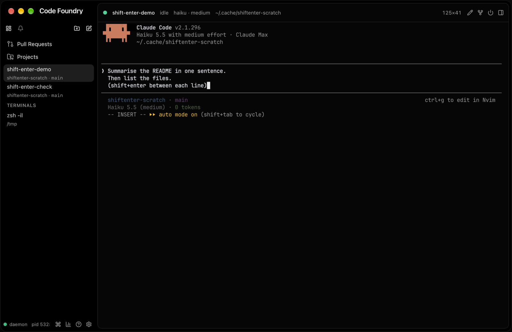
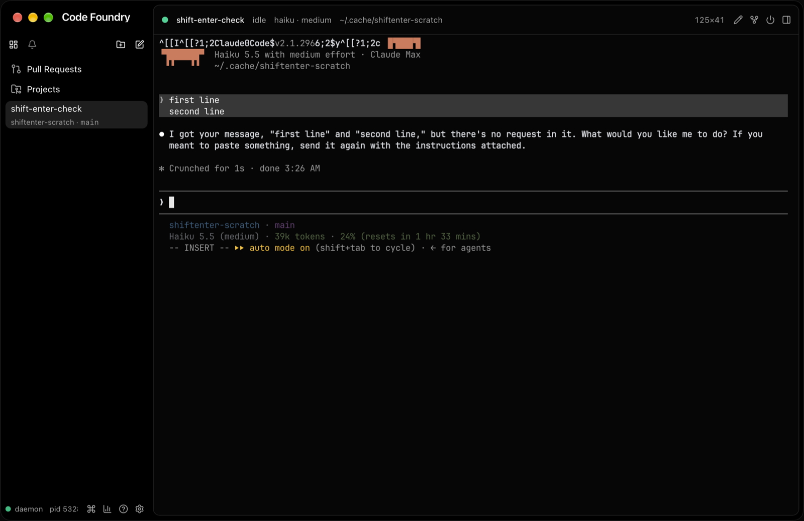
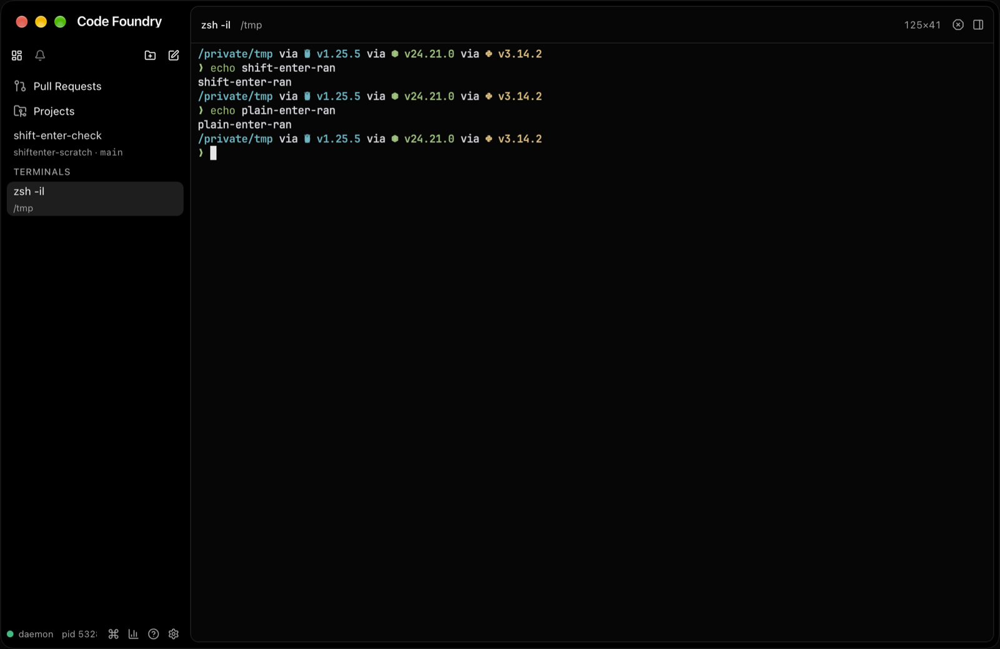

# Shift+Enter in the terminal

Status: done. Frontend-only (`gui/frontend/src/terminal/keyboard.ts`, `xterm.ts`). No
daemon or proto change.

## Problem

xterm.js 6.0 sends `\r` for shift+enter, the same byte as Enter, so Claude Code
submitted the prompt. Native terminals tell the two apart with the kitty keyboard protocol
(`CSI 13;2u`) or xterm's modifyOtherKeys (`CSI 27;2;13~`). xterm.js implements neither.

## What Claude Code 2.1.296 accepts

Probed with a Python pty harness (`claude --model haiku` in a scratch repo, 120x40,
`TERM=xterm-256color`). It typed `hello`, waited, wrote the candidate, waited, typed
`world`, then rendered the captured bytes through libghostty-vt to read the screen.

| Bytes | Result in Claude's prompt |
|---|---|
| `\r` | submits |
| `\n` (ctrl+J) | newline |
| `CSI 13;2u` | newline |
| `CSI 27;2;13~` | newline |
| `ESC CR` (alt+enter) | newline |
| `\` `CR` | newline |

Claude parses all of these whether or not it enabled a keyboard protocol.

**Claude does not enable a protocol in our terminal.** On startup it sends
`CSI ?u` (kitty query), `CSI >0q` (XTVERSION), and DA1. It pushes flags only when
`TERM_PROGRAM` is one it knows. With `TERM_PROGRAM` set to ghostty, kitty, WezTerm, or
iTerm.app, it sends `CSI >5u` (disambiguate + report alternates) and `CSI >4;2m`. Without
it, nothing is pushed, even when the `CSI ?u` query is answered (`CSI ?0u`) and
XTVERSION says ghostty. The daemon does not set `TERM_PROGRAM`. A daemon started from one
of those terminals inherits it, though, so both cases happen.

**Plain zsh (`zsh -f`):** `\n` behaves exactly like Enter (`accept-line`). `CSI 13;2u`
and `CSI 27;2;13~` corrupt the line: ZLE reads the `ESC` as a prefix, eats `hello`, and
prints `rld`. `ESC CR` also runs the line.

## Strategy

`KeyboardModes` mirrors the program's keyboard modes from the output stream with xterm
parser hooks. The handlers observe and return `false`, so xterm's own handling still
runs. The hooks cover:

* kitty push / pop / set: `CSI > u`, `CSI < u`, `CSI = flags ; mode u`. Each screen has
  its own 8-entry stack, following the active xterm buffer the way Ghostty's `FlagStack`
  does.
* modifyOtherKeys: `CSI > 4 ; n m`.
* RIS: `ESC c`. `renderer.reset()` before a snapshot also clears the modes.

Snapshots need no extra work. libghostty's formatter replays both modes in the
snapshot suffix (`CSI = flags ; 1 u`, `CSI > 4 ; 2 m`), and those go through the same
hooks.

Shift+enter sends:

1. `CSI 13;2u` when the kitty disambiguate flag is on (what Ghostty/Kitty/WezTerm send),
2. else `CSI 27;2;13~` when modifyOtherKeys is level 2 (what xterm sends),
3. else `\n`.

Why `\n` as the fallback rather than a CSI sequence or `ESC CR`:

* Claude Code inserts a newline for it. Its own docs list ctrl+J for multi-line input.
* Programs that don't distinguish it from Enter treat it as Enter. That covers shells
  (`accept-line`), most line-oriented programs (the tty's ICRNL makes CR and NL the same
  byte in cooked mode), and vim insert mode. That is exactly what a native terminal
  without the protocols does for shift+enter.
* The CSI forms print junk in a plain zsh. `ESC CR` is alt+enter, and vim takes the ESC as
  "leave insert mode".

The key handler intercepts keydown **and** keypress for shift+enter, and calls
`preventDefault()` so xterm's keypress path cannot add a `\r`. It skips IME composition
(`isComposing`). The bytes go through `term.input()`, so they take the normal
`onData` → `AttachController` → `TerminalService.Write` path, in order with other typing.

## Regressions considered

* **zsh/bash prompt:** shift+enter runs the line, the same as before. Checked live.
* **Programs that bind ctrl+J differently** (fzf: down, emacs -nw:
  `electric-newline-and-maybe-indent`): shift+enter now acts as ctrl+J there instead of
  Enter. This is accepted. Programs that care about shift+enter enable the kitty
  protocol, and then they get `CSI 13;2u`.
* **Programs that push kitty flags (nvim, fish 4, helix):** shift+enter is encoded
  properly. Other keys are still legacy-encoded, as before. Only shift+enter changed.
* **Global chords:** nothing is bound to shift+enter. The check runs before
  `isGlobalChord`.

## Verification

* `keyboard.test.ts`: a table of mode sequences mapped to the expected shift+enter bytes,
  plus stack eviction and masking. `xterm.test.ts`: a real xterm `Terminal` in jsdom
  checks the parser-hook wiring, alt-screen switching, and RIS, and runs the key handler
  for keydown/keypress, enter, ctrl+enter, and IME composition.
* Live (`make gui-build`, isolated `CODE_FOUNDRY_HOME=/tmp/shiftenter-pr`): in a haiku
  thread, text + shift+enter + text gave a multi-line prompt, and Enter then submitted
  both lines as one message. In a `zsh -il` terminal, shift+enter ran the command like
  Enter.

## Gotchas

* **A thread attached while Claude starts shows its startup query replies as text.** In
  `claude-enter-submits.png`, the first line reads `^[[I^[[?1;2c…6;2$y`. That is xterm.js
  answering DA1/DECRQM/focus while Claude's tty is still in cooked mode, and the tty
  echoes the answer. It is unrelated to this change; `phase2-integration.md` notes that
  xterm auto-replies. It disappears if the GUI attaches after startup, and the parser
  hooks suggested in `phase1a-terminal.md` would fix it.
* **A shared `GOCACHE` across worktrees can link the wrong libghostty.** A throwaway cgo
  build tried to link `libghostty-vt.a` from another worktree's `third_party/` path.
  Use a separate `GOCACHE` for one-off cgo builds outside `make`.
