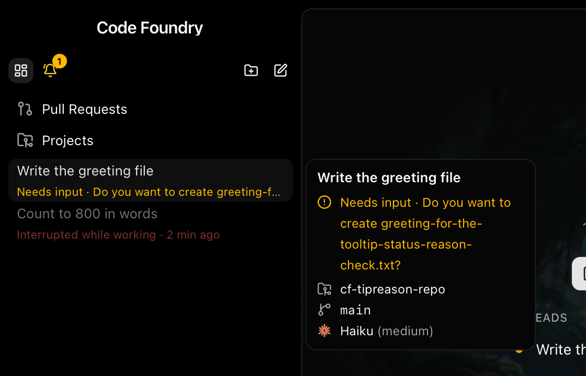
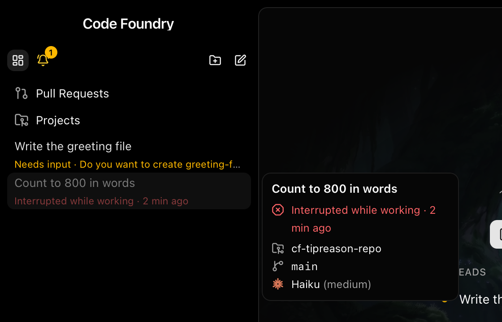
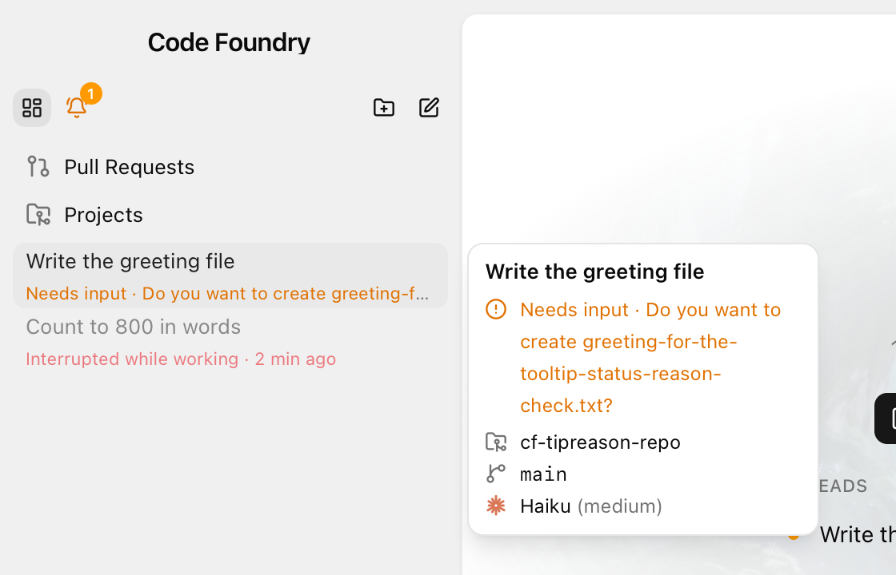
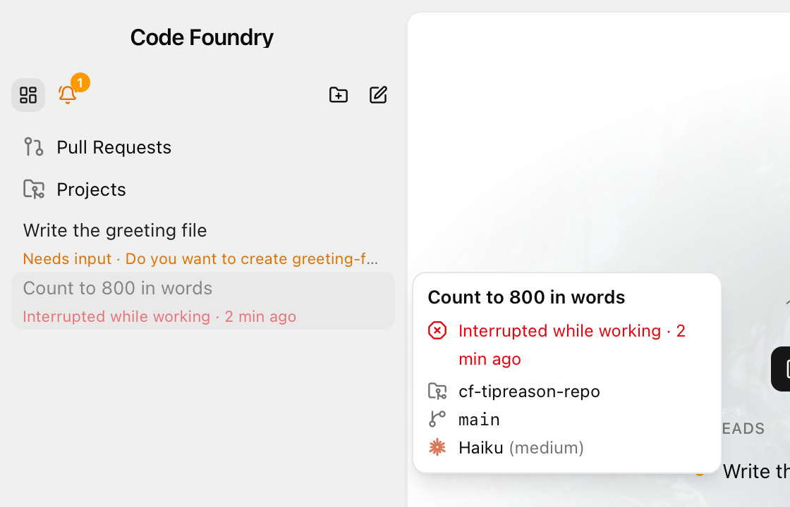

# Thread tooltip: the status reason

Decided 2026-10-11 (Alex). Frontend only; builds on `thread-list.md` (rows, tooltip) and
`thread-status-persistence.md` (`status_reason`, ERROR "interrupted"). Line 2 of a thread
row truncates, so a permission prompt's question ("Needs input · Do you want to create
hello.txt?") is usually cut off; the tooltip now carries all of it.

## What changed

* **A status row in the tooltip**, directly under the name and above the project row
  (`TipStatus` in `components/sidebar/SidebarRow.tsx`, `data-testid="tip-status"`,
  `data-tone="amber" | "red"`). The text is the row's own line-2 text, `statusText(statusLine(s), now)`,
  untruncated and wrapping inside the unchanged 220px tooltip.
  (Widened to 260px on 2026-10-17, see docs/notes/claude-mark-tooltip.md.)
* **Only for amber and red.** `tipStatusTone(kind)` (`lib/statusLine.ts`, table-tested)
  returns the tone from `statusTones` when it is amber (permission / dialog "Needs input",
  "Asked a question", "Plan ready for review") or red ("Error · <code>", "Interrupted while
  working · <ago>"), else null. Finished (emerald), working (sky), idle / place, starting
  and closing get no row: Alex rejected finished, and the others say nothing line 2 does
  not already show.
* **Colour** reuses the row's `toneClasses` map (same file): amber / red 600 in light mode,
  400 in dark. The whole row (icon and text) takes the tone.
* **Icon**: lucide `CircleAlert` for amber, `OctagonX` for red, 14px like the other
  `TipRow` icons, nudged 3px down so it centres on the first line of a wrapped text
  (the row is `items-start`, not `items-center` like `TipRow`).
* **Time**: an interrupted line with a time renders through the existing `TimedStatusText`
  (shared `useNow(30_000)` clock). The tooltip body is mounted only while open, so it
  subscribes only then.

## Decisions and gotchas

* **One predicate, not a second wording.** The tooltip does not get its own text for the
  reason: what it shows is exactly line 2 without the truncation, so the two can never
  disagree. A plain "Needs input" (a bell) still gets the row; it is short, but it is
  still the thing the thread is waiting on.
* **`TipRow` is not reused** for the status: it truncates (`truncate`) and centres the
  icon, both wrong for a multi-line text. The new row keeps `TipRow`'s gap and line height.
* `break-words` on the text so a long path or identifier in a permission question wraps
  instead of widening the tooltip.
* Offline (dimmed) rows: the tooltip is not dimmed, as before; a question that outlived a
  restart shows "Asked a question" in full amber there.
* Kept to the tooltip body and `lib/statusLine.ts` so it merges cleanly with the concurrent
  sidebar ordering / Working section change (`lib/tree.ts`, `Sidebar.tsx`, the header
  rendering in `SidebarRow.tsx`).

## Verification

* `make check` green (gofmt, vet, staticcheck, `go test -race`, typecheck, lint, 1533
  vitest tests in 80 files). New: `lib/statusLine.test.ts` `tipStatusTone` table (prompts,
  question, plan, trust, bell, offline question to amber; Claude error, interrupted with
  and without a time, other error status to red; finished, busy, idle, plain
  disconnected, unknown, starting, closing to none; with the exact text for each).
* `make gui-e2e` green: 480 passed, 20 skipped (the live specs), no failures or flakes.
  New in `sidebar.spec.ts`: on the status-kinds scenario, `s-k-approval` gets a long
  permission question (`POST /__mock/session/status?...&reason=permission: …`); line 2
  truncates it (scrollWidth > clientWidth) while the tooltip shows all of it in amber,
  wrapped (40px+ tall), between the name and the project, at 220px. Question, plan, Claude
  error and interrupted show their line-2 text with the right `data-tone` and class;
  finished, working and idle have no `tip-status`.
* `make gui-build` green.
* **Live** (isolated `CODE_FOUNDRY_HOME=/tmp/cf-tipreason`, daemon started by the built
  GUI, scratch repo `~/tmp/cf-tipreason-repo`, haiku / medium): a supervised thread at
  `permission: Do you want to create greeting-for-the-tooltip-status-reason-check.txt?`
  and a busy thread ("every number from 1 to 800 in words") whose `claude` was SIGKILLed
  mid-turn: `disconnected (crashed)  error (interrupted)`. Daemon log had no warnings or
  errors. Screenshots, dark and light (`settings set appearance.theme`), with the tooltip
  open: `tooltip-status-reason/permission-{dark,light}.png`,
  `interrupted-{dark,light}.png` (also in
  `~/.t3/userdata/attachments/tooltip-status-reason/`).
* **Gotcha: the screenshots are not of the Wails window.** The Mac's screen was locked
  for the whole run (`CGSSessionScreenIsLocked`), so `screencapture` returned only the
  wallpaper and osascript had no assistive access to hover. The PNGs are the same frontend
  (Vite dev server, `?daemon=…&token=…` override) in Playwright WebKit, the engine the
  Wails WKWebView uses, against that same isolated daemon and its real threads, hovered by
  Playwright. Not verified in the Wails shell itself; nothing in this change touches the
  shell.
* Afterwards both threads were removed and the GUI, daemon and Vite stopped; the scratch
  home, the repo and `~/.claude/projects/-Users-alex-tmp-cf-tipreason-repo` were deleted.
  `~/.claude.json` keeps a project key for the deleted repo path (not edited: other
  Claude processes write that file).
* Not verified live: the question, plan and Claude-error rows (mock e2e only), and the
  30 s tick of the interrupted time while the tooltip stays open (the clock is the
  existing shared one).

## Daemon restart

None needed (frontend only).

